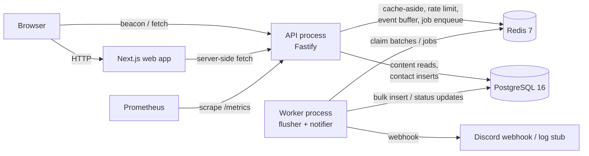

# System Design Specification: Personal Portfolio & Live Telemetry Platform

Progress and per-phase checklists live in [ROADMAP.md](ROADMAP.md).

---

## 1. Overview & Goals

A production-grade personal portfolio platform engineered to demonstrate backend systems
fundamentals: asynchronous ingestion, Redis caching and rate limiting, background job
processing, observability, and disciplined testing.

**Goals**

- Every request path is observable (structured log + metric) and every failure path is explicit.
- No data is silently dropped: buffered events and jobs survive process crashes and restarts.
- The codebase is small, layered, and readable enough to be reviewed in one sitting.

**Non-goals**

- Horizontally scaled workers (we design for **one worker process**; see §8.4).
- An admin UI or CMS. Portfolio content lives in a version-controlled JSON file.
- User accounts or authentication (the only protected surface is `/metrics`, by token).

**Tech stack**

| Concern       | Choice                                                                        |
| ------------- | ----------------------------------------------------------------------------- |
| Runtime       | Node.js 24 LTS, TypeScript 6 (strict), ESM                                    |
| Monorepo      | npm workspaces (`apps/api`, `apps/web`, later `packages/shared`)              |
| API           | Fastify 5, Zod 4 validation, Pino logging                                     |
| Web           | Next.js 16 (App Router), React 19, Tailwind CSS 4                             |
| Datastores    | PostgreSQL 16 (`pg`, plain SQL migrations), Redis 7 (`ioredis`)               |
| Observability | `prom-client` (Prometheus), JSON status endpoint                              |
| Quality       | Vitest 5 (unit + real-datastore integration), ESLint 10, Prettier, GH Actions |

---

## 2. Architecture



### 2.1 Process model

| Process    | Entrypoint                         | Responsibilities                                                                 |
| ---------- | ---------------------------------- | -------------------------------------------------------------------------------- |
| API        | `apps/api/src/main.ts`             | HTTP routes, cache-aside, ingestion enqueue, contact + rate limit, `/metrics`    |
| Worker     | `apps/api/src/worker.ts` (Phase 3) | Telemetry batch flusher, notification consumer, delayed-job promoter, reconciler |
| Migrations | `apps/api/src/cli/migrate.ts`      | Applies SQL migrations; run as a deploy step, **never** on API boot              |

The API and worker share one codebase but run as separate processes, so a slow webhook or
flush never competes with request latency.

### 2.2 MVC layering (API)

A request flows through the layers in one direction:

```
route ──► controller ──► service ──► repository / store ──► Postgres / Redis
 (URL)     (HTTP in/out)  (business     (data access)
                           rules)
                 │
                 └──► view (shapes the JSON response)
```

| Layer         | Folder                    | MVC role   | Responsibility                                                                              |
| ------------- | ------------------------- | ---------- | ------------------------------------------------------------------------------------------- |
| Routes        | `src/routes/`             | —          | The URL table: method + path + schema → controller function. No logic.                      |
| Controllers   | `src/controllers/`        | Controller | Read the request, call **one** service method, choose the status code, render a view.       |
| Services      | `src/services/`           | —          | Business rules (cache-aside, hashing, retry classification). No HTTP objects, no SQL.       |
| Models        | `src/models/`             | Model      | Domain types and Zod validation schemas.                                                    |
| Repositories  | `src/repositories/`       | Model      | The only code that talks to datastores: SQL in `*.repository.ts`, Redis in `*.store.ts`.    |
| Views         | `src/views/`              | View       | Turn models into response bodies (`{ data }` / `{ error }`, camelCase, no internal fields). |
| Cross-cutting | `middleware/`, `errors/`… | —          | Request ids, error handling, config, logging, lifecycle.                                    |

Services depend on repository **interfaces**, which makes them unit-testable with fakes. The
composition roots (`main.ts`, `worker.ts`) create infrastructure clients and pass them down;
nothing reaches for a global singleton. On the frontend, the Next.js app is the user-facing view.

---

## 3. Monorepo Layout

Items marked `(P2)`…`(P6)` arrive in that phase; everything else exists after Phase 1.

```
.
├── .github/workflows/ci.yml              (P2) format, lint, typecheck, unit + integration tests
├── .github/workflows/deploy.yml          (P6) build images → approve → migrate → deploy → smoke test
├── .vscode/extensions.json               recommended extensions (PostgreSQL, Redis, ESLint, Prettier)
├── .dockerignore                         (P6)
├── .nvmrc                                Node 24 LTS
├── .env.example                          documented env vars (copy to .env)
├── .prettierrc.json / .prettierignore
├── CLAUDE.md                             contributor / agent guide
├── DESIGN.md                             this document
├── ROADMAP.md                            phases, branches, progress checklists
├── docs/                                 how-to guides (testing, CI, content & cache, data viewers)
│   └── sql/                              read-only queries to run from the VS Code PostgreSQL extension
├── deploy/                               (P6) compose.prod.yml + Caddyfile for the production host
├── docker-compose.yml                    Postgres 16 + Redis 7 for local dev & tests
├── eslint.config.mjs                     one flat config for the whole repo
├── package.json                          npm workspaces + repo-wide scripts
├── tsconfig.base.json                    strict compiler options shared by all packages
├── apps/
│   ├── api/
│   │   ├── package.json
│   │   ├── Dockerfile                    (P6) one image: api, worker, migrate, seed commands
│   │   ├── tsconfig.json                 typecheck (src + test)
│   │   ├── tsconfig.build.json           emit (src → dist)
│   │   ├── vitest.config.ts              "unit" and "integration" projects
│   │   ├── content/portfolio.json        (P2) source of truth for portfolio content
│   │   ├── migrations/                   NNNN_snake_case_name.sql, applied in order
│   │   │   ├── 0001_portfolio_content.sql        (P2)
│   │   │   ├── 0002_analytics_events.sql         (P3)
│   │   │   └── 0003_contact_messages.sql         (P4)
│   │   ├── src/
│   │   │   ├── main.ts                   API composition root + process lifecycle
│   │   │   ├── worker.ts                 (P3) worker composition root
│   │   │   ├── app.ts                    buildApp(): wires services → controllers → routes
│   │   │   ├── routes/
│   │   │   │   ├── health.routes.ts      GET /health
│   │   │   │   ├── content.routes.ts     (P2) profile, projects
│   │   │   │   ├── events.routes.ts      (P3) telemetry ingestion
│   │   │   │   ├── contact.routes.ts     (P4)
│   │   │   │   └── system.routes.ts      (P5) /metrics, system status
│   │   │   ├── controllers/
│   │   │   │   ├── health.controller.ts
│   │   │   │   ├── parse-request.ts              (P2) Zod-validates params/query/body → 400
│   │   │   │   ├── content.controller.ts         (P2)
│   │   │   │   ├── events.controller.ts          (P3)
│   │   │   │   ├── contact.controller.ts         (P4)
│   │   │   │   └── system.controller.ts          (P5)
│   │   │   ├── services/
│   │   │   │   ├── health.service.ts
│   │   │   │   ├── cache-aside.ts                (P2) generic cache-aside + single-flight + TTL jitter
│   │   │   │   ├── content.service.ts            (P2) profile/projects reads, publish (seed)
│   │   │   │   ├── telemetry.service.ts          (P3) validation, hashing, enqueue
│   │   │   │   ├── contact.service.ts            (P4)
│   │   │   │   ├── rate-limiter.service.ts       (P4)
│   │   │   │   └── system-status.service.ts      (P5)
│   │   │   ├── models/
│   │   │   │   ├── health.model.ts
│   │   │   │   ├── content.model.ts              (P2)
│   │   │   │   ├── analytics-event.model.ts      (P3)
│   │   │   │   ├── contact-message.model.ts      (P4)
│   │   │   │   └── notification-job.model.ts     (P4)
│   │   │   ├── repositories/
│   │   │   │   ├── content.repository.ts         (P2) SQL
│   │   │   │   ├── content-cache.store.ts        (P2) Redis
│   │   │   │   ├── analytics-event.repository.ts (P3)
│   │   │   │   ├── event-buffer.store.ts         (P3)
│   │   │   │   ├── contact-message.repository.ts (P4)
│   │   │   │   ├── rate-limit.store.ts           (P4)
│   │   │   │   ├── notification-queue.store.ts   (P4)
│   │   │   │   └── lua/                          (P3/P4) Lua scripts as TS string constants
│   │   │   ├── views/
│   │   │   │   ├── error.view.ts         { error: { code, message, requestId } }
│   │   │   │   ├── content.view.ts       (P2) { data } bodies for profile/projects
│   │   │   │   └── system-status.view.ts (P5)
│   │   │   ├── workers/                  (P3/P4) background loops started by worker.ts
│   │   │   │   ├── telemetry-flusher.worker.ts   (P3)
│   │   │   │   ├── notification.worker.ts        (P4) consumer + delayed-job promoter
│   │   │   │   └── notification-reconciler.worker.ts (P4)
│   │   │   ├── middleware/
│   │   │   │   ├── request-id.ts         x-request-id accept/generate/echo
│   │   │   │   ├── error-handler.ts      maps any error to the error view
│   │   │   │   └── http-metrics.ts       (P5) request duration histogram hook
│   │   │   ├── errors/app-error.ts       AppError + ErrorCode catalog
│   │   │   ├── config/env.ts             Zod env schema → typed AppConfig (fail-fast)
│   │   │   ├── db/migrator.ts            reads .sql files, applies pending ones
│   │   │   ├── cli/
│   │   │   │   ├── migrate.ts            npm run db:migrate
│   │   │   │   ├── seed-content.ts       (P2) npm run content:seed
│   │   │   │   └── replay-dlq.ts         (P3) npm run dlq:replay
│   │   │   ├── infra/
│   │   │   │   ├── logger.ts             Pino root logger
│   │   │   │   ├── postgres.ts           pg Pool factory + ping
│   │   │   │   ├── redis.ts              ioredis factory + ping
│   │   │   │   ├── with-timeout.ts       bound any promise by a deadline
│   │   │   │   ├── metrics.ts            (P2) prom-client registry + metric definitions
│   │   │   │   └── notifiers/            (P4) log + Discord notification senders
│   │   │   └── lifecycle/
│   │   │       └── graceful-shutdown.ts  signal handling, ordered close, forced exit
│   │   └── test/
│   │       ├── helpers/                  test app builder, datastore helpers
│   │       ├── unit/                     mirrors src/ folders; pure logic, no I/O
│   │       └── integration/              real Postgres + Redis (docker compose)
│   └── web/
│       ├── package.json, next.config.ts, postcss.config.mjs, tsconfig.json
│       ├── Dockerfile                    (P6) Next.js standalone server
│       └── src/
│           ├── app/                      routes: layout.tsx, page.tsx, (P5) projects/, status/
│           ├── components/               (P5) presentational React components
│           └── lib/api-client.ts         (P5) typed fetch wrapper
└── packages/
    └── shared/                           (P5) Zod API contract schemas shared by api + web
```

---

## 4. Configuration

All configuration comes from environment variables, validated once at startup by a Zod
schema in `apps/api/src/config/env.ts`. Invalid or missing values print **every** problem
(names and reasons, never values) and exit with code `1` before any connection is opened.
Empty strings are treated as "unset" so `API_PORT=` cannot silently become port `0`.

| Variable                            | Phase | Default                 | Notes                                                                     |
| ----------------------------------- | ----- | ----------------------- | ------------------------------------------------------------------------- |
| `NODE_ENV`                          | 1     | `development`           | `development` \| `test` \| `production`. Pretty logs only in development. |
| `API_HOST`                          | 1     | `0.0.0.0`               |                                                                           |
| `API_PORT`                          | 1     | `4000`                  | `0` = ephemeral (used by tests).                                          |
| `LOG_LEVEL`                         | 1     | `info`                  | Pino levels + `silent`.                                                   |
| `DATABASE_URL`                      | 1     | — (required)            | `postgres://` or `postgresql://` URL.                                     |
| `DATABASE_POOL_MAX`                 | 1     | `10`                    |                                                                           |
| `REDIS_URL`                         | 1     | — (required)            | `redis://` or `rediss://` URL; may include DB index (`/1`).               |
| `SHUTDOWN_TIMEOUT_MS`               | 1     | `10000`                 | Hard deadline for graceful shutdown before forced exit.                   |
| `CACHE_TTL_SECONDS`                 | 2     | `300`                   | ±10 % jitter applied per write.                                           |
| `TRUST_PROXY`                       | 3     | `false`                 | Set when behind a reverse proxy so `request.ip` is the client IP.         |
| `TELEMETRY_BATCH_SIZE`              | 3     | `50`                    | 1–1000.                                                                   |
| `TELEMETRY_FLUSH_INTERVAL_MS`       | 3     | `5000`                  |                                                                           |
| `TELEMETRY_BUFFER_MAX_LENGTH`       | 3     | `100000`                | Ingestion returns `503` beyond this.                                      |
| `IP_HASH_SECRET`                    | 4     | — (required)            | ≥ 32 chars. Keyed hash for rate-limit / abuse identifiers.                |
| `CONTACT_RATE_LIMIT_MAX`            | 4     | `3`                     |                                                                           |
| `CONTACT_RATE_LIMIT_WINDOW_SECONDS` | 4     | `600`                   |                                                                           |
| `NOTIFIER_DRIVER`                   | 4     | `log`                   | `log` \| `discord`.                                                       |
| `DISCORD_WEBHOOK_URL`               | 4     | unset                   | Required when `NOTIFIER_DRIVER=discord`.                                  |
| `NOTIFY_MAX_ATTEMPTS`               | 4     | `3`                     | Total attempts including the first.                                       |
| `NOTIFY_BACKOFF_BASE_MS`            | 4     | `5000`                  | Delay = base × 2^(attempt−1) ± 20 % jitter.                               |
| `METRICS_TOKEN`                     | 5     | unset                   | If set, `/metrics` requires `Authorization: Bearer <token>`.              |
| `CORS_ORIGINS`                      | 5     | `http://localhost:3000` | Comma-separated allow-list.                                               |
| `API_BASE_URL`                      | 5     | `http://localhost:4000` | Web app → API (server side).                                              |
| `NEXT_PUBLIC_API_BASE_URL`          | 5     | `http://localhost:4000` | Browser → API (beacons, contact form).                                    |

Docker Compose additionally reads `POSTGRES_USER`, `POSTGRES_PASSWORD`, `POSTGRES_DB`,
`POSTGRES_PORT`, `REDIS_PORT` (all with local-dev defaults).

---

## 5. Data Model (PostgreSQL 16)

### 5.1 Migration mechanics

- Files: `apps/api/migrations/NNNN_snake_case_name.sql`, 4-digit zero-padded version.
- Bookkeeping table, created by the migrator itself:

  ```sql
  CREATE TABLE IF NOT EXISTS schema_migrations (
    version     INTEGER     PRIMARY KEY,
    name        TEXT        NOT NULL,
    checksum    TEXT        NOT NULL,          -- sha256 of the file contents
    applied_at  TIMESTAMPTZ NOT NULL DEFAULT now()
  );
  ```

- The migrator takes a session-level `pg_advisory_lock` so two concurrent deploys cannot
  apply migrations twice.
- Each migration runs in **its own transaction** together with its `schema_migrations` row.
  A failure rolls back that file and stops the run.
- Applied files are verified by checksum. **Editing an applied migration is an error**; write
  a new migration instead. A recorded version whose file is missing is also an error.
- Migrations must be **backward compatible** with the code that is already running, because a
  deploy applies them before the new version starts (expand → contract, see §14.4).
- `CREATE INDEX CONCURRENTLY` is not supported (it cannot run inside a transaction).
- `gen_random_uuid()` is built into Postgres 13+, so no extension is needed.
- `updated_at` is set explicitly by repository `UPDATE` statements (no triggers).
- Status columns use `TEXT` + `CHECK` rather than Postgres `ENUM`, which cannot drop or
  rename values without a type rebuild.

### 5.2 `0001_portfolio_content.sql` (Phase 2)

```sql
CREATE TABLE profile (
  id          SMALLINT    PRIMARY KEY DEFAULT 1 CHECK (id = 1),   -- singleton row
  full_name   TEXT        NOT NULL,
  headline    TEXT        NOT NULL,
  summary     TEXT        NOT NULL,
  location    TEXT,
  links       JSONB       NOT NULL DEFAULT '[]'::jsonb,           -- [{ "label": "...", "url": "..." }]
  updated_at  TIMESTAMPTZ NOT NULL DEFAULT now()
);

CREATE TABLE experiences (
  id          UUID        PRIMARY KEY DEFAULT gen_random_uuid(),
  company     TEXT        NOT NULL,
  role        TEXT        NOT NULL,
  start_date  DATE        NOT NULL,
  end_date    DATE,                                               -- NULL = current role
  highlights  TEXT[]      NOT NULL DEFAULT '{}',
  sort_order  INTEGER     NOT NULL DEFAULT 0,
  created_at  TIMESTAMPTZ NOT NULL DEFAULT now(),
  updated_at  TIMESTAMPTZ NOT NULL DEFAULT now(),
  CONSTRAINT experiences_dates_ordered CHECK (end_date IS NULL OR end_date >= start_date)
);
CREATE INDEX experiences_display_order_idx ON experiences (sort_order, start_date DESC);

CREATE TABLE projects (
  id           UUID        PRIMARY KEY DEFAULT gen_random_uuid(),
  slug         TEXT        NOT NULL UNIQUE CHECK (slug ~ '^[a-z0-9]+(-[a-z0-9]+)*$'),
  title        TEXT        NOT NULL,
  summary      TEXT        NOT NULL,
  description  TEXT        NOT NULL,
  tech_stack   TEXT[]      NOT NULL DEFAULT '{}',
  repo_url     TEXT,
  live_url     TEXT,
  featured     BOOLEAN     NOT NULL DEFAULT false,
  sort_order   INTEGER     NOT NULL DEFAULT 0,
  created_at   TIMESTAMPTZ NOT NULL DEFAULT now(),
  updated_at   TIMESTAMPTZ NOT NULL DEFAULT now()
);
CREATE INDEX projects_display_order_idx ON projects (featured DESC, sort_order);
```

### 5.3 `0002_analytics_events.sql` (Phase 3)

```sql
CREATE TABLE analytics_events (
  id             UUID        PRIMARY KEY,          -- assigned at ingestion → idempotent replays
  event_type     TEXT        NOT NULL CHECK (event_type IN ('page_view', 'interaction')),
  event_name     TEXT,                             -- e.g. 'click:github-link'; interactions only
  path           TEXT        NOT NULL,             -- query string stripped
  referrer_host  TEXT,                             -- host only, never the full URL
  session_id     TEXT        NOT NULL,             -- opaque, client-generated
  visitor_hash   TEXT        NOT NULL,             -- sha256(daily_salt + ip + user_agent)
  received_at    TIMESTAMPTZ NOT NULL,             -- server time at ingestion
  inserted_at    TIMESTAMPTZ NOT NULL DEFAULT now(),
  CONSTRAINT analytics_events_name_iff_interaction
    CHECK ((event_type = 'interaction') = (event_name IS NOT NULL))
);

-- Append-only, time-ordered data: a BRIN index is tiny and ideal for "last 24 hours" scans.
CREATE INDEX analytics_events_received_at_brin ON analytics_events USING BRIN (received_at);
-- Per-page breakdowns ("top pages this week").
CREATE INDEX analytics_events_path_received_at_idx ON analytics_events (path, received_at DESC);
```

### 5.4 `0003_contact_messages.sql` (Phase 4)

```sql
CREATE TABLE contact_messages (
  id          UUID        PRIMARY KEY DEFAULT gen_random_uuid(),
  name        TEXT        NOT NULL CHECK (char_length(name) BETWEEN 1 AND 100),
  email       TEXT        NOT NULL CHECK (char_length(email) BETWEEN 3 AND 254),
  message     TEXT        NOT NULL CHECK (char_length(message) BETWEEN 1 AND 5000),
  ip_hash     TEXT        NOT NULL,             -- HMAC-SHA256(IP_HASH_SECRET, ip)
  status      TEXT        NOT NULL DEFAULT 'PENDING'
                          CHECK (status IN ('PENDING', 'SENT', 'FAILED')),
  attempts    INTEGER     NOT NULL DEFAULT 0 CHECK (attempts >= 0),
  last_error  TEXT,
  created_at  TIMESTAMPTZ NOT NULL DEFAULT now(),
  updated_at  TIMESTAMPTZ NOT NULL DEFAULT now(),
  sent_at     TIMESTAMPTZ
);

-- Reconciler scan: small partial index containing only unfinished messages.
CREATE INDEX contact_messages_pending_idx ON contact_messages (updated_at) WHERE status = 'PENDING';
CREATE INDEX contact_messages_created_at_idx ON contact_messages (created_at DESC);
```

---

## 6. Redis Design

### 6.1 Conventions

- Namespaced, colon-separated, lowercase: `<domain>:<entity>[:<qualifier>]`.
- Every key is either **data** (no TTL, never evicted) or **ephemeral** (always has a TTL).
- Test runs use Redis logical DB `1`; development uses DB `0`.
- Lua scripts are registered with ioredis `defineCommand` (EVALSHA with automatic fallback
  to EVAL on `NOSCRIPT`). Scripts receive _all_ keys via `KEYS[]`.

### 6.2 Key catalog

| Key                             | Type                     | TTL                       | Phase | Purpose                                                   |
| ------------------------------- | ------------------------ | ------------------------- | ----- | --------------------------------------------------------- |
| `cache:v1:profile`              | STRING (JSON)            | `CACHE_TTL_SECONDS` ±10 % | 2     | Profile + experiences response                            |
| `cache:v1:projects`             | STRING (JSON)            | same                      | 2     | Project list response                                     |
| `cache:v1:project:{slug}`       | STRING (JSON)            | same                      | 2     | Single project                                            |
| `telemetry:salt:{YYYY-MM-DD}`   | STRING (hex)             | 48 h                      | 3     | Daily visitor-hash salt (UTC date); created with `SET NX` |
| `telemetry:events:buffer`       | LIST (JSON)              | none                      | 3     | Ingested events awaiting flush                            |
| `telemetry:events:inflight`     | LIST (JSON)              | none                      | 3     | Batch claimed by the flusher, not yet committed           |
| `telemetry:events:dlq`          | LIST (JSON)              | none                      | 3     | Events that can never be inserted                         |
| `ratelimit:contact:{ipHash}`    | ZSET                     | window length             | 4     | Sliding-window log of accepted requests                   |
| `jobs:notifications:ready`      | LIST (JSON)              | none                      | 4     | Jobs ready to run (`LPUSH` in, `BLMOVE RIGHT` out = FIFO) |
| `jobs:notifications:processing` | LIST (JSON)              | none                      | 4     | Job currently being processed                             |
| `jobs:notifications:delayed`    | ZSET (score = run-at ms) | none                      | 4     | Jobs waiting for their backoff delay                      |
| `jobs:notifications:dlq`        | LIST (JSON)              | none                      | 4     | Permanently failed jobs                                   |

The `v1` in cache keys is a **shape version**: changing a cached response shape bumps it, so
old entries are never read again and simply expire.

### 6.3 Server configuration (docker-compose)

`redis-server --appendonly yes --maxmemory 256mb --maxmemory-policy volatile-lru`

- **AOF** (`appendfsync everysec`): buffers and queues are data, so they survive restarts
  (≤ 1 s loss window).
- **`volatile-lru`**: under memory pressure only keys _with a TTL_ (cache, rate-limit
  windows, salts) are evicted. Queue data has no TTL and is never evicted; instead writes
  fail, which surfaces as an explicit `503` (see §9).

### 6.4 Sliding-window rate limiter (Phase 4)

Algorithm: **sliding window log**. Each _accepted_ request adds one ZSET member scored by its
timestamp; the window is `(now − window, now]`. Rejected requests are **not** recorded, so a
client that keeps retrying while blocked does not extend its own lockout.

```lua
-- KEYS[1]  ratelimit:contact:{ipHash}
-- ARGV[1]  now (ms since epoch)
-- ARGV[2]  window length (ms)
-- ARGV[3]  max requests per window
-- ARGV[4]  unique member id for this request (e.g. "<now>-<random>")
-- Returns { allowed (1|0), remaining, retryAfterMs }
local key       = KEYS[1]
local now       = tonumber(ARGV[1])
local window    = tonumber(ARGV[2])
local limit     = tonumber(ARGV[3])
local member    = ARGV[4]

redis.call('ZREMRANGEBYSCORE', key, '-inf', now - window)
local used = redis.call('ZCARD', key)

if used < limit then
  redis.call('ZADD', key, now, member)
  redis.call('PEXPIRE', key, window)
  return { 1, limit - used - 1, 0 }
end

local oldest = redis.call('ZRANGE', key, 0, 0, 'WITHSCORES')
local retryAfterMs = tonumber(oldest[2]) + window - now
return { 0, 0, retryAfterMs }
```

- **Atomicity**: read-check-write runs in one script, so 20 concurrent requests with
  `limit = 3` admit exactly 3 (covered by an integration test).
- **Clock**: `now` is passed from the app, which keeps the script deterministic to test.
- **Memory**: at most `limit` members per key; the key expires one window after the last
  accepted request.
- **Keying**: `HMAC-SHA256(IP_HASH_SECRET, ip)`. A static secret (not the daily analytics
  salt) keeps windows stable across midnight.
- **Failure policy: fail closed.** If Redis is unreachable the contact endpoint returns `503`.

### 6.5 Telemetry buffer scripts (Phase 3)

**Bounded enqueue** (ingestion):

```lua
-- KEYS[1] telemetry:events:buffer   ARGV[1] max length   ARGV[2] event JSON
if redis.call('LLEN', KEYS[1]) >= tonumber(ARGV[1]) then
  return 0                      -- buffer full → caller answers 503
end
redis.call('RPUSH', KEYS[1], ARGV[2])
return 1
```

**Claim batch** (flusher):

```lua
-- KEYS[1] telemetry:events:buffer   KEYS[2] telemetry:events:inflight
-- ARGV[1] batch size
-- An unacknowledged in-flight batch (crash or failed insert) is returned again first.
local inflight = redis.call('LRANGE', KEYS[2], 0, -1)
if #inflight > 0 then
  return inflight
end
local batch = redis.call('LRANGE', KEYS[1], 0, tonumber(ARGV[1]) - 1)
if #batch == 0 then
  return batch
end
redis.call('LTRIM', KEYS[1], #batch, -1)
redis.call('RPUSH', KEYS[2], unpack(batch))
return batch
```

**Acknowledge**: `DEL telemetry:events:inflight` after the Postgres transaction commits.
Because event ids are assigned at ingestion and inserts use `ON CONFLICT (id) DO NOTHING`,
re-processing a batch after a crash never creates duplicates.

### 6.6 Notification queue scripts (Phase 4)

**Promote due jobs** (runs every second in the worker):

```lua
-- KEYS[1] jobs:notifications:delayed   KEYS[2] jobs:notifications:ready
-- ARGV[1] now (ms)   ARGV[2] max jobs to promote
local due = redis.call('ZRANGEBYSCORE', KEYS[1], '-inf', ARGV[1], 'LIMIT', 0, tonumber(ARGV[2]))
for _, job in ipairs(due) do
  redis.call('ZREM', KEYS[1], job)
  redis.call('LPUSH', KEYS[2], job)
end
return #due
```

Consume: `BLMOVE jobs:notifications:ready jobs:notifications:processing RIGHT LEFT 5` on a
**dedicated** ioredis connection (blocking commands monopolise a connection). Completion,
retry scheduling and dead-lettering each run as a `MULTI` that also performs
`LREM jobs:notifications:processing 1 <job>`.

---

## 7. HTTP API Contracts

### 7.1 Conventions

- Base path `/api/v1`. Operational endpoints (`/health`, `/metrics`) are unversioned.
- JSON only. Request bodies are capped at **16 KiB** (`413` beyond).
- **Success envelope**: `{ "data": <payload> }`. Lists are small and returned whole.
- **Error envelope** (every non-2xx except `/health`'s `503` report):

  ```json
  {
    "error": {
      "code": "VALIDATION_ERROR",
      "message": "Request validation failed",
      "requestId": "0f8fad5b-d9cb-469f-a165-70867728950e",
      "details": [{ "path": "email", "message": "Invalid email address" }]
    }
  }
  ```

  `details` appears **only** on `VALIDATION_ERROR`. `message` for `500` is always the generic
  `"An unexpected error occurred"`; the real error is logged with the same `requestId`.

- **Request IDs**: an inbound `x-request-id` is reused if it matches
  `^[A-Za-z0-9._:-]{1,128}$`; otherwise a UUID v4 is generated. The id is echoed in the
  `x-request-id` response header and bound to every log line of that request as `requestId`.

### 7.2 Error codes

| HTTP | `code`                   | When                                               |
| ---- | ------------------------ | -------------------------------------------------- |
| 400  | `VALIDATION_ERROR`       | Body/query/params fail schema validation           |
| 400  | `BAD_REQUEST`            | Malformed JSON or other client error               |
| 401  | `UNAUTHORIZED`           | Missing/invalid `/metrics` token                   |
| 404  | `NOT_FOUND`              | Unknown route or missing resource                  |
| 413  | `PAYLOAD_TOO_LARGE`      | Body exceeds 16 KiB                                |
| 415  | `UNSUPPORTED_MEDIA_TYPE` | Non-JSON body                                      |
| 429  | `RATE_LIMITED`           | Sliding-window limit exceeded                      |
| 503  | `SERVICE_UNAVAILABLE`    | Required dependency down, or telemetry buffer full |
| 500  | `INTERNAL_ERROR`         | Anything unexpected                                |

### 7.3 `GET /health` (Phase 1)

Readiness check: verifies Postgres (`SELECT 1`) and Redis (`PING`) in parallel, each bounded
by a 2 s timeout. Not wrapped in `{ data }` because load balancers consume it directly.

`200 OK`

```json
{
  "status": "ok",
  "checks": {
    "postgres": { "status": "up", "latencyMs": 2 },
    "redis": { "status": "up", "latencyMs": 1 }
  }
}
```

`503 Service Unavailable` (any dependency down)

```json
{
  "status": "degraded",
  "checks": {
    "postgres": { "status": "up", "latencyMs": 2 },
    "redis": { "status": "down", "latencyMs": 0 }
  }
}
```

Failure reasons are **logged** (with `requestId`), never returned; they can contain hostnames.

### 7.4 Content (Phase 2)

`GET /api/v1/profile` → `200`

```json
{
  "data": {
    "fullName": "Your Name",
    "headline": "Backend Engineer",
    "summary": "…",
    "location": "…",
    "links": [{ "label": "GitHub", "url": "https://github.com/…" }],
    "experiences": [
      {
        "id": "uuid",
        "company": "…",
        "role": "…",
        "startDate": "2023-01-01",
        "endDate": null,
        "highlights": ["…"]
      }
    ]
  }
}
```

`404 NOT_FOUND` if content has not been seeded.

`GET /api/v1/projects` → `200 { "data": [ProjectSummary] }`, ordered by featured, then `sort_order`.
`ProjectSummary = { slug, title, summary, techStack[], repoUrl|null, liveUrl|null, featured }`

`GET /api/v1/projects/:slug` → `200 { "data": Project }` (`ProjectSummary` + `description`), `404` if
no such project, or `400 VALIDATION_ERROR` if the slug is malformed (`^[a-z0-9]+(-[a-z0-9]+)*$`, ≤ 100).

All three set `X-Cache: hit | miss`.

### 7.5 Telemetry ingestion (Phase 3)

`POST /api/v1/events`

```json
{
  "type": "page_view",
  "path": "/projects/telemetry-platform?utm_source=x",
  "referrer": "https://news.ycombinator.com/item?id=1",
  "sessionId": "k3J9xQ2mP0aZ",
  "name": null
}
```

| Field       | Rule                                                                            |
| ----------- | ------------------------------------------------------------------------------- |
| `type`      | `page_view` \| `interaction`                                                    |
| `path`      | starts with `/`, ≤ 512 chars; query string and fragment stripped before storage |
| `referrer`  | optional absolute URL, ≤ 1024 chars; only the host is stored                    |
| `sessionId` | `^[A-Za-z0-9_-]{8,64}$`, random per browser tab                                 |
| `name`      | required iff `type = interaction`; `^[a-z0-9:_-]{1,64}$`                        |

The server records its own receive time; client clocks are not trusted.

`202 Accepted` → `{ "data": { "eventId": "uuid" } }`. Never touches Postgres.
`503 SERVICE_UNAVAILABLE` when Redis is down or the buffer is at `TELEMETRY_BUFFER_MAX_LENGTH`.

### 7.6 Contact (Phase 4)

`POST /api/v1/contact`

```json
{ "name": "Ada", "email": "ada@example.com", "message": "Hello!" }
```

Limits: name 1–100, email valid ≤ 254, message 1–5000 chars (trimmed).

`202 Accepted` → `{ "data": { "id": "uuid", "status": "PENDING" } }`

Rate-limit headers on **every** response from this route: `X-RateLimit-Limit: 3`,
`X-RateLimit-Remaining: 2`. On `429`, additionally `Retry-After: <seconds, rounded up>`.

### 7.7 Observability (Phase 5)

`GET /metrics` → Prometheus text exposition (`text/plain; version=0.0.4`).

`GET /api/v1/system/status` → `200`, served from a 5 s in-process cache:

```json
{
  "data": {
    "generatedAt": "2026-11-17T12:00:00.000Z",
    "uptimeSeconds": 86400,
    "dependencies": {
      "postgres": { "status": "up", "latencyMs": 2 },
      "redis": { "status": "up", "latencyMs": 1 }
    },
    "http": {
      "windowSeconds": 300,
      "requestCount": 1520,
      "latencyMs": { "p50": 3.1, "p95": 18.4 }
    },
    "cache": { "hits": 940, "misses": 31, "hitRatio": 0.968 },
    "analytics": { "pageViewsLast24h": 412 },
    "queues": {
      "telemetryBuffer": 3,
      "telemetryDeadLetter": 0,
      "notificationsReady": 0,
      "notificationsDelayed": 0,
      "notificationsDeadLetter": 0
    }
  }
}
```

Rolling percentiles come from an in-process ring buffer of the last 5 minutes of request
durations (Prometheus histograms are cumulative, not rolling). Values are per API instance.

---

## 8. Module Behaviour

### 8.1 Module A: Content (cache-aside)

The generic algorithm lives in `services/cache-aside.ts`; `content.service.ts` only says which
key, schema and repository query to use.

1. `GET cache:v1:<key>` → hit: parse + validate with the model's Zod schema → return.
2. Miss: load from Postgres → `SET <key> <json> EX <ttl ± 10 %>` → return.
3. **Single-flight**: concurrent misses for the same key in one process share one DB query,
   preventing a stampede when a hot key expires. TTL jitter prevents synchronized expiry.
   A failed load is not remembered: the next request tries again.
4. Redis error on read or write → serve from Postgres, log `warn` + `cache_errors_total{operation}`.
5. Corrupt entry (bad JSON / schema mismatch) → treat as miss (log + `operation="decode"`); the
   freshly loaded value overwrites it.
6. "Not found" (`null`) is **not cached**, so newly published content appears immediately.
7. `npm run content:seed` validates `content/portfolio.json` (all problems listed, nothing
   written on error) and, in one transaction, upserts the profile, replaces all experiences
   (their ids change per seed), upserts projects by slug and deletes projects no longer in the
   file. It then deletes every content cache key (`SCAN` for `cache:v1:project:*`) and warms
   the cache through the normal read path. If clearing the cache fails, the command exits `1`
   (Postgres is already updated; cached copies may be stale until their TTL). There is no admin
   HTTP endpoint.

### 8.2 Module B: Telemetry pipeline

**Ingestion** (API process):

1. Validate body (§7.5). Normalise `path` (strip query/fragment) and `referrer` (host only).
2. Get today's salt: in-process memo keyed by UTC date → else `GET` → else `SET NX EX 172800`
   with 32 random bytes, then `GET` (whoever won the race defines the salt).
3. `visitorHash = sha256(salt + ip + userAgent)`; raw IP/UA are never stored or logged.
4. Build `{ id: uuidv4, type, name, path, referrerHost, sessionId, visitorHash, receivedAt }`.
5. Bounded enqueue script → `202`, or `503` (+ `telemetry_events_rejected_total{reason}`).

**Flusher** (worker process):

```
loop until stopping:
  batch = claimBatch(BATCH_SIZE)               # returns any un-acked in-flight batch first
  if batch is empty: sleep FLUSH_INTERVAL_MS; continue
  parse each item; unparseable → DLQ (reason: invalid_payload)
  try:
    INSERT … SELECT * FROM unnest(…) ON CONFLICT (id) DO NOTHING   # one statement, one round trip
    DEL inflight                                                    # ack
    consecutiveFailures = 0
  except transient error:                      # connection errors, SQLSTATE 08*, 53*, 57P*, 40001, 40P01
    log warn + metric; sleep backoff(consecutiveFailures)  # 0.5 s → 30 s cap; batch stays in-flight
  except permanent error:                      # data/constraint errors, e.g. 22*, 23*
    insert rows one by one; failing rows → DLQ with error code; then ack
  if batch was full: continue immediately (drain at full speed under load)
  else: sleep FLUSH_INTERVAL_MS
```

At low traffic events land within `FLUSH_INTERVAL_MS`; under load the loop drains full
batches back-to-back. During a Postgres outage events wait safely in Redis rather than
flooding the DLQ, which is reserved for poison data.

DLQ entries: `{ "payload": "<original JSON>", "reason": "...", "errorCode": "23502", "failedAt": "…" }`.
`npm run dlq:replay -- telemetry` moves DLQ entries back into the buffer after a fix.

### 8.3 Module C: Contact + notifications

**API** `POST /api/v1/contact`:

1. Rate limit (§6.4) → `429` or continue.
2. Validate, `INSERT` with `status = 'PENDING'`.
3. `LPUSH jobs:notifications:ready {"jobId","messageId","attempt":1,"enqueuedAt"}`.
   If this fails the message is already safe in Postgres: log `error` +
   `notification_enqueue_failures_total`, still return `202`; the reconciler enqueues it.

**Worker**:

1. On startup: move everything in `processing` back to `ready` (crash recovery).
2. `BLMOVE ready → processing` (5 s block, so shutdown is noticed promptly).
3. Load the message. If its status is no longer `PENDING`, ack and skip (**idempotency**;
   delivery is at-least-once).
4. Send via the configured notifier (`log` | `discord`), 5 s timeout.
5. Outcome:
   - success → `UPDATE status='SENT', sent_at=now(), attempts=attempt` → ack.
   - retryable failure (network, timeout, HTTP 429/5xx) and `attempt < NOTIFY_MAX_ATTEMPTS` →
     `UPDATE attempts, last_error` → `ZADD delayed` with backoff → ack from `processing`.
   - non-retryable (HTTP 4xx other than 429) or attempts exhausted →
     `UPDATE status='FAILED'` → `LPUSH dlq` → ack.
6. Promoter (every 1 s) moves due jobs from `delayed` to `ready`.
7. Reconciler (every 60 s) re-enqueues `PENDING` messages untouched for 5 minutes and bumps
   their `updated_at`, closing the gap when the enqueue in step 3 failed.

### 8.4 Single-worker assumption

The in-flight and processing lists are single keys, which is correct for **one** worker
process. Running several would require per-worker keys plus a lease/heartbeat to recover a
dead worker's items.

### 8.5 Module D: Observability

The metric registry (`infra/metrics.ts`) is created in Phase 2 so every phase can count its
retries and fallbacks; `/metrics` exposes it in Phase 5. Default process metrics are enabled.

| Metric                                           | Type      | Labels                                                    | Phase |
| ------------------------------------------------ | --------- | --------------------------------------------------------- | ----- |
| `cache_requests_total`                           | counter   | `cache`, `result` (`hit`\|`miss`)                         | 2     |
| `cache_errors_total`                             | counter   | `operation` (`read`\|`write`\|`decode`)                   | 2     |
| `redis_reconnects_total`                         | counter   | `client`                                                  | 2     |
| `postgres_pool_errors_total`                     | counter   | —                                                         | 2     |
| `telemetry_events_ingested_total`                | counter   | `type`                                                    | 3     |
| `telemetry_events_rejected_total`                | counter   | `reason`                                                  | 3     |
| `telemetry_events_flushed_total`                 | counter   | —                                                         | 3     |
| `telemetry_flush_failures_total`                 | counter   | `kind` (`transient`\|`permanent`)                         | 3     |
| `telemetry_events_dead_lettered_total`           | counter   | `reason`                                                  | 3     |
| `rate_limit_decisions_total`                     | counter   | `limiter`, `decision`                                     | 4     |
| `rate_limit_errors_total`                        | counter   | `limiter`                                                 | 4     |
| `notification_jobs_total`                        | counter   | `outcome` (`sent`\|`retried`\|`dead_lettered`\|`skipped`) | 4     |
| `notification_enqueue_failures_total`            | counter   | —                                                         | 4     |
| `http_request_duration_seconds`                  | histogram | `method`, `route`, `status_code`                          | 5     |
| `http_requests_total`                            | counter   | `method`, `route`, `status_code`                          | 5     |
| `telemetry_buffer_depth` / `telemetry_dlq_depth` | gauge     | — (read on scrape via `LLEN`)                             | 5     |
| `notification_queue_depth`                       | gauge     | `queue` (`ready`\|`delayed`\|`dlq`)                       | 5     |

`route` uses the route **template** (`/api/v1/projects/:slug`); unmatched requests use
`route="unmatched"`, keeping label cardinality bounded.

---

## 9. Failure Modes & Edge Cases

| Situation                                  | Behaviour                                                                                                                  | Signal                                                        |
| ------------------------------------------ | -------------------------------------------------------------------------------------------------------------------------- | ------------------------------------------------------------- |
| Invalid env at boot                        | Print all invalid vars, exit 1, open no connections                                                                        | stderr                                                        |
| Postgres/Redis unreachable at boot         | Fail fast, exit 1 (orchestrator restarts with backoff)                                                                     | `fatal` log                                                   |
| Redis drops at runtime                     | ioredis reconnects (200 ms × attempt, 2 s cap); commands fail **immediately** (offline queue disabled) rather than hanging | `warn` per reconnect, `redis_reconnects_total`                |
| Postgres drops at runtime                  | Idle-client pool errors are caught (they would otherwise crash the process); 5 s connect timeout, 10 s statement timeout   | `error` log, `postgres_pool_errors_total`                     |
| `/health` while a dependency is down       | `503` + per-dependency status; each check ≤ 2 s                                                                            | `warn` log                                                    |
| Redis down → content                       | Served from Postgres                                                                                                       | `cache_errors_total`                                          |
| Redis down → ingestion                     | `503` (no in-process fallback buffer; it would be lost on crash)                                                           | `telemetry_events_rejected_total{reason="redis_unavailable"}` |
| Redis down → contact                       | `503` (fail closed)                                                                                                        | `rate_limit_errors_total`                                     |
| Postgres down → flusher                    | Events stay in Redis; retry with capped backoff; ingestion continues until buffer cap                                      | `telemetry_flush_failures_total{kind="transient"}`            |
| Poison event                               | Isolated row-by-row, sent to DLQ, batch acknowledged                                                                       | `telemetry_events_dead_lettered_total`                        |
| Worker crash mid-batch                     | In-flight batch re-claimed on restart; duplicates ignored by `ON CONFLICT`                                                 | —                                                             |
| Worker crash mid-job                       | Job moved back from `processing` on startup; status check prevents re-processing finished messages                         | —                                                             |
| Webhook down                               | Retries with exponential backoff, then DLQ + `FAILED`                                                                      | `notification_jobs_total{outcome}`                            |
| SIGTERM / SIGINT                           | See §10                                                                                                                    | `info` logs                                                   |
| Repeated signal during shutdown            | Logged and ignored (`tsx watch` and container runtimes often deliver duplicates); the deadline timer still guarantees exit | `warn` log                                                    |
| Shutdown exceeds `SHUTDOWN_TIMEOUT_MS`     | Forced exit (code 1)                                                                                                       | `error` log                                                   |
| `uncaughtException` / `unhandledRejection` | Log `fatal`, run graceful shutdown with exit code 1                                                                        | `fatal` log                                                   |
| Malicious `x-request-id`                   | Ignored; a fresh UUID is generated                                                                                         | —                                                             |
| Oversized / malformed body                 | `413` / `400` with error envelope                                                                                          | `http_requests_total`                                         |

---

## 10. Graceful Shutdown

**API process** (Phase 1):

1. First `SIGTERM`/`SIGINT` → log `shutdown started`; arm an `unref`'d timer for
   `SHUTDOWN_TIMEOUT_MS` that forces `exit(1)`.
2. `app.close()`: stop accepting connections, let in-flight requests finish, close idle
   keep-alive sockets.
3. Close Redis (`QUIT`), then the Postgres pool (`end()`). Steps run **in order**; a failing
   step is logged and does not prevent later steps.
4. Log `shutdown complete`; exit `0` if every step succeeded, else `1`.

**Worker process** (Phase 3+): stop claiming new work → finish the current batch/job → drain
the remaining telemetry buffer until it is empty or the deadline nears → close connections.
Anything not drained is still safe in Redis (AOF) and is picked up on the next start.

---

## 11. Testing Strategy

**Tooling**: Vitest with two projects (`unit`, `integration`); Fastify `app.inject()` for HTTP
(in-memory requests, no sockets). See [docs/TESTING.md](docs/TESTING.md) for how to run them.

**Unit tests** (`apps/api/test/unit`, mirrors `src/` folders, no I/O, run in parallel):

- Env parsing, request ids, error handler mapping, graceful shutdown orchestration (fake
  steps and a fake `exit`), health service.
- (P2) Content service: hit, miss, Redis error fallback, corrupt entry, single-flight.
- (P3) Flusher: error classification, backoff schedule, DLQ routing, full-batch draining.
- (P4) Backoff/jitter bounds, notifier HTTP-status classification.
- (P5) Rolling percentile tracker.

**Integration tests** (`apps/api/test/integration`, real Postgres + Redis from docker
compose, run serially):

- Global setup creates database `portfolio_test` if missing and applies migrations; it fails
  with an actionable message if Docker is not reachable. Redis tests use logical DB `1`.
- Phase 1: `/health` 200 / 503 (Redis down, Postgres down); `x-request-id` propagation; 404
  envelope; migrator (order, idempotent re-run, checksum mismatch, rollback) in an isolated
  schema; **real process** test: spawn the API, call `/health`, send `SIGTERM`, expect exit `0`.
- (P2) Cache-aside round trip; seed CLI invalidation.
- (P3) Ingest → flush → rows; crash simulation (pre-populated in-flight list) → no duplicate
  rows; poison event → DLQ; buffer cap → 503; worker `SIGTERM` drains the buffer.
- (P4) Rate limiter: limit, sliding expiry, `Retry-After`, **20 concurrent requests admit
  exactly 3**; notification worker against a local stub HTTP server (fail twice then succeed
  → `SENT`; always 500 → DLQ + `FAILED`; 400 → immediate DLQ); reconciler re-enqueue.

**CI** (from Phase 2): GitHub Actions runs `format:check`, `lint`, `typecheck` and the full
test suite against Postgres and Redis service containers on every push and pull request.
See [docs/CI.md](docs/CI.md).

---

## 12. Security & Privacy

- No raw IPs or user agents are stored or logged. Analytics uses a daily-rotating salted hash
  (unlinkable across days); abuse controls use a keyed HMAC.
- Referrers are reduced to host; paths lose query strings.
- Docker ports bind to `127.0.0.1` only (Redis has no password in local dev).
- Logs redact `authorization` and `cookie` headers.
- Error responses never leak internal messages or stack traces.
- (P5) `@fastify/helmet` security headers and an explicit CORS allow-list for the web app.

---

## 13. Roadmap

| Phase | Branch                       | Scope                                                                                 |
| ----- | ---------------------------- | ------------------------------------------------------------------------------------- |
| 1     | `main` (initial scaffold)    | Monorepo, Docker infra, config, logging, migrator, graceful shutdown, `/health`       |
| 2     | `feat/portfolio-cache-api`   | CI workflow; Module A: profile/projects endpoints, Redis cache-aside, cache metrics   |
| 3     | `feat/telemetry-pipeline`    | Module B: event ingestion, Redis buffer, batch flusher worker, DLQ, SIGTERM test      |
| 4     | `feat/contact-rate-limiter`  | Module C: Lua sliding-window limiter, contact endpoint, notification worker + backoff |
| 5     | `feat/metrics-and-dashboard` | Module D: `/metrics`, system status API, Next.js portfolio + live dashboard           |
| 6     | `feat/continuous-delivery`   | Docker images, GHCR, deploy workflow with approval gate, smoke test, rollback (§14)   |

Detailed checklists and current status: [ROADMAP.md](ROADMAP.md).

---

## 14. Deployment & Continuous Delivery (Phase 6)

- **Continuous delivery**: every commit on `main` is automatically built, tested and packaged
  into a release that _can_ go to production with one click of approval.
- **Continuous deployment**: the same pipeline without the approval click.

We start with delivery (a required reviewer on a GitHub `production` Environment) and remove the
gate once releases are routine.

### 14.1 Already deploy-ready (decisions from Phases 1–5)

| Property                                         | Why it matters for deployment                                   |
| ------------------------------------------------ | --------------------------------------------------------------- |
| All config from env vars, validated at startup   | The same image runs everywhere; bad config fails before serving |
| Migrations are a separate CLI, never run on boot | Run once per release as a step, not by every container          |
| `/health` checks real dependencies               | Container healthcheck and post-deploy smoke test                |
| Graceful shutdown with a deadline                | Stopping the old version lets in-flight requests finish         |
| Worker is a separate process                     | Restarted independently of the API                              |
| CI on every PR and on `main`                     | Only tested commits become releases                             |

### 14.2 Artifacts

- `apps/api/Dockerfile`, multi-stage: install → `tsc` build → small runtime image with
  production dependencies only, running as the non-root `node` user. One image, several
  commands: `node dist/main.js` (API), `node dist/worker.js`, `node dist/cli/migrate.js`,
  `node dist/cli/seed-content.js`. It contains `migrations/` and `content/`.
- `apps/web/Dockerfile`: Next.js `output: 'standalone'` server.
- Images go to GitHub Container Registry, tagged with the **git commit SHA**
  (`ghcr.io/<owner>/portfolio-api:<sha>`). Every release is traceable to a commit, and a
  rollback is "deploy the previous SHA".
- CI builds both images on every PR, so a broken Dockerfile fails before merge.

### 14.3 Pipeline (`.github/workflows/deploy.yml`)

```
merge to main ─► CI green ─► build + push images (tag = SHA)
                              │
                              ▼
               deploy job  [environment: production → waits for your approval]
                 1. migrate          node dist/cli/migrate.js   (backward compatible, §14.4)
                 2. seed content     node dist/cli/seed-content.js (idempotent)
                 3. roll out         stop old worker → start new api, worker, web
                 4. smoke test       GET /health = 200, GET /api/v1/projects = 200
                 5. on failure       redeploy the previous SHA, mark the job failed
```

### 14.4 Rules this imposes on every phase

- **Expand → contract migrations.** Between steps 1 and 3 the _old_ code runs against the
  _new_ schema. So a migration may add tables, nullable columns or columns with defaults, but
  must not drop or rename anything the running version reads. A rename becomes: add the new
  column → backfill → release code using it → drop the old column in a later release.
- **No secrets in images or Git.** Production values (`IP_HASH_SECRET`, `METRICS_TOKEN`,
  `DISCORD_WEBHOOK_URL`, database passwords) live in GitHub Environment secrets and an env
  file on the host.
- **One worker at a time** (§8.4): the rollout stops the old worker before starting the new one.
- **Redis is a datastore, not only a cache**: production Redis must keep AOF persistence and
  the `volatile-lru` policy. This rules out hosted plans that disable persistence or force
  `allkeys-lru` (which would evict queued events).
- Production settings: `NODE_ENV=production`, `TRUST_PROXY=true`, `CORS_ORIGINS=https://<domain>`,
  `METRICS_TOKEN` set.

### 14.5 Hosting (decided at the start of Phase 6)

**Default: one small Linux VPS** running `deploy/compose.prod.yml` (Postgres, Redis, API,
worker, web, and Caddy for automatic HTTPS). It mirrors local development, keeps Redis
configuration under our control, and costs a few dollars a month. The deploy job connects over
SSH (key stored as an Environment secret) and runs `docker compose pull` + `up -d` with the new
tag. A restart causes a few seconds of downtime, which is acceptable for a portfolio; two API
replicas behind Caddy (zero downtime) is a stretch goal.

Alternative: a container platform plus managed Postgres/Redis. Less server upkeep, higher cost,
and the Redis constraints in §14.4 must be checked. The images and pipeline are the same either
way; only step 3 changes.

Operations included in Phase 6: nightly `pg_dump` backups copied off the host, with a restore
that has actually been tested.
