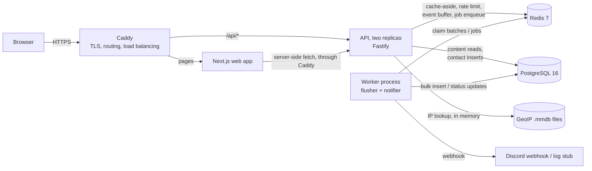

# System Design Specification: Personal Portfolio & Live Telemetry Platform

Progress and per-phase checklists live in [ROADMAP.md](ROADMAP.md).

---

## 1. Overview & Goals

A production-grade personal portfolio platform engineered to demonstrate backend systems
fundamentals: asynchronous ingestion, Redis caching and rate limiting, background job
processing, observability, and disciplined testing.

**Goals**

- Every request path is observable (structured log + metric) and every failure path is explicit.
- No data is silently dropped: buffered events and jobs survive process crashes and restarts.
- The codebase is small, layered, and readable enough to be reviewed in one sitting.

**Non-goals**

- Horizontally scaled workers (we design for **one worker process**; see §8.4).
- A CMS. Portfolio content lives in a version-controlled JSON file; the only owner page is
  the read-only `/admin` (§8.7).
- User accounts. The owner's token (`ADMIN_TOKEN`) and the metrics token are the only
  credentials.

**Tech stack**

| Concern       | Choice                                                                        |
| ------------- | ----------------------------------------------------------------------------- |
| Runtime       | Node.js 24 LTS, TypeScript 6 (strict), ESM                                    |
| Monorepo      | npm workspaces (`packages/shared`, `apps/api`, `apps/web`)                    |
| API           | Fastify 5, Zod 4 validation, Pino logging                                     |
| Web           | Next.js 16 (App Router), React 19, Tailwind CSS 4                             |
| Datastores    | PostgreSQL 16 (`pg`, plain SQL migrations), Redis 7 (`ioredis`)               |
| Observability | `prom-client` (Prometheus), JSON status endpoint                              |
| Quality       | Vitest 5 (unit + real-datastore integration), ESLint 10, Prettier, GH Actions |

---

## 2. Architecture



That is production (§14.5). In development there is no Caddy: the site runs on `:3000`, the
API on `:4000`, and the browser calls the API directly. A walkthrough of every flow, with
diagrams: [docs/PROJECT-GUIDE.md](docs/PROJECT-GUIDE.md).

### 2.1 Process model

| Process    | Entrypoint                         | Responsibilities                                                                          |
| ---------- | ---------------------------------- | ----------------------------------------------------------------------------------------- |
| API        | `apps/api/src/main.ts`             | HTTP routes, cache-aside, ingestion enqueue, contact + rate limit, `/metrics`             |
| Worker     | `apps/api/src/worker.ts` (Phase 3) | Telemetry batch flusher; (P4) notification consumer, delayed-job promoter, reconciler     |
| Web        | `apps/web` (Phase 5)               | Renders pages from the API per request; serves the browser code (beacon, form, dashboard) |
| Migrations | `apps/api/src/cli/migrate.ts`      | Applies SQL migrations; run as a deploy step, **never** on API boot                       |
| Other CLIs | `apps/api/src/cli/*.ts`            | `content:seed` (P2), `dlq:replay` and `geoip:download` (P3): one-off commands, then exit  |

The API and worker share one codebase but run as separate processes, so a slow webhook or
flush never competes with request latency.

### 2.2 Layering (API)

A request flows through the layers in one direction:

```
controller ──────► manager ──────► DAL ──────► Postgres / Redis
(endpoint +        (business       (data        rows typed by dao/
 validation)        rules)          access)     mapped to schema/ types
     │
     └──► view (shapes the JSON response)
```

| Layer         | Folder                    | Files             | Responsibility                                                                                                  |
| ------------- | ------------------------- | ----------------- | --------------------------------------------------------------------------------------------------------------- |
| Controllers   | `src/controllers/`        | `*.controller.ts` | Declare endpoints (method + path), validate input, call **one** manager method, pick the status, render a view. |
| Managers      | `src/services/`           | `*.manager.ts`    | Business rules (cache-aside, hashing, retry classification). No HTTP objects, no SQL.                           |
| DAL           | `src/dal/`                | `*.dal.ts`        | The only code that talks to datastores (SQL or Redis); maps DAO rows to schema types.                           |
| DAO           | `src/dao/`                | `*.dao.ts`        | Row types: one interface per table, column for column (`snake_case`).                                           |
| Schema        | `src/schema/`             | `*.schema.ts`     | The contract: Zod schemas + types for API responses, requests and input files (`camelCase`).                    |
| Views         | `src/views/`              | `*.view.ts`       | Turn schema types into response bodies (`{ data }` / `{ error }`, no internal fields).                          |
| Workers       | `src/workers/`            | `*.worker.ts`     | Background loops started by `worker.ts`: decide _when_ to run, call one manager method, back off on failure.    |
| Cross-cutting | `middleware/`, `errors/`… | —                 | Request ids, error handling, config, logging, lifecycle.                                                        |

A worker loop is the background equivalent of a controller: time (an interval, a backoff), not
an HTTP request, triggers it, and the manager it calls holds the business rules.

Route middleware runs before the handler and calls its own manager, so the handler still calls
one. The rate limiter (`middleware/rate-limit.ts`, Phase 4) is a Fastify `onRequest` hook that
a controller attaches to a route: `{ onRequest: rateLimit(limiter) }`.

Why DAO and schema are separate: the database and the API change for different reasons. A
column rename touches a DAO row type and one mapping function in the DAL; the API (and its
cache entries) stay unchanged. Managers depend on DAL **interfaces**, which makes them
unit-testable with fakes. The composition roots (`main.ts`, `worker.ts`) create infrastructure
clients and pass them down; nothing reaches for a global singleton. On the frontend, the
Next.js app is the user-facing view.

---

## 3. Monorepo Layout

Items marked `(P2)`…`(P6)` arrive in that phase; everything else exists after Phase 1.

```
.
├── .github/workflows/ci.yml              (P2) format, lint, typecheck, unit + integration tests,
│                                         (P5) web unit tests + the site's production build,
│                                         (P6) both Docker images built for linux/arm64
├── .github/workflows/deploy.yml          (P6) build images → approve → migrate → deploy → smoke test
├── .vscode/extensions.json               recommended extensions (PostgreSQL, Redis, ESLint, Prettier)
├── .dockerignore                         (P6)
├── .nvmrc                                Node 24 LTS
├── .env.example                          documented env vars (copy to .env)
├── .prettierrc.json / .prettierignore
├── CLAUDE.md                             contributor / agent guide
├── DESIGN.md                             this document
├── ROADMAP.md                            phases, branches, progress checklists
├── docs/                                 the guides (PROJECT-GUIDE.md first; README.md lists them all)
│   └── sql/                              read-only queries for the VS Code PostgreSQL extension
│                                         (content.sql, (P3) telemetry.sql, (P4) contact.sql)
├── deploy/                               (P6) the production stack (docs/PRODUCTION-STACK.md):
│                                         compose.prod.yml, caddy/ (Caddyfile, back-soon.html),
│                                         .env.example (→ gitignored .env), deploy.sh,
│                                         backup.sh, restore.sh, pull-backups.sh, failover-test.sh
├── docker-compose.yml                    Postgres 16 + Redis 7 for local dev & tests
├── eslint.config.mjs                     one flat config for the whole repo
├── package.json                          npm workspaces + repo-wide scripts
├── tsconfig.base.json                    strict compiler options shared by all packages
├── apps/
│   ├── api/
│   │   ├── package.json
│   │   ├── Dockerfile                    (P6) one image: api, worker, migrate, seed commands
│   │   ├── tsconfig.json                 typecheck (src + test)
│   │   ├── tsconfig.build.json           emit (src → dist)
│   │   ├── vitest.config.ts              "unit" and "integration" projects
│   │   ├── content/portfolio.json        (P2) source of truth for portfolio content
│   │   ├── data/geoip/                   (P3, gitignored) npm run geoip:download puts the .mmdb files here
│   │   ├── migrations/                   NNNN_snake_case_name.sql, applied in order
│   │   │   ├── 0001_portfolio_content.sql        (P2)
│   │   │   ├── 0002_education.sql                (P2)
│   │   │   ├── 0003_analytics_events.sql         (P3)
│   │   │   ├── 0004_analytics_visitor_details.sql (P3)
│   │   │   ├── 0005_contact_messages.sql         (P4)
│   │   │   ├── 0006_project_sections.sql         (P6)
│   │   │   ├── 0007_analytics_ip_address.sql     (P6)
│   │   │   └── 0008_content_updated_at.sql       "Last updated" dates (§5.2d)
│   │   ├── src/
│   │   │   ├── main.ts                   API composition root + process lifecycle
│   │   │   ├── worker.ts                 (P3) worker composition root + process lifecycle
│   │   │   ├── app.ts                    buildApp(): wires DAL → managers → controllers
│   │   │   ├── controllers/              endpoints (method + path) + input validation
│   │   │   │   ├── health.controller.ts          GET /health, (P6) GET /health/live
│   │   │   │   ├── api-v1.ts                     (P3) the /api/v1 prefix shared by controllers
│   │   │   │   ├── parse-request.ts              (P2) Zod-validates params/query/body → 400
│   │   │   │   ├── content.controller.ts         (P2) profile, projects
│   │   │   │   ├── events.controller.ts          (P3) telemetry ingestion
│   │   │   │   ├── contact.controller.ts         (P4)
│   │   │   │   ├── system.controller.ts          (P5) /metrics
│   │   │   │   └── admin.controller.ts           (P6) owner routes: system status, visitor summary
│   │   │   ├── services/                 business rules ("managers")
│   │   │   │   ├── health.manager.ts
│   │   │   │   ├── cache-aside.manager.ts        (P2) generic cache-aside + single-flight + TTL jitter
│   │   │   │   ├── content.manager.ts            (P2) profile/projects reads, publish (seed)
│   │   │   │   ├── telemetry.manager.ts          (P3) ingestion: normalise, hash, enqueue
│   │   │   │   ├── visitor-details.manager.ts    (P3) what the link, browser and IP reveal
│   │   │   │   ├── telemetry-flush.manager.ts    (P3) one flush: claim → insert → ack, DLQ routing
│   │   │   │   ├── telemetry-dlq.manager.ts      (P3) dead-letter replay
│   │   │   │   ├── contact.manager.ts            (P4) store the message, queue its notification job
│   │   │   │   ├── rate-limiter.manager.ts       (P4) sliding window per hashed IP, fail closed
│   │   │   │   ├── notification.manager.ts       (P4) one job: send → sent / retry / DLQ; promote; reconcile
│   │   │   │   ├── notification-dlq.manager.ts   (P4) dead-letter replay: reopen FAILED messages
│   │   │   │   ├── system-status.manager.ts      (P5) status JSON (5 s cache) + Prometheus text
│   │   │   │   └── visitor-insights.manager.ts   (P6) ranks visits for the owner's summary
│   │   │   ├── dal/                      the only datastore code
│   │   │   │   ├── content.dal.ts                (P2) Postgres
│   │   │   │   ├── content-cache.dal.ts          (P2) Redis
│   │   │   │   ├── analytics-event.dal.ts        (P3) Postgres: bulk insert with unnest
│   │   │   │   ├── event-buffer.dal.ts           (P3) Redis: buffer, in-flight batch, DLQ
│   │   │   │   ├── telemetry-salt.dal.ts         (P3) Redis
│   │   │   │   ├── ip-location.dal.ts            (P3) local GeoIP files: IP → organisation, location
│   │   │   │   ├── contact-message.dal.ts        (P4) Postgres
│   │   │   │   ├── rate-limit.dal.ts             (P4) Redis
│   │   │   │   ├── notification-queue.dal.ts     (P4) Redis
│   │   │   │   ├── queue-depth.dal.ts            (P5) Redis: LLEN/ZCARD of every queue, one round trip
│   │   │   │   ├── visitor-insights.dal.ts       (P6) Postgres: visits grouped by session
│   │   │   │   ├── redis-exec.ts                 (P4) MULTI/pipeline that throws if any command failed
│   │   │   │   └── lua/                          (P3/P4) Lua scripts as TS string constants
│   │   │   │       ├── bounded-enqueue.lua.ts    (P3) + its typed ioredis command
│   │   │   │       ├── claim-batch.lua.ts        (P3) + its typed ioredis command
│   │   │   │       ├── sliding-window.lua.ts     (P4) the rate limiter (§6.4)
│   │   │   │       └── promote-due-jobs.lua.ts   (P4) delayed → ready (§6.6)
│   │   │   ├── dao/                      row types, one per table
│   │   │   │   ├── content.dao.ts                (P2) profile, experiences, education, projects
│   │   │   │   ├── analytics-event.dao.ts        (P3)
│   │   │   │   └── contact-message.dao.ts        (P4)
│   │   │   ├── schema/                   API + input contract: Zod schemas and their types
│   │   │   │   ├── health.schema.ts
│   │   │   │   ├── content.schema.ts             (P2) responses + content/portfolio.json
│   │   │   │   ├── analytics-event.schema.ts     (P3) request, visitor details, buffered event, dead letter
│   │   │   │   ├── contact-message.schema.ts     (P4)
│   │   │   │   ├── notification-job.schema.ts    (P4)
│   │   │   │   ├── system-status.schema.ts       (P5)
│   │   │   │   └── visitor-insights.schema.ts    (P6)
│   │   │   ├── views/
│   │   │   │   ├── data.view.ts          (P3) the { data } envelope type
│   │   │   │   ├── error.view.ts         { error: { code, message, requestId } }
│   │   │   │   ├── content.view.ts       (P2) { data } bodies for profile/projects
│   │   │   │   ├── telemetry.view.ts     (P3) { data: { eventId } }
│   │   │   │   ├── contact.view.ts       (P4) { data: { id, status } }
│   │   │   │   ├── system-status.view.ts (P5) { data: { … } } for the dashboard
│   │   │   │   └── visitor-insights.view.ts (P6) { data: VisitorSummary }
│   │   │   ├── workers/                  (P3/P4) background loops started by worker.ts
│   │   │   │   ├── telemetry-flusher.worker.ts   (P3) when to flush: interval, backoff, drain on stop
│   │   │   │   ├── notification-consumer.worker.ts (P4) one job after another; backoff on outages
│   │   │   │   ├── periodic.worker.ts            (P4) "every N ms": the promoter and the reconciler
│   │   │   │   └── backoff.ts                    (P4) 0.5 s → 30 s schedule shared by the loops
│   │   │   ├── middleware/
│   │   │   │   ├── request-id.ts         x-request-id accept/generate/echo
│   │   │   │   ├── error-handler.ts      maps any error to the error view
│   │   │   │   ├── rate-limit.ts         (P4) onRequest hook: X-RateLimit-* headers, 429
│   │   │   │   ├── http-metrics.ts       (P5) onResponse hook: duration histogram, counter, rolling window
│   │   │   │   ├── bearer-token.ts       (P5) onRequest hook for /metrics, (P6) owner routes: constant-time check
│   │   │   │   └── security.ts           (P5) Helmet headers + CORS allow-list
│   │   │   ├── errors/app-error.ts       AppError + ErrorCode catalog
│   │   │   ├── config/env.ts             Zod env schema → typed AppConfig (fail-fast)
│   │   │   ├── db/migrator.ts            reads .sql files, applies pending ones
│   │   │   ├── cli/
│   │   │   │   ├── migrate.ts            npm run db:migrate
│   │   │   │   ├── seed-content.ts       (P2) npm run content:seed
│   │   │   │   ├── replay-dlq.ts         (P3) npm run dlq:replay -- telemetry | (P4) notifications
│   │   │   │   └── download-geoip.ts     (P3) npm run geoip:download
│   │   │   ├── infra/
│   │   │   │   ├── logger.ts             Pino root logger
│   │   │   │   ├── postgres.ts           pg Pool factory + ping
│   │   │   │   ├── redis.ts              ioredis factory + ping
│   │   │   │   ├── with-timeout.ts       bound any promise by a deadline
│   │   │   │   ├── sleep.ts              (P3) a wait that a stopping worker can cut short
│   │   │   │   ├── ip-databases.ts       (P3) opens the GeoIP files at API startup
│   │   │   │   ├── transient-error.ts    (P3) outage vs bug: 503 in the API, retry vs DLQ in the worker
│   │   │   │   ├── ip-hash.ts            (P4) HMAC-SHA256(IP_HASH_SECRET, ip)
│   │   │   │   ├── rolling-latency.ts    (P5) ring buffer of the last 5 min of durations → p50/p95
│   │   │   │   ├── metrics.ts            (P2) prom-client registry + metric definitions
│   │   │   │   └── notifiers/            (P4) log + Discord senders, NotificationError (retryable?)
│   │   │   └── lifecycle/
│   │   │       └── graceful-shutdown.ts  signal handling, ordered close, forced exit
│   │   └── test/
│   │       ├── helpers/                  test app builder, datastore helpers
│   │       ├── fixtures/geoip/           (P3) MaxMind's tiny test .mmdb files (Apache-2.0/MIT)
│   │       ├── unit/                     mirrors src/ folders; pure logic, no I/O
│   │       └── integration/              real Postgres + Redis (docker compose)
│   └── web/                          (P5) the website (§8.6)
│       ├── package.json, next.config.ts, postcss.config.mjs, tsconfig.json
│       ├── vitest.config.ts              unit tests for src/lib
│       ├── Dockerfile                    (P6) Next.js standalone server
│       ├── src/
│       │   ├── app/                      routes (App Router)
│       │   │   ├── layout.tsx            header, footer, page-view beacon
│       │   │   ├── page.tsx              home: hero, about, experience, projects, outside work, contact
│       │   │   ├── [slug]/               one project, at /<slug> (old /projects/* links redirect)
│       │   │   ├── admin/                (P6) owner dashboard + its status route (password-protected)
│       │   │   ├── error.tsx             "This page couldn't load" + Try again
│       │   │   ├── not-found.tsx
│       │   │   ├── icon.svg, apple-icon.png   browser-tab and home-screen icons
│       │   │   └── globals.css           theme tokens, reveal, reduced motion
│       │   ├── proxy.ts                  (P6) HTTP Basic login in front of /admin
│       │   ├── components/               sections and effects ('use client' only where needed)
│       │   ├── content/                  photos.ts + the photos (web copies, metadata removed)
│       │   └── lib/                      logic without React: api (server fetch), telemetry
│       │                                 (beacon), contact, status, carousel, scroll-spy,
│       │                                 section-scroll, project-page, format, config,
│       │                                 (P6) admin-auth, admin-api, visitors
│       └── test/lib/                     unit tests mirroring src/lib
└── packages/
    └── shared/                           (P5) the API contract: Zod schemas for every public
        ├── package.json                  request/response (content, contact, events, system
        ├── tsconfig.json / .build.json   status, (P6) visitors, error envelope). Built to dist/
        └── src/                          (`build:shared`, run by postinstall, dev:*, typecheck, test)
```

---

## 4. Configuration

All configuration comes from environment variables, validated once at startup by a Zod
schema in `apps/api/src/config/env.ts`. Invalid or missing values print **every** problem
(names and reasons, never values) and exit with code `1` before any connection is opened.
Empty strings are treated as "unset" so `API_PORT=` cannot silently become port `0`.

| Variable                            | Phase | Default                 | Notes                                                                     |
| ----------------------------------- | ----- | ----------------------- | ------------------------------------------------------------------------- |
| `NODE_ENV`                          | 1     | `development`           | `development` \| `test` \| `production`. Pretty logs only in development. |
| `API_HOST`                          | 1     | `0.0.0.0`               |                                                                           |
| `API_PORT`                          | 1     | `4000`                  | `0` = ephemeral (used by tests).                                          |
| `LOG_LEVEL`                         | 1     | `info`                  | Pino levels + `silent`.                                                   |
| `DATABASE_URL`                      | 1     | — (required)            | `postgres://` or `postgresql://` URL.                                     |
| `DATABASE_POOL_MAX`                 | 1     | `10`                    |                                                                           |
| `REDIS_URL`                         | 1     | — (required)            | `redis://` or `rediss://` URL; may include DB index (`/1`).               |
| `SHUTDOWN_TIMEOUT_MS`               | 1     | `10000`                 | Hard deadline for graceful shutdown before forced exit.                   |
| `CACHE_TTL_SECONDS`                 | 2     | `300`                   | ±10 % jitter applied per write.                                           |
| `TRUST_PROXY`                       | 3     | `false`                 | Set when behind a reverse proxy so `request.ip` is the client IP.         |
| `TELEMETRY_BATCH_SIZE`              | 3     | `50`                    | 1–1000 events per `INSERT`.                                               |
| `TELEMETRY_FLUSH_INTERVAL_MS`       | 3     | `5000`                  | 100–300000. The worker's pause once it has caught up.                     |
| `TELEMETRY_BUFFER_MAX_LENGTH`       | 3     | `100000`                | Ingestion returns `503` beyond this.                                      |
| `GEOIP_ASN_DB_PATH`                 | 3     | unset                   | IP → organisation `.mmdb` file. Unset = lookup off. Relative to apps/api. |
| `GEOIP_LOCATION_DB_PATH`            | 3     | unset                   | IP → country/city `.mmdb` file. Set but missing = API refuses to start.   |
| `IP_HASH_SECRET`                    | 4     | — (required)            | ≥ 32 chars. Keyed hash for rate-limit / abuse identifiers.                |
| `CONTACT_RATE_LIMIT_MAX`            | 4     | `3`                     |                                                                           |
| `CONTACT_RATE_LIMIT_WINDOW_SECONDS` | 4     | `600`                   |                                                                           |
| `NOTIFIER_DRIVER`                   | 4     | `log`                   | `log` \| `discord`.                                                       |
| `DISCORD_WEBHOOK_URL`               | 4     | unset                   | `https://`; required when `NOTIFIER_DRIVER=discord`. A secret (token).    |
| `NOTIFY_MAX_ATTEMPTS`               | 4     | `3`                     | 1–10. Total attempts including the first.                                 |
| `NOTIFY_BACKOFF_BASE_MS`            | 4     | `5000`                  | Delay = base × 2^(attempt−1) ± 20 % jitter, capped at 4 min.              |
| `METRICS_TOKEN`                     | 5     | unset                   | ≥ 16 chars. If set, `/metrics` requires `Authorization: Bearer <token>`.  |
| `CORS_ORIGINS`                      | 5     | `http://localhost:3000` | Comma-separated origins (`https://host[:port]`, no path, no `/`).         |
| `API_BASE_URL`                      | 5     | `http://localhost:4000` | Web app → API (server side, read at request time).                        |
| `NEXT_PUBLIC_API_BASE_URL`          | 5     | `http://localhost:4000` | Browser → API. Baked in at `next build`. Empty = same origin (§14.5).     |
| `ADMIN_TOKEN`                       | 6     | unset                   | ≥ 32 chars. Owner area (§8.7): API bearer token and /admin password.      |

The web variables are read by Next.js from the environment or from `apps/web/.env*` files
(not the root `.env`); the defaults suit local development. `ADMIN_TOKEN` is set in both apps
(the API checks it, the web server sends it and checks the owner's password against it);
`apps/web/.env.development`, read by `next dev` only, holds the same development value as
`.env.example`. `NEXT_PUBLIC_*` values are copied into the JavaScript bundle when the site is
built, so changing one means rebuilding.

Docker Compose additionally reads `POSTGRES_USER`, `POSTGRES_PASSWORD`, `POSTGRES_DB`,
`POSTGRES_PORT`, `REDIS_PORT` (all with local-dev defaults).

---

## 5. Data Model (PostgreSQL 16)

### 5.1 Migration mechanics

- Files: `apps/api/migrations/NNNN_snake_case_name.sql`, 4-digit zero-padded version.
- Bookkeeping table, created by the migrator itself:

  ```sql
  CREATE TABLE IF NOT EXISTS schema_migrations (
    version     INTEGER     PRIMARY KEY,
    name        TEXT        NOT NULL,
    checksum    TEXT        NOT NULL,          -- sha256 of the file contents
    applied_at  TIMESTAMPTZ NOT NULL DEFAULT now()
  );
  ```

- The migrator takes a session-level `pg_advisory_lock` so two concurrent deploys cannot
  apply migrations twice.
- Each migration runs in **its own transaction** together with its `schema_migrations` row.
  A failure rolls back that file and stops the run.
- Applied files are verified by checksum. **Editing an applied migration is an error**; write
  a new migration instead. A recorded version whose file is missing is also an error.
- Migrations must be **backward compatible** with the code that is already running, because a
  deploy applies them before the new version starts (expand → contract, see §14.4).
- `CREATE INDEX CONCURRENTLY` is not supported (it cannot run inside a transaction).
- `gen_random_uuid()` is built into Postgres 13+, so no extension is needed.
- `updated_at` is set explicitly by the DAL's `UPDATE` statements (no triggers). Content rows
  get it only when the seed really changes them (§8.1), so it means "last changed".
- Status columns use `TEXT` + `CHECK` rather than Postgres `ENUM`, which cannot drop or
  rename values without a type rebuild.

### 5.2 `0001_portfolio_content.sql` (Phase 2)

```sql
CREATE TABLE profile (
  id          SMALLINT    PRIMARY KEY DEFAULT 1 CHECK (id = 1),   -- singleton row
  full_name   TEXT        NOT NULL,
  headline    TEXT        NOT NULL,
  summary     TEXT        NOT NULL,
  location    TEXT,
  links       JSONB       NOT NULL DEFAULT '[]'::jsonb,           -- [{ "label": "...", "url": "..." }]
  updated_at  TIMESTAMPTZ NOT NULL DEFAULT now()
);

CREATE TABLE experiences (
  id          UUID        PRIMARY KEY DEFAULT gen_random_uuid(),
  company     TEXT        NOT NULL,
  role        TEXT        NOT NULL,
  start_date  DATE        NOT NULL,
  end_date    DATE,                                               -- NULL = current role
  highlights  TEXT[]      NOT NULL DEFAULT '{}',
  sort_order  INTEGER     NOT NULL DEFAULT 0,
  created_at  TIMESTAMPTZ NOT NULL DEFAULT now(),
  updated_at  TIMESTAMPTZ NOT NULL DEFAULT now(),
  CONSTRAINT experiences_dates_ordered CHECK (end_date IS NULL OR end_date >= start_date)
);
CREATE INDEX experiences_display_order_idx ON experiences (sort_order, start_date DESC);

CREATE TABLE projects (
  id           UUID        PRIMARY KEY DEFAULT gen_random_uuid(),
  slug         TEXT        NOT NULL UNIQUE CHECK (slug ~ '^[a-z0-9]+(-[a-z0-9]+)*$'),
  title        TEXT        NOT NULL,
  summary      TEXT        NOT NULL,
  description  TEXT        NOT NULL,
  tech_stack   TEXT[]      NOT NULL DEFAULT '{}',
  repo_url     TEXT,
  live_url     TEXT,
  featured     BOOLEAN     NOT NULL DEFAULT false,
  sort_order   INTEGER     NOT NULL DEFAULT 0,
  created_at   TIMESTAMPTZ NOT NULL DEFAULT now(),
  updated_at   TIMESTAMPTZ NOT NULL DEFAULT now()
);
CREATE INDEX projects_display_order_idx ON projects (featured DESC, sort_order);
```

### 5.2b `0002_education.sql` (Phase 2)

Added after 0001 had been applied, so it is a separate, additive migration.

```sql
CREATE TABLE education (
  id             UUID        PRIMARY KEY DEFAULT gen_random_uuid(),
  institution    TEXT        NOT NULL,
  qualification  TEXT        NOT NULL,
  start_date     DATE        NOT NULL,
  end_date       DATE,                                 -- NULL = still studying
  highlights     TEXT[]      NOT NULL DEFAULT '{}',    -- honours, scholarships, grades
  sort_order     INTEGER     NOT NULL DEFAULT 0,
  created_at     TIMESTAMPTZ NOT NULL DEFAULT now(),
  updated_at     TIMESTAMPTZ NOT NULL DEFAULT now(),
  CONSTRAINT education_dates_ordered CHECK (end_date IS NULL OR end_date >= start_date)
);
CREATE INDEX education_display_order_idx ON education (sort_order, start_date DESC);
```

### 5.2c `0006_project_sections.sql` (Phase 6)

Structured detail for project pages. Expand-only (a column with a default), so the code that
was deployed before it keeps working (§14.4).

```sql
ALTER TABLE projects
  ADD COLUMN sections JSONB NOT NULL DEFAULT '[]'::jsonb,
  ADD CONSTRAINT projects_sections_is_array CHECK (jsonb_typeof(sections) = 'array');
```

Each element is `{ "heading": text, "body": text | null, "points": [text] }`. JSONB rather
than a child table: sections are always read and written together with their project, never
queried on their own. Only `content:seed` writes them, after the content file's schema has
checked every section (heading ≤ 120 characters, body ≤ 2,000, points ≤ 500 each, at most 20
sections, and a body or at least one point under every heading).

### 5.2d `0008_content_updated_at.sql` (after launch)

The "Last updated" dates on the site (§8.6). Expand-only, like 0006.

```sql
ALTER TABLE profile ADD COLUMN content_updated_at TIMESTAMPTZ NOT NULL DEFAULT now();
UPDATE profile SET content_updated_at = updated_at;   -- the last seed: the best known answer
```

- **A project page** shows `projects.updated_at`.
- **The home page** shows `profile.content_updated_at`: when the seed last changed _any_ content
  (the profile, an experience, an education entry or a project, removals included). It sits on
  the profile row because that is the content's only singleton. A column on its own, rather
  than the newest `updated_at` of all rows, because a removed project leaves no row behind to
  carry the date.

Both move only when something really changed (§8.1, step 7). Before 0008 every seed rewrote
every row, so on the live site all dates start from the last seed before it.

### 5.3 `0003_analytics_events.sql` (Phase 3)

```sql
CREATE TABLE analytics_events (
  id             UUID        PRIMARY KEY,          -- assigned at ingestion → idempotent replays
  event_type     TEXT        NOT NULL CHECK (event_type IN ('page_view', 'interaction')),
  event_name     TEXT,                             -- e.g. 'click:linkedin-link'; interactions only
  path           TEXT        NOT NULL,             -- query string stripped
  referrer_host  TEXT,                             -- host only, never the full URL
  session_id     TEXT        NOT NULL,             -- opaque, client-generated
  visitor_hash   TEXT        NOT NULL,             -- sha256(daily_salt + ip + user_agent)
  received_at    TIMESTAMPTZ NOT NULL,             -- server time at ingestion
  inserted_at    TIMESTAMPTZ NOT NULL DEFAULT now(),
  CONSTRAINT analytics_events_name_iff_interaction
    CHECK ((event_type = 'interaction') = (event_name IS NOT NULL))
);

-- Append-only, time-ordered data: a BRIN index is tiny and ideal for "last 24 hours" scans.
CREATE INDEX analytics_events_received_at_brin ON analytics_events USING BRIN (received_at);
-- Per-page breakdowns ("top pages this week").
CREATE INDEX analytics_events_path_received_at_idx ON analytics_events (path, received_at DESC);
```

### 5.3b `0004_analytics_visitor_details.sql` (Phase 3)

Added after 0003 had been applied: what we learn about each visitor (§8.2), in three groups.

```sql
ALTER TABLE analytics_events
  -- From the link: tagged links such as /?ref=acme&utm_source=linkedin
  ADD COLUMN ref           TEXT,
  ADD COLUMN utm_source    TEXT,
  ADD COLUMN utm_medium    TEXT,
  ADD COLUMN utm_campaign  TEXT,
  -- From the browser: parsed user agent, Accept-Language header, the page's timezone
  ADD COLUMN browser       TEXT,          -- e.g. 'Chrome'
  ADD COLUMN os            TEXT,          -- e.g. 'macOS'
  ADD COLUMN device_type   TEXT,          -- 'desktop' | 'mobile' | 'tablet' | 'tv' | 'bot'
  ADD COLUMN language      TEXT,          -- e.g. 'en-SG'
  ADD COLUMN timezone      TEXT,          -- e.g. 'Asia/Singapore'
  -- From the IP address, looked up in local GeoIP database files
  ADD COLUMN country_code  TEXT,          -- ISO 3166-1 alpha-2, e.g. 'SG'
  ADD COLUMN city          TEXT,
  ADD COLUMN organization  TEXT;          -- who owns the network, e.g. 'Google LLC'
```

Every column is nullable: older rows, and details that are unknown (no GeoIP file, a private
IP, `curl`), are `NULL`. Adding nullable columns is backward compatible (§14.4). No new indexes:
the table is small, and these columns are read by occasional ad-hoc queries
(`docs/sql/telemetry.sql`), not by request paths. `device_type` has no `CHECK`, because a new
value from the user-agent parser must not make inserts fail.

### 5.3c `0007_analytics_ip_address.sql` (Phase 6)

The visitor's IP address, kept with each event at the owner's request (§12). Expand-only.

```sql
ALTER TABLE analytics_events ADD COLUMN ip_address INET;
```

`INET` holds IPv4 and IPv6 addresses and refuses anything else, so the API stores `NULL` for
a `request.ip` that is not a valid address (`storableIp`): one bad value would otherwise fail
the worker's whole batch insert. Events buffered before this release have no address and are
stored with `NULL`. Behind Caddy the address is the visitor's only with `TRUST_PROXY=true`
(§14.4); in local development every visit is `127.0.0.1` or `::1`.

### 5.4 `0005_contact_messages.sql` (Phase 4)

```sql
CREATE TABLE contact_messages (
  id          UUID        PRIMARY KEY DEFAULT gen_random_uuid(),
  name        TEXT        NOT NULL CHECK (char_length(name) BETWEEN 1 AND 100),
  email       TEXT        NOT NULL CHECK (char_length(email) BETWEEN 3 AND 254),
  message     TEXT        NOT NULL CHECK (char_length(message) BETWEEN 1 AND 5000),
  ip_hash     TEXT        NOT NULL,             -- HMAC-SHA256(IP_HASH_SECRET, ip)
  status      TEXT        NOT NULL DEFAULT 'PENDING'
                          CHECK (status IN ('PENDING', 'SENT', 'FAILED')),
  attempts    INTEGER     NOT NULL DEFAULT 0 CHECK (attempts >= 0),
  last_error  TEXT,
  created_at  TIMESTAMPTZ NOT NULL DEFAULT now(),
  updated_at  TIMESTAMPTZ NOT NULL DEFAULT now(),
  sent_at     TIMESTAMPTZ
);

-- Reconciler scan: small partial index containing only unfinished messages.
CREATE INDEX contact_messages_pending_idx ON contact_messages (updated_at) WHERE status = 'PENDING';
CREATE INDEX contact_messages_created_at_idx ON contact_messages (created_at DESC);
```

---

## 6. Redis Design

### 6.1 Conventions

- Namespaced, colon-separated, lowercase: `<domain>:<entity>[:<qualifier>]`.
- Every key is either **data** (no TTL, never evicted) or **ephemeral** (always has a TTL).
- Test runs use Redis logical DB `1`; development uses DB `0`.
- Lua scripts are registered with ioredis `defineCommand` (EVALSHA with automatic fallback
  to EVAL on `NOSCRIPT`). Scripts receive _all_ keys via `KEYS[]`.

### 6.2 Key catalog

| Key                             | Type                     | TTL                       | Phase | Purpose                                                   |
| ------------------------------- | ------------------------ | ------------------------- | ----- | --------------------------------------------------------- |
| `cache:v3:profile`              | STRING (JSON)            | `CACHE_TTL_SECONDS` ±10 % | 2     | Profile + experiences + education response                |
| `cache:v1:projects`             | STRING (JSON)            | same                      | 2     | Project list response                                     |
| `cache:v3:project:{slug}`       | STRING (JSON)            | same                      | 2     | Single project (v2: `sections`, v3: `updatedAt`)          |
| `telemetry:salt:{YYYY-MM-DD}`   | STRING (hex)             | 48 h                      | 3     | Daily visitor-hash salt (UTC date); created with `SET NX` |
| `telemetry:events:buffer`       | LIST (JSON)              | none                      | 3     | Ingested events awaiting flush                            |
| `telemetry:events:inflight`     | LIST (JSON)              | none                      | 3     | Batch claimed by the flusher, not yet committed           |
| `telemetry:events:dlq`          | LIST (JSON)              | none                      | 3     | Events that can never be inserted                         |
| `ratelimit:contact:{ipHash}`    | ZSET                     | window length             | 4     | Sliding-window log of accepted requests                   |
| `jobs:notifications:ready`      | LIST (JSON)              | none                      | 4     | Jobs ready to run (`LPUSH` in, `BLMOVE RIGHT` out = FIFO) |
| `jobs:notifications:processing` | LIST (JSON)              | none                      | 4     | Job currently being processed                             |
| `jobs:notifications:delayed`    | ZSET (score = run-at ms) | none                      | 4     | Jobs waiting for their backoff delay                      |
| `jobs:notifications:dlq`        | LIST (JSON)              | none                      | 4     | Permanently failed jobs                                   |

The `v1`/`v2` in cache keys is a **shape version**: changing a cached response shape bumps it,
so old entries are never read again and simply expire. It also keeps a deploy safe: while old
and new code run side by side, each reads and writes its own key instead of overwriting the
other's entries. The profile is at `v3` (`education`, then `contentUpdatedAt`), a single
project at `v3` (`sections`, then `updatedAt`); the list's shape never changed.

### 6.3 Server configuration (docker-compose)

`redis-server --appendonly yes --maxmemory 256mb --maxmemory-policy volatile-lru`

- **AOF** (`appendfsync everysec`): buffers and queues are data, so they survive restarts
  (≤ 1 s loss window).
- **`volatile-lru`**: under memory pressure only keys _with a TTL_ (cache, rate-limit
  windows, salts) are evicted. Queue data has no TTL and is never evicted; instead writes
  fail, which surfaces as an explicit `503` (see §9).

### 6.4 Sliding-window rate limiter (Phase 4)

Algorithm: **sliding window log**. Each _accepted_ request adds one ZSET member scored by its
timestamp; the window is `(now − window, now]`. Rejected requests are **not** recorded, so a
client that keeps retrying while blocked does not extend its own lockout.

```lua
-- KEYS[1]  ratelimit:contact:{ipHash}
-- ARGV[1]  now (ms since epoch)
-- ARGV[2]  window length (ms)
-- ARGV[3]  max requests per window
-- ARGV[4]  unique member id for this request (e.g. "<now>-<random>")
-- Returns { allowed (1|0), remaining, retryAfterMs }
local key       = KEYS[1]
local now       = tonumber(ARGV[1])
local window    = tonumber(ARGV[2])
local limit     = tonumber(ARGV[3])
local member    = ARGV[4]

redis.call('ZREMRANGEBYSCORE', key, '-inf', now - window)
local used = redis.call('ZCARD', key)

if used < limit then
  redis.call('ZADD', key, now, member)
  redis.call('PEXPIRE', key, window)
  return { 1, limit - used - 1, 0 }
end

local oldest = redis.call('ZRANGE', key, 0, 0, 'WITHSCORES')
local retryAfterMs = tonumber(oldest[2]) + window - now
return { 0, 0, retryAfterMs }
```

- **Atomicity**: read-check-write runs in one script, so 20 concurrent requests with
  `limit = 3` admit exactly 3 (covered by an integration test).
- **Clock**: `now` is passed from the app, which keeps the script deterministic to test.
- **Memory**: at most `limit` members per key; the key expires one window after the last
  accepted request.
- **Keying**: `HMAC-SHA256(IP_HASH_SECRET, ip)`. A static secret (not the daily analytics
  salt) keeps windows stable across midnight.
- **Failure policy: fail closed.** If Redis is unreachable the contact endpoint returns `503`.
- **Where it runs**: a Fastify `onRequest` hook, the first hook of a request, before the body is
  read. A blocked client costs one Redis call, and every request counts, including one that
  later fails validation (`400`), so a bot cannot probe the validator for free.
- **`Retry-After`** is `retryAfterMs` rounded **up** to whole seconds (at least 1): rounded down,
  a client that obeys it could arrive a moment too early and be refused again.

### 6.5 Telemetry buffer scripts (Phase 3)

**Bounded enqueue** (ingestion):

```lua
-- KEYS[1] telemetry:events:buffer   ARGV[1] max length   ARGV[2] event JSON
if redis.call('LLEN', KEYS[1]) >= tonumber(ARGV[1]) then
  return 0                      -- buffer full → caller answers 503
end
redis.call('RPUSH', KEYS[1], ARGV[2])
return 1
```

**Claim batch** (flusher):

```lua
-- KEYS[1] telemetry:events:buffer   KEYS[2] telemetry:events:inflight
-- ARGV[1] batch size
-- An unacknowledged in-flight batch (crash or failed insert) is returned again first.
local inflight = redis.call('LRANGE', KEYS[2], 0, -1)
if #inflight > 0 then
  return inflight
end
local batch = redis.call('LRANGE', KEYS[1], 0, tonumber(ARGV[1]) - 1)
if #batch == 0 then
  return batch
end
redis.call('LTRIM', KEYS[1], #batch, -1)
redis.call('RPUSH', KEYS[2], unpack(batch))
return batch
```

**Acknowledge** (after the insert commits): `RPUSH telemetry:events:dlq <dead letters…>` (if
any), **then** `DEL telemetry:events:inflight`. Because event ids are assigned at ingestion and
inserts use `ON CONFLICT (id) DO NOTHING`, re-processing a batch after a crash never creates
duplicate rows. That is also why these two commands need no script: a crash between them
re-claims the batch, re-inserts its good events as no-ops and dead-letters its bad ones a
second time. Delivery is **at least once**: a duplicate, never a loss.

**Replay** (`npm run dlq:replay -- telemetry`): for each DLQ entry, `RPUSH` its original
payload to the buffer, **then** `LREM` the entry. The same reasoning makes the order safe.

### 6.6 Notification queue scripts (Phase 4)

**Promote due jobs** (runs every second in the worker):

```lua
-- KEYS[1] jobs:notifications:delayed   KEYS[2] jobs:notifications:ready
-- ARGV[1] now (ms)   ARGV[2] max jobs to promote
local due = redis.call('ZRANGEBYSCORE', KEYS[1], '-inf', ARGV[1], 'LIMIT', 0, tonumber(ARGV[2]))
for _, job in ipairs(due) do
  redis.call('ZREM', KEYS[1], job)
  redis.call('LPUSH', KEYS[2], job)
end
return #due
```

Consume: `BLMOVE jobs:notifications:ready jobs:notifications:processing RIGHT LEFT 5` on a
**dedicated** ioredis connection (a blocked connection cannot run any other command, so
sharing it would freeze the promoter, the reconciler and the flusher for up to 5 s). Retry
scheduling and dead-lettering each run as a `MULTI` that also performs
`LREM jobs:notifications:processing 1 <job>`; completion is that `LREM` alone. ioredis reports
a failed command inside `EXEC` in its results instead of rejecting, so the DAL checks them.

**Requeue stranded jobs**: `LMOVE processing ready LEFT RIGHT` until it returns nil, before
**every** take. One consumer runs one job at a time, so between two jobs `processing` must be
empty: anything there was left by a crash or by an outage mid-job. The right end of `ready` is
taken next, so recovered jobs go first, in their original order.

**Every move is atomic** (one command, a `MULTI`, or a script), so a job is always in exactly
one of `ready`, `processing`, `delayed` or `dlq`, never in none.

---

## 7. HTTP API Contracts

### 7.1 Conventions

- Base path `/api/v1`. Operational endpoints (`/health`, `/metrics`) are unversioned.
- JSON only. Request bodies are capped at **16 KiB** (`413` beyond).
- **Success envelope**: `{ "data": <payload> }`. Lists are small and returned whole.
- **Error envelope** (every non-2xx except `/health`'s `503` report):

  ```json
  {
    "error": {
      "code": "VALIDATION_ERROR",
      "message": "Request validation failed",
      "requestId": "0f8fad5b-d9cb-469f-a165-70867728950e",
      "details": [{ "path": "email", "message": "Invalid email address" }]
    }
  }
  ```

  `details` appears **only** on `VALIDATION_ERROR`. `message` for `500` is always the generic
  `"An unexpected error occurred"`; the real error is logged with the same `requestId`.

- **Request IDs**: an inbound `x-request-id` is reused if it matches
  `^[A-Za-z0-9._:-]{1,128}$`; otherwise a UUID v4 is generated. The id is echoed in the
  `x-request-id` response header and bound to every log line of that request as `requestId`.

### 7.2 Error codes

| HTTP | `code`                   | When                                               |
| ---- | ------------------------ | -------------------------------------------------- |
| 400  | `VALIDATION_ERROR`       | Body/query/params fail schema validation           |
| 400  | `BAD_REQUEST`            | Malformed JSON or other client error               |
| 401  | `UNAUTHORIZED`           | Missing/invalid `/metrics` or owner token          |
| 404  | `NOT_FOUND`              | Unknown route or missing resource                  |
| 413  | `PAYLOAD_TOO_LARGE`      | Body exceeds 16 KiB                                |
| 415  | `UNSUPPORTED_MEDIA_TYPE` | Non-JSON body                                      |
| 429  | `RATE_LIMITED`           | Sliding-window limit exceeded                      |
| 503  | `SERVICE_UNAVAILABLE`    | Required dependency down, or telemetry buffer full |
| 500  | `INTERNAL_ERROR`         | Anything unexpected                                |

### 7.3 `GET /health` (Phase 1)

Readiness check: verifies Postgres (`SELECT 1`) and Redis (`PING`) in parallel, each bounded
by a 2 s timeout. Used by deploys, monitoring and the smoke test. Not wrapped in `{ data }`
because tools consume it directly.

**`GET /health/live` (Phase 6)**: liveness check for the load balancer. `200 {"status":"ok"}`
whenever the process can answer; checks no dependencies, on purpose (§14.5 explains why).
Both health routes log at `warn`: Caddy calls `/health/live` every 5 s and Docker calls
`/health` every 30 s, per replica, and Fastify's two info-level request lines would otherwise
fill the logs. A dependency failing its check is still logged (`warn`).

`200 OK`

```json
{
  "status": "ok",
  "checks": {
    "postgres": { "status": "up", "latencyMs": 2 },
    "redis": { "status": "up", "latencyMs": 1 }
  }
}
```

`503 Service Unavailable` (any dependency down)

```json
{
  "status": "degraded",
  "checks": {
    "postgres": { "status": "up", "latencyMs": 2 },
    "redis": { "status": "down", "latencyMs": 0 }
  }
}
```

Failure reasons are **logged** (with `requestId`), never returned; they can contain hostnames.

### 7.4 Content (Phase 2)

`GET /api/v1/profile` → `200`

```json
{
  "data": {
    "fullName": "Your Name",
    "headline": "Backend Engineer",
    "summary": "…",
    "location": "…",
    "links": [{ "label": "GitHub", "url": "https://github.com/…" }],
    "experiences": [
      {
        "id": "uuid",
        "company": "…",
        "role": "…",
        "startDate": "2023-01-01",
        "endDate": null,
        "highlights": ["…"]
      }
    ],
    "education": [
      {
        "id": "uuid",
        "institution": "…",
        "qualification": "…",
        "startDate": "2022-01-01",
        "endDate": "2026-05-31",
        "highlights": ["…"]
      }
    ],
    "contentUpdatedAt": "2026-11-21T09:30:00.000Z"
  }
}
```

`contentUpdatedAt` (since migration 0008): when the seed last changed any content, projects
included (§5.2d). The home page's "Last updated" date.

`404 NOT_FOUND` if content has not been seeded.

`GET /api/v1/projects` → `200 { "data": [ProjectSummary] }`, ordered by featured, then `sort_order`.
`ProjectSummary = { slug, title, summary, techStack[], repoUrl|null, liveUrl|null, featured }`

`GET /api/v1/projects/:slug` → `200 { "data": Project }`, `404` if no such project, or
`400 VALIDATION_ERROR` if the slug is malformed (`^[a-z0-9]+(-[a-z0-9]+)*$`, ≤ 100).
`Project = ProjectSummary + { description, sections: [{ heading, body|null, points[] }], updatedAt }`
(`sections` since migration 0006; `[]` for a project without any). `updatedAt`: when the seed
last changed this project, a new position in the list included (§5.2d); its page's date.

All three set `X-Cache: hit | miss`.

### 7.5 Telemetry ingestion (Phase 3)

`POST /api/v1/events`

```json
{
  "type": "page_view",
  "path": "/portfolio-telemetry-platform?ref=acme&utm_source=linkedin",
  "referrer": "https://www.linkedin.com/",
  "sessionId": "k3J9xQ2mP0aZ",
  "name": null,
  "timezone": "Asia/Singapore"
}
```

| Field       | Rule                                                                                                                                      |
| ----------- | ----------------------------------------------------------------------------------------------------------------------------------------- |
| `type`      | `page_view` \| `interaction`                                                                                                              |
| `path`      | starts with `/`, ≤ 512 chars. Stored without query string and fragment; `ref`, `utm_source`, `utm_medium`, `utm_campaign` get own columns |
| `referrer`  | optional `http(s)` URL, ≤ 1024 chars; the host is stored                                                                                  |
| `sessionId` | `^[A-Za-z0-9_-]{8,64}$`, random per browser tab                                                                                           |
| `name`      | required iff `type = interaction`; `^[a-z0-9:_-]{1,64}$`                                                                                  |
| `timezone`  | optional IANA name (`Intl.DateTimeFormat().resolvedOptions().timeZone`), ≤ 64 chars                                                       |

The server also reads the `User-Agent` and `Accept-Language` headers and the client IP
(`X-Forwarded-For` only when `TRUST_PROXY=true`), and records its own receive time; client
clocks are not trusted.

The body is JSON, sent as `application/json` or as `text/plain` (the web app's beacon uses
`text/plain` so browsers send it without a CORS preflight, §8.6); text that is not JSON is
`400 BAD_REQUEST`.

`202 Accepted` → `{ "data": { "eventId": "uuid" } }`. Never touches Postgres.
`503 SERVICE_UNAVAILABLE` when Redis is down or the buffer is at `TELEMETRY_BUFFER_MAX_LENGTH`.

### 7.6 Contact (Phase 4)

`POST /api/v1/contact`

```json
{ "name": "Ada", "email": "ada@example.com", "message": "Hello!" }
```

Limits: name 1–100, email valid ≤ 254, message 1–5000 chars (trimmed).

`202 Accepted` → `{ "data": { "id": "uuid", "status": "PENDING" } }`

Rate-limit headers on **every** response from this route once the limiter has run (all but a
`503` caused by Redis being down): `X-RateLimit-Limit: 3`, `X-RateLimit-Remaining: 2`,
`X-RateLimit-Window: 600` (seconds; so the form can say "3 messages every 10 minutes"). On
`429`, additionally `Retry-After: <seconds, rounded up>`.

| Status | When                                                                                   |
| ------ | -------------------------------------------------------------------------------------- |
| `202`  | Stored as `PENDING` (also when queueing the notification failed: see §8.3)             |
| `400`  | `VALIDATION_ERROR` with `details`; the request still counted towards the limit         |
| `429`  | `RATE_LIMITED`: the sender already has `CONTACT_RATE_LIMIT_MAX` messages in the window |
| `503`  | Redis down (the limiter fails closed, nothing stored), or Postgres down                |

### 7.7 Observability (Phase 5)

`GET /metrics` → Prometheus text exposition (`text/plain; version=0.0.4`). With
`METRICS_TOKEN` set, a request without `Authorization: Bearer <token>` gets `401 UNAUTHORIZED`
and `WWW-Authenticate: Bearer`. The token is compared in constant time (both sides hashed,
then `timingSafeEqual`), so response timing reveals nothing about it.

`GET /api/v1/admin/system-status` → `200`, served from a 5 s in-process cache. Owner-only
(§7.8): it needs the admin bearer token, like every `/api/v1/admin/*` route.

```json
{
  "data": {
    "generatedAt": "2026-11-17T12:00:00.000Z",
    "instance": "api-1",
    "uptimeSeconds": 86400,
    "dependencies": {
      "postgres": { "status": "up", "latencyMs": 2 },
      "redis": { "status": "up", "latencyMs": 1 }
    },
    "http": {
      "windowSeconds": 300,
      "requestCount": 1520,
      "latencyMs": { "p50": 3.1, "p95": 18.4 }
    },
    "cache": { "hits": 940, "misses": 31, "hitRatio": 0.968 },
    "analytics": { "pageViewsLast24h": 412 },
    "queues": {
      "telemetryBuffer": 3,
      "telemetryDeadLetter": 0,
      "notificationsReady": 0,
      "notificationsDelayed": 0,
      "notificationsDeadLetter": 0
    }
  }
}
```

Always `200`, even with a datastore down: a source that cannot be read becomes `null`
(`queues` when Redis is down, `analytics.pageViewsLast24h` when Postgres is) and is counted in
`observability_read_errors_total{source}`; `dependencies` says which one is down. Each read
has a 2 s timeout. Concurrent requests during a refresh share it (single-flight).

Rolling percentiles come from an in-process ring buffer (10 000 samples) of the last 5 minutes
of request durations (Prometheus histograms are cumulative, not rolling). Requests to
`/health`, `/health/live` (the load balancer's check), `/metrics` and the owner endpoints are
left out of it (Prometheus still counts them), or a dashboard polling every few seconds would
mostly measure itself. `cache` counts content-cache lookups since the process started. Values
are per API instance; `instance` (the container hostname) says which one answered, because
with two replicas (§14.5) consecutive polls can reach different instances.

### 7.8 Owner endpoints (Phase 6)

Read by the web app's password-protected `/admin` page (§8.7), never by browsers directly.
Every route under `/api/v1/admin/` needs `Authorization: Bearer <ADMIN_TOKEN>` (the same
constant-time check as `/metrics`) and answers `Cache-Control: no-store`. Without
`ADMIN_TOKEN` the routes are not registered at all (`404`). In production Caddy also refuses
`/api/v1/admin/*` from the internet (§14.5): only the web server, inside the server, calls them.

`GET /api/v1/admin/system-status`: the status report of §7.7.

`GET /api/v1/admin/visitors?days=7` (`days` 1–365, default 7; today in UTC is the first day)
→ `200 { "data": VisitorSummary }`:

| Field                            | What                                                                                 |
| -------------------------------- | ------------------------------------------------------------------------------------ |
| `days`, `since`, `generatedAt`   | The period: `since` is UTC midnight of the first day                                 |
| `totals`                         | `{ pageViews, visits, clicks }`                                                      |
| `daily[]`                        | `{ day, pageViews, visitors }` for every UTC day, zeros included                     |
| `referrers[]`                    | `{ referrer \| null, visits }`; `null` = direct or unknown                           |
| `campaigns[]`                    | `{ ref, utmSource, utmMedium, utmCampaign, visits }` for tagged visits               |
| `locations[]`, `organizations[]` | `{ countryCode, city, visits }`; `{ organization, countryCode, visits, lastSeenAt }` |
| `pages[]`, `clicks[]`            | `{ path, views, visits }`; `{ name, clicks }`                                        |
| `devices[]`, `browsers[]`        | `{ deviceType, visits }`; `{ browser, visits }`                                      |
| `recentVisits[]`                 | the 50 newest visits, each with every field above and its `ipAddress`                |
| `truncated`                      | `true` if the period had more than 20,000 visits (the newest are used)               |

Ranked lists hold at most 10 entries. A **visit** is one browser tab's `session_id`: Postgres
groups its events (`GROUP BY session_id`) and takes the first non-null referrer, tagged-link
field, place, network and device in time order; the manager
(`services/visitor-insights.manager.ts`) ranks the visits. Unique visitors are counted per UTC
day only, because the visitor hash changes every day (§8.2). Crawlers (`device_type = 'bot'`)
and `/admin` pages are never counted.

---

## 8. Module Behaviour

### 8.1 Module A: Content (cache-aside)

The generic algorithm lives in `services/cache-aside.manager.ts`; `content.manager.ts` only says
which key, schema and DAL query to use.

1. `GET cache:vN:<key>` → hit: parse + validate with its Zod schema (`schema/`) → return.
2. Miss: load from Postgres → `SET <key> <json> EX <ttl ± 10 %>` → return.
3. **Single-flight**: concurrent misses for the same key in one process share one DB query,
   preventing a stampede when a hot key expires. TTL jitter prevents synchronized expiry.
   A failed load is not remembered: the next request tries again.
4. Redis error on read or write → serve from Postgres, log `warn` + `cache_errors_total{operation}`.
5. Corrupt entry (bad JSON / schema mismatch) → treat as miss (log + `operation="decode"`); the
   freshly loaded value overwrites it.
6. "Not found" (`null`) is **not cached**, so newly published content appears immediately.
7. `npm run content:seed` validates `content/portfolio.json` (all problems listed, nothing
   written on error) and, in one transaction, upserts the profile, replaces the experiences
   and the education entries (their ids change when they do), upserts projects by slug and
   deletes projects no longer in the file. **Only what changed is written**, because every
   deploy runs the seed and `updated_at` is the site's "Last updated" date (§5.2d): the
   upserts end in `WHERE (columns) IS DISTINCT FROM (EXCLUDED columns)`, so a matching row is
   skipped (a project's `sort_order` is one of those columns: moving it is a change), and a
   list of experiences or education entries is only replaced if it differs from the stored
   one, order included. If anything changed, removals included, `profile.content_updated_at`
   becomes `now()`, the same instant as the changed rows. The command logs `changed: true` or
   `false`. It then deletes every content cache key (`SCAN` for `cache:v3:project:*`) and warms
   the cache through the normal read path. If clearing the cache fails, the command exits `1`
   (Postgres is already updated; cached copies may be stale until their TTL). There is no HTTP
   endpoint for editing content.

### 8.2 Module B: Telemetry pipeline

**Ingestion** (API process, `services/telemetry.manager.ts`):

1. Validate body (§7.5).
2. Describe the visitor (`services/visitor-details.manager.ts`); every field is `null` when
   unknown:
   - **campaign**, from the link: `ref`, `utm_source`, `utm_medium`, `utm_campaign` in the
     path's query string;
   - **device**, from the browser: browser, OS and device type parsed from `User-Agent`
     (`bowser`), the preferred language from `Accept-Language`, and `timezone` from the body;
   - **network**, from the IP address: country, city and organisation (local GeoIP files, below).
3. Normalise `path` (strip query/fragment) and `referrer` (host only).
4. Get today's salt: in-process memo keyed by UTC date → else `GET` → else `SET NX EX 172800`
   with 32 random bytes, then `GET` (whoever won the race defines the salt).
5. `visitorHash = sha256(salt, ip, userAgent joined by newlines)`; the separator keeps the parts
   unambiguous. It counts unique visitors per day; a new salt each day means the hash cannot
   link the same person across days (the stored IP address can, §12).
6. Build the buffered event: `id` (a new UUID), `type`, `name`, `path`, `referrerHost`,
   `sessionId`, `visitorHash`, `receivedAt`, the `campaign`, `device` and `network` groups,
   and `ipAddress` (since migration 0007).
7. Bounded enqueue script → `202`, or `503` (+ `telemetry_events_rejected_total{reason}`).

The raw user agent is used in steps 2 and 5, then discarded: it reaches neither Redis, nor
Postgres, nor the logs. The IP address is also kept, in the event (`ipAddress`) and its row
(`ip_address`), by the owner's choice (§12); it never appears in logs.

#### Visitor details: what is (and is not) possible

- **A browser never says who the visitor is.** No header or browser API reveals a name or an
  email. The reliable way to know _which company_ is looking is a **tagged link**: share
  `https://<site>/?ref=acme` with Acme, and the first event of that visit carries
  `ref = 'acme'`. `docs/sql/telemetry.sql` follows the `session_id` to show every page they
  viewed afterwards. Linking contact-form emails to browsing sessions is on hold.
- **Referrers are reduced to the host because browsers send little more.** Since about 2021
  browsers default to `Referrer-Policy: strict-origin-when-cross-origin`, so a click from
  another site sends only its origin (`https://www.linkedin.com/`), never the page or profile.
- **IP → organisation and location, offline.** The API loads two MaxMind-format (`.mmdb`)
  files into memory at startup: DB-IP Lite ASN (who owns the network) and City (country and
  city). They are free, updated monthly (`npm run geoip:download`, then restart), and licensed
  CC BY 4.0: anything that shows the data publicly must credit "IP Geolocation by DB-IP"
  (https://db-ip.com). A lookup is an in-memory tree search (~0.5 µs), with no external calls.
  Cost: ~140 MB of RAM per API process (the City file is 127 MB; a country-only file is a
  drop-in replacement if memory is tight). The organisation is a company's name for visitors on
  its own network, and an ISP for people at home or on mobile data; VPNs change both.
- **Why look up at ingestion, not in the worker:** the GeoIP files are loaded in the API
  already, and the lookup cannot fail because a server is down.
- **Configuration**: a path that is unset turns that lookup off (a `warn` at startup, the
  columns stay `NULL`); a path that is set but unreadable stops the API from starting.
- **Queued data outlives the code that wrote it.** Events buffered before migration 0004 have
  no `campaign`/`device`/`network`. The buffered-event schema defaults them to all-null, so the
  flusher inserts those events instead of dead-lettering them.

**Flusher** (worker process). The loop decides _when_ to flush
(`workers/telemetry-flusher.worker.ts`); one flush is a manager call
(`services/telemetry-flush.manager.ts`):

```
loop until stopping:
  try:
    outcome = flushOnce()
    consecutiveFailures = 0
  except error:                                # flushOnce only throws for outages and bugs
    consecutiveFailures += 1
    metric kind = transient (outage) | unexpected (bug); log warn | error
    sleep backoff(consecutiveFailures)         # 0.5 s, 1 s, 2 s, … 30 s cap
    continue
  if outcome.claimed < BATCH_SIZE: sleep FLUSH_INTERVAL_MS   # caught up (or empty)
  # a full batch: flush again immediately, draining at full speed under load

flushOnce():
  batch = claimBatch(BATCH_SIZE)               # the un-acked in-flight batch first (§6.5)
  if batch is empty: return
  parse each entry; invalid JSON or schema → dead letter (reason invalid_payload)
  try:
    INSERT … SELECT * FROM unnest(…) ON CONFLICT (id) DO NOTHING   # one statement, one round trip
  except transient error:                      # connection errors, SQLSTATE 08*, 53*, 57P*, 40001, 40P01
    raise                                      # the batch stays in flight and is retried
  except permanent error:                      # data/constraint errors, e.g. 22*, 23*
    metric kind = permanent; insert rows one at a time;
    failing rows → dead letter (reason insert_failed, with the SQLSTATE); an outage still raises
  acknowledge(dead letters)                    # RPUSH dlq …, then DEL inflight (§6.5)
```

At low traffic events land within `FLUSH_INTERVAL_MS`; under load the loop drains full
batches back-to-back. During a Postgres outage events wait safely in Redis rather than
flooding the DLQ, which is reserved for poison data.

DLQ entries: `{ "payload": "<original JSON>", "reason": "invalid_payload" | "insert_failed",
"errorCode": "23514" | null, "errorMessage": "…", "failedAt": "…" }`.
`npm run dlq:replay -- telemetry` moves them back into the buffer after a fix; an event that
still fails returns to the DLQ. Unreadable entries are left in place, and the command exits `1`.

### 8.3 Module C: Contact + notifications

**API** `POST /api/v1/contact`:

1. Rate limit (§6.4, an `onRequest` hook: before the body is parsed) → `429` or continue.
2. Validate, `INSERT` with `status = 'PENDING'` and `ip_hash`.
3. `LPUSH jobs:notifications:ready {"jobId","messageId","attempt":1,"enqueuedAt"}`.
   If this fails the message is already safe in Postgres: log `error` +
   `notification_enqueue_failures_total`, still return `202`; the reconciler enqueues it.
   Postgres and Redis cannot be written in one transaction (the "dual write" problem), so
   Postgres goes first as the source of truth, and the reconciler repairs a missing job.
   The job carries ids only: the name, email and text never leave Postgres.

**Worker**:

Three loops (`workers/`), each calling one manager method (`services/notification.manager.ts`):

**Consumer** (`notification-consumer.worker.ts`), one job after another, `processNext`:

1. Requeue anything stranded in `processing` (§6.6). This covers startup after a crash and
   recovery after an outage with one rule.
2. `BLMOVE ready → processing`, waiting up to 5 s for a job (`idle` if none arrives).
3. Validate the job; an unreadable one → DLQ (`invalid_payload`).
4. Load the message. If it is missing or no longer `PENDING`, ack and skip (**idempotency**:
   delivery is at least once, so a job may repeat).
5. Send via the configured notifier (`log` | `discord`), 5 s timeout.
6. Outcome:
   - success → `UPDATE status='SENT', sent_at=now(), attempts=attempt` → ack.
   - retryable failure (network, timeout, HTTP 429/5xx) and `attempt < NOTIFY_MAX_ATTEMPTS` →
     `UPDATE attempts, last_error` → the same job with `attempt + 1` into `delayed`, due after
     `base × 2^(attempt−1) ± 20 %` (capped at 4 min) → ack from `processing`.
   - non-retryable (HTTP 4xx other than 429, or a crash inside the notifier) or attempts
     exhausted → `UPDATE status='FAILED'` → `RPUSH dlq` (reason `rejected` or
     `attempts_exhausted`) → ack. Postgres first: it is the source of truth.
   - Postgres or Redis down at any step → `processNext` throws, the job stays in
     `processing`, and the loop backs off (0.5 s → 30 s). An outage never uses up attempts.
     If the outage struck after sending, the next try sends again: a duplicate, never a loss.

**Promoter** (`periodic.worker.ts`, every 1 s, `promoteDue`): moves due jobs from `delayed`
to `ready` (script in §6.6).

**Reconciler** (`periodic.worker.ts`, every 60 s, `reconcile`): one
`UPDATE … SET updated_at = now() WHERE id IN (SELECT … PENDING AND updated_at < now() − 5 min
… FOR UPDATE SKIP LOCKED) RETURNING id, attempts` claims stale messages, then each gets a new
job with `attempt = attempts + 1`. This closes the gap when the enqueue in the API failed, or
Redis lost data. Its first run waits one interval, so after downtime the consumer works
through the jobs already queued before anything looks lost. Retry delays are capped at 4 min,
below the 5-minute threshold, so a retry waiting in `delayed` is never mistaken for a lost job.

**Replay** (`npm run dlq:replay -- notifications`): for each DLQ entry, reopen the message
(`FAILED` → `PENDING`, `attempts = 0`), `LPUSH` a fresh job with `attempt = 1`, then `LREM` the
entry. Entries without a readable job (`invalid_payload`) are left in place, exit code `1`.

### 8.4 Single-worker assumption

The in-flight and processing lists are single keys, which is correct for **one** worker
process. Running several would require per-worker keys plus a lease/heartbeat to recover a
dead worker's items.

### 8.5 Module D: Observability

The metric registry (`infra/metrics.ts`) is created in Phase 2 so every phase can count its
retries and fallbacks; `/metrics` exposes it in Phase 5. Default process metrics are enabled.

| Metric                                 | Type      | Labels                                                    | Phase |
| -------------------------------------- | --------- | --------------------------------------------------------- | ----- |
| `cache_requests_total`                 | counter   | `cache`, `result` (`hit`\|`miss`)                         | 2     |
| `cache_errors_total`                   | counter   | `operation` (`read`\|`write`\|`decode`)                   | 2     |
| `redis_reconnects_total`               | counter   | `client`                                                  | 2     |
| `postgres_pool_errors_total`           | counter   | —                                                         | 2     |
| `telemetry_events_ingested_total`      | counter   | `type`                                                    | 3     |
| `telemetry_events_rejected_total`      | counter   | `reason`                                                  | 3     |
| `telemetry_events_flushed_total`       | counter   | — (new rows; re-inserted duplicates not counted)          | 3     |
| `telemetry_flush_failures_total`       | counter   | `kind` (`transient`\|`permanent`\|`unexpected`)           | 3     |
| `telemetry_events_dead_lettered_total` | counter   | `reason` (`invalid_payload`\|`insert_failed`)             | 3     |
| `rate_limit_decisions_total`           | counter   | `limiter`, `decision`                                     | 4     |
| `rate_limit_errors_total`              | counter   | `limiter`                                                 | 4     |
| `notification_jobs_total`              | counter   | `outcome` (`sent`\|`retried`\|`dead_lettered`\|`skipped`) | 4     |
| `notification_enqueue_failures_total`  | counter   | —                                                         | 4     |
| `notification_jobs_requeued_total`     | counter   | `reason` (`stranded`\|`reconciled`)                       | 4     |
| `worker_loop_failures_total`           | counter   | `loop`, `kind` (`transient`\|`unexpected`)                | 4     |
| `http_request_duration_seconds`        | histogram | `method`, `route`, `status_code`                          | 5     |
| `http_requests_total`                  | counter   | `method`, `route`, `status_code`                          | 5     |
| `queue_depth`                          | gauge     | `queue` (5 queues, see below)                             | 5     |
| `observability_read_errors_total`      | counter   | `source` (`queue_depths`\|`page_views`)                   | 5     |

`route` uses the route **template** (`/api/v1/projects/:slug`); unmatched requests use
`route="unmatched"`, keeping label cardinality bounded: every distinct label value is a separate
time series, so raw URLs (or a bot guessing random paths) would grow them without limit.

`queue_depth{queue}` (`telemetry_buffer`, `telemetry_dlq`, `notifications_ready`,
`notifications_delayed`, `notifications_dlq`) is refreshed from Redis (one pipeline of
`LLEN`/`ZCARD`) each time `/metrics` is read. It is one gauge with a `queue` label rather than
one gauge per queue because prom-client reports a label-less gauge as `0` even after a reset:
when Redis is down, the samples are removed, so Prometheus shows a gap ("unknown") instead of
a false "empty".

### 8.6 The website (Phase 5)

**Contract.** `packages/shared` holds the Zod schemas of every public request and response.
The API's `schema/` files re-export them (internal shapes stay in the API), and the web app
validates what it receives and what it sends with the same schemas, so the two cannot drift.
The package is compiled to `dist/` with `tsc` (`npm run build:shared`); `postinstall`, the
`dev:*` scripts, `typecheck` and `test` build it first, and `npm run dev:shared` rebuilds on
save. Plain `node` (production) and every tool then import ordinary JavaScript.

**Rendering.** Pages with content are Server Components rendered per request
(`connection()` in `lib/api.ts`): they fetch from `API_BASE_URL`, validate with the shared
schemas, and never depend on the API during `next build`. The API's Redis cache keeps this
cheap. React `cache()` dedupes `getProfile()` between `generateMetadata` and the page. A
missing profile (not seeded) shows a hint; an unknown project is a 404; an unreachable API
renders `error.tsx` with a retry button. Projects live at `/<slug>` (`app/[slug]`): static
routes such as `/admin` take precedence, the content file refuses slugs that would collide
with them (`admin`, `projects`, `privacy`), a path that cannot be a slug is a 404 without
asking the API, and `next.config.ts` redirects the old `/projects` and `/projects/<slug>`
addresses permanently (and the removed `/privacy` to the home page). There is no separate
projects list: the home page's Projects section is the list.

**Page-view beacon** (`components/page-view-beacon.tsx`, logic in `lib/telemetry.ts`):

- one `page_view` per navigation, with the path **including its query string** (so tagged
  links work), the browser's time zone, and the referrer **on the first view only** (later
  ones come from our own pages);
- `sessionId`: 16 random URL-safe characters in `sessionStorage` (per tab, never sent on its
  own like a cookie; a fresh id per page load if storage is blocked);
- clicks on links marked `data-track="click:…"` (external links, project repos) send an
  `interaction`, through one delegated listener;
- events are validated with the shared schema before sending; a path is trimmed to 512
  characters and an unusual time zone is dropped rather than losing the event;
- `fetch(…, { keepalive: true })`, so a click that leaves the site still gets counted, with
  the JSON body sent as `Content-Type: text/plain`. That makes it a CORS "simple" request: no
  preflight (one request instead of two), and no reliance on browsers combining preflights
  with `keepalive`. The API accepts either content type on this endpoint (§7.5). Failures are
  ignored on purpose: analytics must never break the page.

**Contact form** (`components/contact-form.tsx`, `lib/contact.ts`): validated in the browser
with the API's schema, then sent. Every answer has a message: `202` explains the spam limit
from the `X-RateLimit-*` headers ("… the form accepts 3 messages per person every 10 minutes,
so you can send 2 more in that time"), `400` puts the API's field details under each field,
`429` gives the rule and the wait from `Retry-After` (rounded up), and `503` and network
failures each have their own message. The wording lives in `lib/contact.ts`
(`sentMessage`, `rateLimitedMessage`).

**Look.** Warm and personal rather than technical: a light "paper" background, white cards,
warm grey text, and a terracotta accent taken from the photos, with a soft green for
education. Headings use Fraunces, a soft serif (loaded by `next/font` at build time and served
from the site itself), body text the system sans-serif. Colors are named theme tokens in
`globals.css` (`canvas`, `surface`, `ink`, `body`, `muted`, `line`, `field`, `brand`, `moss`);
components never use raw palette colors, so a theme change is one block of CSS. Lines that
only separate areas (`line` 1.6:1, `line-strong` 2:1 on white) may be soft, but form inputs
are outlined in `field` (3.3:1, WCAG 1.4.11): the outline shows where to type. A 1.3:1 line
color vanished on some screens (Chrome on Windows draws thinner than Firefox). No terminal
imitation (prompts, `./` prefixes, fake commands); monospace remains only for the owner
dashboard's numbers. Status colors keep their meaning (green healthy, amber degraded, red down).

**Photos and icons.** The hero shows a portrait beside the name, the header a round avatar,
and the "Outside work" section a carousel (`components/photo-carousel.tsx`; photos listed in
`content/photos.ts` with a screen-reader description, caption, optional sentence and focal
point). The photos sit on a turning ring (`lib/carousel.ts`): the active one in front with
its caption, its neighbours angled away on each side, the rest behind (hidden and inert).
Arrow buttons, dots, a click on a side photo, ← → keys and a horizontal swipe all turn it,
wrapping round at the ends; CSS animates each move, and a polite live region announces the
new photo. No autoplay: the visitor decides. Photos are static imports, so `next/image` knows
their size, serves resized WebP/AVIF copies and shows a blurred preview while loading; the
committed files are resized and stripped of metadata (camera and GPS data would otherwise be
published). Section titles carry an icon (lucide-react; the
LinkedIn mark from Simple Icons). The browser tab shows `app/icon.svg` (a "YC" monogram);
phones saving the site get `app/apple-icon.png`, the avatar.

**Section links.** Next.js's `<Link>` does nothing when the address already ends in the
clicked `#hash`, so a second click on "Projects" after scrolling up used to do nothing.
`components/section-link.tsx` scrolls explicitly on every click (`lib/section-scroll.ts`;
`behavior: 'auto'` under reduced motion) and keeps the `#hash` in the address. For the same
reason the name in the header scrolls to the top itself when already on `/`
(`scrollToPageTop`, which also drops the `#hash`). The header and a project page's contents
list highlight the section being read with one scrollspy (`components/use-scroll-spy.ts`,
`lib/scroll-spy.ts`): it tracks every section inside the band and highlights the first, or
none, so nothing stays lit above the first section.

**Effects.** Scroll-linked effects write one CSS variable (`--progress`,
`components/use-scroll-progress.ts`) per animation frame instead of re-rendering React: the
hero stays fully visible until 60 % of it has scrolled off the top, then fades as the rest
leaves (and drifts up 2 rem), and the timeline line fills. Sections reveal once on entering
the screen (IntersectionObserver), and the header highlights the section being read. Content
is in the server-rendered HTML first; effects only enhance it, so without JavaScript or with
`prefers-reduced-motion: reduce` everything is visible and still.

**Projects.** Each card is one large link: the title link's `::after` covers the card, so the
whole box opens the project while screen readers hear only the title. Hovering lifts the card
and moves its "Read more →" arrow; keyboard focus outlines it (`has-[a:focus-visible]`). A
technology filter narrows the grid. A project page shows the overview (`description`), then
each section (heading, paragraphs, points) with an "On this page" list on wide screens that
highlights the section being read (`components/project-contents.tsx`; ids from
`lib/project-page.ts`). A "Back to projects" button (at least 44 px tall) sits at the top and
bottom, beside a link to the next project. Source and live links appear on the project page
only, never inside a card (a link inside a link is invalid HTML).

**Last updated.** The last line of each visitor page's content says when it last changed
(`components/last-updated.tsx`): on the home page `contentUpdatedAt` (any content, projects
included), on a project page that project's `updatedAt` (§5.2d). It shows the day in
Singapore, where the owner edits (`formatDay` in `lib/format.ts`), inside a `<time>` element
with the exact moment. The not-found and error pages have no content of their own, so no date.

**Live system dashboard** (on `/admin`, §8.7; `components/status-dashboard.tsx`, logic in
`lib/status.ts`). The browser polls `/admin/system-status` every 5 s (the API's own cache
period), a web-server route that asks the API with the admin token; the result is validated
with the shared schema. Polling pauses while the tab is hidden and resumes at once when it is
shown. If the API stops answering, the last numbers stay on screen under a "lost contact"
banner instead of disappearing. It shows a health banner (icon + words, never colour alone),
stat tiles (uptime, requests, p50/p95, cache hit ratio, page views), two charts and
dependencies and queue lengths (a non-empty dead-letter queue is flagged "needs attention").
The charts (p95 latency and request count, one measure each) cover the last 30 minutes the
page was open, placed by time: a labelled tick every 5 minutes on the viewer's clock, a 2 px
line that breaks where polling paused (a hidden tab), crosshair and tooltip on hover or touch.
Nothing on the public site links to it.

### 8.7 The owner area (`/admin`, Phase 6)

One private page for the site's owner: who visited and how they found the site (§7.8), then
the live system dashboard (§8.6). The system's health, dependencies and queues are nobody
else's business, so nothing about them is public any more.

**Login: HTTP Basic.** `proxy.ts` (Next.js 16's name for middleware, run before every
`/admin` request) checks `Authorization: Basic …`: the password must be `ADMIN_TOKEN` (the
username is ignored; constant-time comparison of SHA-256 digests, `lib/admin-auth.ts`). Without
it the answer is `401` with `WWW-Authenticate: Basic realm="Owner"`, so the browser shows its
own login box and then resends the credentials with every `/admin` request, including the
dashboard's polling. Without `ADMIN_TOKEN` configured, `/admin` is a `404`. The page and its
route check again themselves (Next.js advises against relying on the proxy alone), and every
response carries `Cache-Control: no-store` and `X-Robots-Tag: noindex`. Basic rather than a
login form: one owner, read-only pages, HTTPS everywhere, and no session or CSRF code to get
wrong. Brute force is hopeless against a 32-character random token.

**Data path.** The page is a Server Component: it reads `/api/v1/admin/visitors` with the
token as a bearer token (`lib/admin-api.ts`), so the token stays on the web server.
`?days=` picks the period (Today, 7, 30 or 90 days, as links so a period can be bookmarked).

**Layout.** Totals (visits, page views, link clicks); a column chart of unique visitors per
UTC day (tooltip with page views, a screen-reader table with the same numbers); ranked lists
(one hue, label and count, a thin bar scaled to the largest) for referring sites, tagged
links, organisations (with when each was last seen), places, devices, browsers, pages and link
clicks; a table of the 50 newest visits (when, came from, where and which network, device,
pages in order); then the system dashboard.

**Every number says what it means.** The page is read rarely, so its terms must not need
remembering. Each total and status tile has a one-line plain-English description; each ranked
list says what it measures, and section notes say the lists count visits. A closed
`<details>` ("How visits, page views and clicks are counted", `components/admin/explainer.tsx`)
holds the fine print: a visit is a tab's session id, reloads are page views but section jumps
are not, only links leaving the site are clicks, unique visitors are per UTC day (why there is
no period total), and what is never counted. Under the status tiles, a "content cache" card
explains hit and miss (§8.1) and why a low ratio is normal at low traffic, and the queue card
names each queue in plain words with its Redis key, what it holds, that 0 is normal, and the
`dlq:replay` command for the two dead-letter lists. The queue texts are a `Record` over the
contract's queue fields (`components/admin/queue-card.tsx`), so a queue added to §7.7 without
an explanation fails the typecheck. Texts quote the default settings (cache copies kept about
5 minutes).

**The owner is not a visitor.** The page-view beacon never sends `/admin` pages, and opening
`/admin` marks the browser as the owner's (`localStorage`, with a checkbox to undo it): the
beacon then sends nothing from that browser (`lib/telemetry.ts` `shouldRecord`). The API also
leaves `/admin` paths out of every summary.

**Devices.** Mobile-first Tailwind: one column on phones, the header's links collapse into a
menu below `md`, project cards go 1 → 2 → 3 columns (`sm`, `lg`), the timeline puts dates
beside entries from `md`, and a project page's contents list appears from `lg`. Tap targets
are at least 24 px; the main buttons are 44 px tall.

---

## 9. Failure Modes & Edge Cases

| Situation                                  | Behaviour                                                                                                                  | Signal                                                        |
| ------------------------------------------ | -------------------------------------------------------------------------------------------------------------------------- | ------------------------------------------------------------- |
| Invalid env at boot                        | Print all invalid vars, exit 1, open no connections                                                                        | stderr                                                        |
| Postgres/Redis unreachable at boot         | Fail fast, exit 1 (orchestrator restarts with backoff)                                                                     | `fatal` log                                                   |
| Redis drops at runtime                     | ioredis reconnects (200 ms × attempt, 2 s cap); commands fail **immediately** (offline queue disabled) rather than hanging | `warn` per reconnect, `redis_reconnects_total`                |
| Postgres drops at runtime                  | Idle-client pool errors are caught (they would otherwise crash the process); 5 s connect timeout, 10 s statement timeout   | `error` log, `postgres_pool_errors_total`                     |
| `/health` while a dependency is down       | `503` + per-dependency status; each check ≤ 2 s                                                                            | `warn` log                                                    |
| Redis down → content                       | Served from Postgres                                                                                                       | `cache_errors_total`                                          |
| Postgres down → content                    | Cached entries still served; cache misses return `503 SERVICE_UNAVAILABLE` (`infra/transient-error.ts`)                    | `error` log                                                   |
| One API replica down (P6)                  | Caddy's health check removes it within 5 s; meanwhile `lb_try_duration` retries refused connections on the other replica   | Caddy log, container restart count                            |
| Redis down → ingestion                     | `503` (no in-process fallback buffer; it would be lost on crash)                                                           | `telemetry_events_rejected_total{reason="redis_unavailable"}` |
| GeoIP path set but file unreadable at boot | API exits 1 naming the variable (`npm run geoip:download`)                                                                 | `fatal` log                                                   |
| GeoIP path not set                         | API starts; `country_code`, `city`, `organization` stay `NULL`                                                             | `warn` log at startup                                         |
| Redis down → contact                       | `503` (fail closed)                                                                                                        | `rate_limit_errors_total`                                     |
| Redis or Postgres down → system status     | Still `200`; the unreadable parts are `null`, `dependencies` shows which is down; `queue_depth` samples disappear          | `observability_read_errors_total{source}`                     |
| Postgres or Redis down → flusher           | The batch stays in the in-flight list; retried with backoff (0.5 s → 30 s); ingestion continues until the buffer cap       | `telemetry_flush_failures_total{kind="transient"}`            |
| Poison event                               | Batch insert fails → rows retried one by one → failing rows to the DLQ with their SQLSTATE, the rest inserted              | `telemetry_events_dead_lettered_total{reason}`                |
| Unexpected flush error (a bug)             | Logged at `error`, retried with the same backoff (never a crash loop, never dropped)                                       | `telemetry_flush_failures_total{kind="unexpected"}`           |
| Event buffered by the previous version     | Missing visitor details default to `NULL`; the event is inserted, not dead-lettered                                        | —                                                             |
| Worker crash mid-batch                     | In-flight batch re-claimed on restart; duplicates ignored by `ON CONFLICT`                                                 | —                                                             |
| Worker crash mid-job                       | Job moved back from `processing` on startup; status check prevents re-processing finished messages                         | —                                                             |
| Webhook down / slow                        | 5 s timeout; retries with exponential backoff, then DLQ + `FAILED`                                                         | `notification_jobs_total{outcome}`                            |
| Webhook deleted or URL wrong (HTTP 4xx)    | No retry: DLQ (`rejected`) + `FAILED`; fix the URL, then `npm run dlq:replay -- notifications`                             | `notification_jobs_total{outcome="dead_lettered"}`            |
| Postgres or Redis down → notifications     | Job stays in `processing`; consumer backs off (0.5 s → 30 s), requeues it once back; attempts untouched                    | `worker_loop_failures_total{loop="notification-consumer"}`    |
| Contact job lost (enqueue failed)          | Reconciler re-queues `PENDING` messages untouched for 5 min                                                                | `notification_jobs_requeued_total{reason="reconciled"}`       |
| SIGTERM / SIGINT                           | See §10                                                                                                                    | `info` logs                                                   |
| Repeated signal during shutdown            | Logged and ignored (`tsx watch` and container runtimes often deliver duplicates); the deadline timer still guarantees exit | `warn` log                                                    |
| Shutdown exceeds `SHUTDOWN_TIMEOUT_MS`     | Forced exit (code 1)                                                                                                       | `error` log                                                   |
| `uncaughtException` / `unhandledRejection` | Log `fatal`, run graceful shutdown with exit code 1                                                                        | `fatal` log                                                   |
| Malicious `x-request-id`                   | Ignored; a fresh UUID is generated                                                                                         | —                                                             |
| Oversized / malformed body                 | `413` / `400` with error envelope                                                                                          | `http_requests_total`                                         |

---

## 10. Graceful Shutdown

**API process** (Phase 1):

1. First `SIGTERM`/`SIGINT` → log `shutdown started`; arm an `unref`'d timer for
   `SHUTDOWN_TIMEOUT_MS` that forces `exit(1)`.
2. `app.close()`: stop accepting connections, let in-flight requests finish, close idle
   keep-alive sockets.
3. Close Redis (`QUIT`), then the Postgres pool (`end()`). Steps run **in order**; a failing
   step is logged and does not prevent later steps.
4. Log `shutdown complete`; exit `0` if every step succeeded, else `1`.

**Worker process** (Phase 3+), same signal handling and deadline. Each step is told the time
left before the forced exit:

1. `notification-consumer`: close the blocking connection, which ends a pending `BLMOVE` at
   once (a job Redis had just moved stays in `processing` and is requeued on the next start);
   a job in progress finishes first (≤ 5 s notifier timeout).
2. `notification-promoter`, `notification-reconciler`: wake from their sleep, finish a running
   task, stop.
3. `telemetry-flusher`: wake the flush loop if it is sleeping, let the current flush finish,
   then flush back to back (no interval, no backoff) until the buffer is empty, a flush fails,
   or the time left minus 1 s has passed. The last second is kept for the next steps.
4. Close the blocking Redis connection, Redis, then the Postgres pool.

Anything not drained is still safe in Redis (AOF) and is picked up on the next start. Draining
matters most for deploys: the old worker empties the buffer before the new one starts (§14.5).

---

## 11. Testing Strategy

**Tooling**: Vitest with two projects (`unit`, `integration`); Fastify `app.inject()` for HTTP
(in-memory requests, no sockets). See [docs/TESTING.md](docs/TESTING.md) for how to run them.

**Unit tests** (`apps/api/test/unit`, mirrors `src/` folders, no I/O, run in parallel):

- Env parsing, request ids, error handler mapping, graceful shutdown orchestration (fake
  steps and a fake `exit`), health manager.
- (P2) Cache-aside and content managers: hit, miss, Redis error fallback, corrupt entry,
  single-flight.
- (P3) Error classification; flush manager with fake DALs (DLQ routing, poison-row isolation,
  no acknowledge on an outage); flush loop with a fake `sleep` and clock (interval, backoff
  schedule, full-batch draining, drain on stop); visitor details (tagged links, user agents,
  languages); buffered-event defaults for events from the previous version.
- (P4) Rate limiter and contact managers with fake DALs; notification manager (sent, retry with
  backoff, attempts exhausted, rejected, skip non-`PENDING`, unreadable job, outage leaves the
  job in `processing`, reconciler); backoff/jitter bounds; Discord notifier status
  classification, timeout and payload (mentions off, truncation); consumer and periodic loops
  with a fake `sleep`; shutdown steps receive the time left.
- (P5) Rolling percentile tracker (nearest rank, window expiry, fixed capacity); system status
  manager (5 s cache, single-flight, unreadable sources → `null` + metric, hit ratio, queue
  gauges reset when Redis is down); CORS origin and metrics token config.
- (P6) Visitor-insights manager (ranking, day filling); the content file's rules for project
  sections.
- Web (`apps/web/test/lib`, Vitest, no browser). (P5) Beacon session ids, referrer filtering,
  path trimming, time zone fallback, interaction names; contact validation and every API
  answer (202/400/429/503/garbage); date formatting; dashboard fetching/validation, health
  summary, uptime and "—" formatting, chart path (gaps break the line) and scale. (P6) The
  owner's login check, the visitor summary, `shouldRecord`, the photo carousel, scrollspy,
  section scrolling, project-page anchors, chart time ticks.

**Integration tests** (`apps/api/test/integration`, real Postgres + Redis from docker
compose, run serially):

- Global setup creates database `portfolio_test` if missing and applies migrations; it fails
  with an actionable message if Docker is not reachable. Redis tests use logical DB `1`.
- Phase 1: `/health` 200 / 503 (Redis down, Postgres down); `x-request-id` propagation; 404
  envelope; migrator (order, idempotent re-run, checksum mismatch, rollback) in an isolated
  schema; **real process** test: spawn the API, call `/health`, send `SIGTERM`, expect exit `0`.
- (P2) Cache-aside round trip; seed CLI invalidation.
- (P3) Ingest → flush → rows with every column; crash simulation (a claimed batch already
  inserted) → no duplicate rows; poison events → DLQ (invalid JSON, CHECK violation `23514`);
  Postgres down → batch stays in flight; buffer cap → 503; IP lookup on MaxMind's test
  databases; `dlq:replay` CLI; **real worker process**: `SIGTERM` drains the buffer, exit `0`.
- (P4) Rate limiter: limit, sliding expiry, `Retry-After`, **20 concurrent requests across 4
  API instances admit exactly 3**, Redis down → 503; notification worker against a local stub
  HTTP server (API → webhook end to end; fail twice then succeed → `SENT`; always 500 → DLQ +
  `FAILED`; 400 → immediate DLQ); crash recovery from `processing`; Postgres down mid-job;
  reconciler; promoter; `dlq:replay -- notifications`; **real worker process** sends a queued
  notification and stops on `SIGTERM` without waiting out `BLMOVE`.
- (P5) The system status endpoint (`/api/v1/admin/system-status` since P6) with live
  datastores (traffic excluding monitors, page views, queues, 5 s cache) and with Redis down;
  `/metrics` (route templates, `unmatched`, queue gauges, histogram buckets); bearer token
  401/200; Helmet headers; CORS preflight (not rate-limited), exposed rate-limit headers,
  other origins refused.
- (P6) Owner endpoints: 401 without the token, 200 with it, 404 when `ADMIN_TOKEN` is unset,
  answers match the contract; the visitor summary's aggregation (bots, `/admin` and older
  events left out); `/health/live`; a project's detail with and without sections.

**CI** (from Phase 2): GitHub Actions runs `format:check`, `lint`, `typecheck` and the full
test suite (API unit + integration, web unit) against Postgres and Redis service containers,
then (P5) `next build` for the website, which must succeed without the API running, and (P6)
builds both Docker images for `linux/arm64`. It runs on every pull request, and on every
commit to `main` inside the Deploy workflow (§14.3); `main` only accepts pull requests that
passed it. See [docs/CI.md](docs/CI.md).

---

## 12. Security & Privacy

**What the analytics keep (decided in Phase 3).** The goal is to learn who visits, so every
event stores what the visitor's link, browser and IP address reveal (§8.2): campaign parameters
(`ref`, `utm_*`), browser, OS, device type, language, time zone, and the country, city and
organisation of the IP address. Full user-agent strings are neither stored nor logged, only
what is derived from them, plus a daily-salted visitor hash (unlinkable across days) for
counting unique visitors. **IP addresses are stored since Phase 6** (`ip_address`, §5.3c): the
owner chose to see them on `/admin`, reversing the Phase 3 choice not to. They are personal
data under the GDPR. **Retention: kept indefinitely, with no notice to visitors** (the owner's
decision, 2026-11-19; nothing deletes them). They are never written to logs, and they are in
the database backups. Referrers keep their host, which is nearly all browsers send (§8.2).
Contact-form emails are not linked to browsing sessions (on hold).

Consequences:

- Derived details such as organisation and city still count as personal data under the GDPR
  (for EU/UK visitors) and similar laws. A privacy notice (`/privacy`) existed from P5 until
  the owner removed it in P6; GDPR expects visitors to be told what is collected, so bring one
  back before targeting EU/UK audiences. The DB-IP attribution (CC BY 4.0) is shown wherever
  the data is displayed: on `/admin` only, since nothing about visitors is public.
- Visitor details are for the site owner only: on the password-protected `/admin` page (§8.7)
  or with SQL (`docs/sql/telemetry.sql`). Nothing about visitors, and since Phase 6 nothing
  about the system's health or queues, is shown publicly.

Other measures:

- Abuse controls (P4) use a keyed HMAC of the IP, never the IP itself.
- (P6) The owner area: `ADMIN_TOKEN` (≥ 32 characters) is the `/admin` password and the bearer
  token for `/api/v1/admin/*`; both compare in constant time, and Caddy refuses the API's owner
  routes from outside the server (§7.8, §8.7, §14.5).
- Datastore ports: in development Docker publishes them on `127.0.0.1` only (Redis has no
  password locally); in production they publish none (§14.5).
- Logs redact `authorization` and `cookie` headers.
- Error responses never leak internal messages or stack traces.
- (P5) `@fastify/helmet` security headers on every response, and an explicit CORS allow-list
  (`CORS_ORIGINS`) for the web app: methods `GET`/`POST`, request headers `content-type` and
  `x-request-id`, and the web app may read `x-request-id`, `x-ratelimit-*` (limit, remaining,
  window), `retry-after` and `x-cache` (browsers hide other response headers from scripts).
  Preflights are cached for 10 minutes and never reach the rate limiter. CORS only governs what
  browsers let scripts read; it is not access control (curl ignores it). In production the site and
  the API share one origin (§14.5), so browsers make no cross-origin calls there; the allow-list
  matters in local development, where the site (`:3000`) and the API (`:4000`) are different
  origins.

---

## 13. Roadmap

| Phase | Branch                       | Scope                                                                                                                                                                   |
| ----- | ---------------------------- | ----------------------------------------------------------------------------------------------------------------------------------------------------------------------- |
| 1     | `main` (initial scaffold)    | Monorepo, Docker infra, config, logging, migrator, graceful shutdown, `/health`                                                                                         |
| 2     | `feat/portfolio-cache-api`   | CI workflow; Module A: profile/projects endpoints, Redis cache-aside, cache metrics                                                                                     |
| 3     | `feat/telemetry-pipeline`    | Module B: event ingestion, visitor details, Redis buffer, batch flusher worker, DLQ + replay, SIGTERM drain                                                             |
| 4     | `feat/contact-rate-limiter`  | Module C: Lua sliding-window limiter, contact endpoint, notification worker + backoff                                                                                   |
| 5     | `feat/metrics-and-dashboard` | Module D: `/metrics`, system status API, Next.js portfolio + live dashboard                                                                                             |
| 6     | `feat/continuous-delivery`   | Docker images, GHCR, deploy with approval gate, two API replicas behind Caddy, rolling update, smoke test, rollback, backups, pause switch (§14); the owner area (§8.7) |

Detailed checklists and current status: [ROADMAP.md](ROADMAP.md).

---

## 14. Deployment & Continuous Delivery (Phase 6)

- **Continuous delivery**: every commit on `main` is automatically built, tested and packaged
  into a release that _can_ go to production with one click of approval.
- **Continuous deployment**: the same pipeline without the approval click.

We start with delivery (a required reviewer on a GitHub `production` Environment) and remove the
gate once releases are routine.

### 14.1 Already deploy-ready (decisions from Phases 1–5)

| Property                                         | Why it matters for deployment                                   |
| ------------------------------------------------ | --------------------------------------------------------------- |
| All config from env vars, validated at startup   | The same image runs everywhere; bad config fails before serving |
| Migrations are a separate CLI, never run on boot | Run once per release as a step, not by every container          |
| `/health` checks real dependencies               | Container healthcheck and post-deploy smoke test                |
| Graceful shutdown with a deadline                | Stopping the old version lets in-flight requests finish         |
| Worker is a separate process                     | Restarted independently of the API                              |
| CI on every PR and on `main`                     | Only tested commits become releases                             |
| `/metrics` and the system status (P5)            | Monitoring and the owner's dashboard work from day one          |
| Web pages render per request, not at build (P5)  | `next build` never needs the API, so the web image builds in CI |

### 14.2 Artifacts

- `apps/api/Dockerfile`, multi-stage: install (`npm ci` for the API and shared workspaces) →
  `tsc` build of `packages/shared` and the API → small runtime image with production
  dependencies and `packages/shared/dist` only, running as the non-root `node` user. One
  image, several commands: `node dist/main.js` (API), `node dist/worker.js`,
  `node dist/cli/migrate.js`, `node dist/cli/seed-content.js`, `node dist/cli/replay-dlq.js`.
  It contains `migrations/` and `content/`. The GeoIP files (§8.2) are not in Git: a `geoip`
  build stage runs the downloader (with `tsx`, from only its own source files, so a code change
  elsewhere reuses the cached ~140 MB of files), and each image carries that month's files.
  The build argument `GEOIP_MONTH` (CI passes the current `YYYY-MM`) is part of the cache key,
  so a month's first build fetches fresh files; an image older than a month should be rebuilt
  to refresh them. `GEOIP_*_DB_PATH` default to those files in the image, and
  `NODE_OPTIONS=--enable-source-maps` maps stack traces to the TypeScript lines.
- Both images: `node:24-trixie-slim` (Debian, glibc, which the lockfile's prebuilt native
  packages target; Alpine's musl is avoided). Package files are copied and installed before
  the source, so a code change reuses the installed packages; `npm ci --ignore-scripts`, then
  `packages/shared` is built explicitly (the root `postinstall` would run before its source is
  copied). Files belong to `root` and the process runs as `node`. No `HEALTHCHECK` in the API
  image, because the worker and CLIs use it too: compose checks the API service. Node runs as
  PID 1 and handles `SIGTERM` itself (§10).
- `apps/web/Dockerfile`: Next.js `output: 'standalone'` server (set in `next.config.ts`,
  with `outputFileTracingRoot` at the repo root so the workspace packages are traced).
  `NEXT_PUBLIC_API_BASE_URL` is copied into the browser bundle **at build time** (§4); the image
  is built with it empty, so browsers call `/api/v1/...` on the page's own origin (§14.5). The
  image therefore contains no hostname and runs unchanged under any hostname. `API_BASE_URL`
  stays a runtime variable. `@portfolio/shared` is bundled into the server code, so the
  standalone folder needs no copy of it; only `.next/cache` (resized images) is writable.
- **CPU architecture**: the production server is an Arm machine (§14.5), so CI builds the
  images for `linux/arm64` on GitHub's Arm runners (free for public repositories), natively
  rather than under emulation. Local builds use the laptop's own architecture.
- Images go to GitHub Container Registry, tagged with the **git commit SHA**
  (`ghcr.io/<owner>/portfolio-api:<sha>`). Every release is traceable to a commit, and a
  rollback is "deploy the previous SHA".
- CI builds both images on every PR, so a broken Dockerfile fails before merge (job `images`,
  on `ubuntu-24.04-arm`, layers cached in the GitHub Actions cache with one scope per image).
  Guide: [docs/DOCKER.md](docs/DOCKER.md).

### 14.3 Pipeline (`.github/workflows/deploy.yml`, `deploy/deploy.sh`)

```
merge to main ─► CI (ci.yml) ─► publish: both images to GHCR (tag = SHA)
                                  │
                                  ▼
   deploy job  [environment: production → waits for your approval]
     copy deploy/ to ~/portfolio/deploy (rsync; deploy/.env, caddy/paused excluded), then over SSH
     deploy/deploy.sh <sha>:
       0. pull + check    pull the images (the job's own token, not stored); `compose config`
                          (a missing .env value) and `caddy validate`: nothing has changed yet
       1. migrate         node dist/cli/migrate.js   (backward compatible, §14.4)
       2. seed content    node dist/cli/seed-content.js (idempotent)
       3. roll out        worker → api-1 → api-2 → web, one at a time (§14.5)
       4. smoke test      GET /health = 200 on each replica, the worker running without
                          restarts, GET /api/v1/projects and / through Caddy on the host
                          (paused: both inside the web container, and the back-soon page
                          through Caddy, §14.5)
       5. on failure      (3 or 4) roll out the previous release the same way, seed its
                          content again, smoke test, fail the job
     then from GitHub's machine: GET https://<host>/api/v1/projects and / (DNS, firewalls;
     paused: / must answer 503, the back-soon page)
```

- **CI runs once per commit on `main`**: `deploy.yml` calls `ci.yml` (`workflow_call`), and
  only a passing commit is published. `publish` rebuilds from CI's cached layers and labels the
  image with its source repository and commit.
- **The server records the current release** in `deploy/.env` (`API_IMAGE`, `WEB_IMAGE`), so
  `backup.sh`, `restore.sh` and `compose up` run the same images. "Previous release" is what
  the file said before the deploy. Only the current and previous images stay on the server
  (not "the newest N": a cached rebuild can carry an older creation time).
- **Our own wait loop**, not `compose up --wait`: Compose v5.0 reports success when its timeout
  passes while a container is still `starting`, which let a dead replica through in the
  rollback test. `deploy.sh` polls Docker until `healthy` (the worker: 5 s without a restart);
  `unhealthy`, `exited`, `restarting` or a new restart fail at once.
- **A rollback restores** images and content, not the schema (migrations only go forward; the
  old migrator even refuses: "applied but its file is missing") and not the deploy files.
  Going fully back = running the workflow by hand with the older SHA (`workflow_dispatch`:
  that commit's `deploy/`, no CI or publish, still approved).
- **One deploy at a time**: job-level concurrency group `production` (a running deploy is never
  cancelled; a newer waiting one replaces an older waiting one) and `flock` on the server. The
  deploy job needs a successful `publish` (or a manual start): a commit whose CI failed or was
  cancelled has no images.
- **GitHub holds** (environment `production`: approved jobs from `main` only) the secret
  `SSH_PRIVATE_KEY` and the variables `SSH_HOST`, `SSH_KNOWN_HOSTS` (pins the server's host key)
  and `SITE_HOST`; no application secrets (§14.4). The deploy key is root-equivalent (the
  `docker` group); its `authorized_keys` line starts with `restrict`. The job checks the key
  before using it: a key broken by copy and paste fails with a clear message, not SSH's
  "error in libcrypto" (set the secret from the file: `gh secret set … < file`). Guide:
  [docs/CD.md](docs/CD.md).

### 14.4 Rules this imposes on every phase

- **Expand → contract migrations.** Between steps 1 and 3 the _old_ code runs against the
  _new_ schema. So a migration may add tables, nullable columns or columns with defaults, but
  must not drop or rename anything the running version reads. A rename becomes: add the new
  column → backfill → release code using it → drop the old column in a later release.
- **No secrets in images or Git.** Production values (`IP_HASH_SECRET`, `METRICS_TOKEN`,
  `ADMIN_TOKEN`, `DISCORD_WEBHOOK_URL`, database passwords) live only in an env file on the
  host (`deploy/.env`, owner-only), with a copy of that file in a password manager. GitHub
  holds just what the deploy job needs to reach the server (§14.3), so a leaked workflow log
  or a compromised action cannot reveal them. The hostname is not in Git either (§14.5).
- **One worker at a time** (§8.4): the rollout stops the old worker before starting the new one.
- **Redis is a datastore, not only a cache**: production Redis must keep AOF persistence and
  the `volatile-lru` policy. This rules out hosted plans that disable persistence or force
  `allkeys-lru` (which would evict queued events).
- Production settings: `NODE_ENV=production`, `TRUST_PROXY=true` (without it every visitor
  would have Caddy's IP, and the IP lookup would find nothing), `CORS_ORIGINS=https://<host>`,
  `METRICS_TOKEN` set, `GEOIP_ASN_DB_PATH` / `GEOIP_LOCATION_DB_PATH` pointing into the image,
  `NOTIFIER_DRIVER=discord` with `DISCORD_WEBHOOK_URL`, `ADMIN_TOKEN` (the same value in the
  API and web containers, §8.7), and for the web container
  `API_BASE_URL=http://caddy:8080` (Caddy's internal listener, §14.5), built with an empty
  `NEXT_PUBLIC_API_BASE_URL` (§14.2).
- **Memory**: each API replica holds ~140 MB of GeoIP data (§8.2); the VM is sized for two
  replicas (§14.5), or the country-only file would halve that.

### 14.5 Hosting: Oracle Cloud free tier, one hostname

**Server: one Oracle Cloud Always Free Arm VM** (`VM.Standard.A1.Flex`, Ubuntu 24.04 LTS, in the
account's home region) running `deploy/compose.prod.yml`: Postgres, Redis, **two API
replicas**, worker, web, and Caddy for automatic HTTPS and load balancing. It is an ordinary
Linux server, so it mirrors local development, keeps Redis configuration under our control (§14.4),
and costs nothing. The deploy job connects over SSH (key stored as an Environment secret),
copies `deploy/` and runs `deploy/deploy.sh`, which pulls the new tag and does the rolling
update below (§14.3). Setup steps: [docs/HOSTING.md](docs/HOSTING.md).

What the free tier implies:

- **Arm CPU**: the images are built for `linux/arm64` (§14.2).
- **Size**: 1 OCPU and 6 GB (the free allowance is 2 OCPUs and 12 GB). Raising it to 2 OCPUs
  failed with "out of host capacity" (2026-11-20), and one core is enough: images are built by
  GitHub, not on the server, and a quiet portfolio needs little CPU. Measured on the server
  (`docker stats`, 2026-11-20, idle): about 600 MB for all seven containers (each API replica
  and web ~170 MB, worker 45 MB, Postgres 30 MB, Caddy 15 MB, Redis 5 MB).
- **Idle reclamation**: Oracle may reclaim an Always Free VM whose CPU (95th percentile),
  network and memory use all stay below 20 % for 7 days. A quiet portfolio has low CPU and
  network use (CPU ~5 %), so memory has to stay above the line. 6 GB was chosen for an
  estimated 2 GB; the stack measured ~0.6 GB, and Oracle's Memory utilization metric reads
  ~22 % for the whole VM (2026-11-20): above the line by a small margin. Open (ROADMAP.md):
  watch the 7-day metric; if it falls under 20 %, resize to 3 GB (~1.3 GB in use is over 40 %).
- **The VM is replaceable.** Images live in GHCR, configuration in Git, secrets in a password
  manager (the deploy key in GitHub), and Caddy re-issues certificates by itself; the database
  is the only data that exists solely on the VM, and it is to be backed up off the host weekly
  (§14.6; not switched on yet). Losing the VM costs a rebuild from docs/HOSTING.md plus
  pointing the hostname at the new IP.

**Hostname: one free hostname, no purchased domain.** `<name>.duckdns.org` (DuckDNS, ready in
minutes) serves the site (live since 2026-11-20). `<name>.is-a.dev` is to replace it: it was waiting
for a live site, because is-a.dev only approves finished ones. Its terms also forbid AI-written
requests, so the owner writes that pull request. Both are plain A records pointing at the VM's
public IP, so Caddy gets Let's Encrypt certificates the usual way (HTTP-01 challenge on port 80).
The hostname is not in Git: it is `SITE_HOST` in the host's env file and a GitHub Environment
variable, so switching hostnames is a configuration change, not a rebuild.

**One origin, split by path.** The site and the API share the hostname, and Caddy routes by path:

```
https://<host>/api/*   →  api-1 / api-2   (round robin)
https://<host>/*       →  web
```

- Browser calls are same-origin: no CORS preflight before each `POST`, and the web image
  needs no hostname (§14.2).
- Only `/api/*` reaches the API from outside. `/health`, `/health/live` and `/metrics` are not
  routed publicly: Caddy calls `/health/live` on each replica directly, the deploy job checks
  `/health` from the host, and a Prometheus server (not set up yet) would scrape each replica
  directly.
- One certificate and one DNS record to manage.

**Pause switch** ([docs/CD.md §5](docs/CD.md#5-pausing-the-site)). While the file
`deploy/caddy/paused` exists on the host, Caddy answers every public request with
`deploy/caddy/back-soon.html`, status `503` and `Retry-After` (a temporary outage to search
engines), except `/admin` and the `/_next/` files its pages load. Caddy checks for the file on
each request, so pausing needs no reload, and every container keeps running. The deploy never
removes the file (rsync excludes it) and still works while paused: its smoke test checks the
pages from inside the web container and expects the back-soon page at the public address.

#### Load balancing: two API replicas behind Caddy

```
         browser (HTTPS :443)        web server (HTTP :8080, internal only)
                         │              │
                         ▼              ▼
                 ┌──────────────────────────┐
                 │          Caddy           │  TLS, path routing, round robin,
                 └───┬──────────────┬───────┘  health checks (GET /health/live every 5 s)
           /api/*    ▼       ▼      │ everything else
                  api-1     api-2   └──────► web
                     │       │
                     └───┬───┘
                Postgres + Redis       all shared state lives here
```

```
# deploy/caddy/Caddyfile (comments shortened)
(api_replicas) {
	reverse_proxy api-1:4000 api-2:4000 {
		lb_policy       round_robin
		lb_try_duration 5s           # a request that cannot connect → retry on the other
		health_uri      /health/live
		health_interval 5s
		health_timeout  2s
		transport http {
			dial_timeout 1s          # connecting, name lookup included, gives up after 1 s
		}
	}
}

{$SITE_HOST} {
	@paused {                        # the pause switch (above)
		file {
			root /etc/caddy
			try_files /paused
		}
		not path /admin /admin/* /_next/*
	}
	handle @paused {
		header Retry-After 3600
		header Cache-Control no-store
		root * /etc/caddy
		rewrite * /back-soon.html
		file_server {
			status 503
		}
	}
	handle {                         # nested, so the pause is checked first for every path
		# The owner's API routes are for the web server only, which uses :8080 below.
		handle /api/v1/admin/* {
			respond 404
		}
		handle /api/* {
			import api_replicas
		}
		handle {
			reverse_proxy web:3000
		}
	}
}

# Not published on the host: the web server's own API calls, balanced the same way.
:8080 {
	import api_replicas
}
```

`API_BASE_URL` (the web server's calls) is `http://caddy:8080`, so those calls are balanced too
without leaving the server or paying for TLS. The worker and web stay single instances.

Two settings come from the failover test (`deploy/failover-test.sh`, which fails if a single
request fails while one replica is stopped and while both are replaced in turn):

- **`dial_timeout 1s`**: a replaced container is gone before Caddy's next check notices, and
  a lookup of a name Docker no longer knows is passed to the host's DNS, where it can hang for
  seconds (6 s measured): longer than the 5 s of retries. Failing the connection after 1 s
  leaves time to retry on the other replica; that request takes ~1.3 s instead of failing.
- **No passive health checks** (`fail_duration`): they kept a recovered replica excluded for
  their whole duration after Caddy's active check had passed again, so during a rolling update
  both replicas could be excluded at once (`503`). Retries already cover requests that reach a
  dead replica before the next active check.

Caddy's config is mounted as the folder `deploy/caddy/`, not as a single file: a bind-mounted
file keeps the version from when the container started (editors and `git pull` replace files),
so `caddy reload` would silently reload old rules. With the folder, a change is applied with
`caddy reload`, without a restart.

**The compose file** (`deploy/compose.prod.yml`, project `portfolio-prod`): only Caddy publishes
ports (80, 443, 443/udp); Postgres and Redis are reachable only on the Compose network.
Variables come from `deploy/.env` on the host (gitignored, template `deploy/.env.example`) and
are passed per container (least privilege: the web server gets `API_BASE_URL` and
`ADMIN_TOKEN` only); a missing required one stops Compose with its name (`${VAR:?…}`). The
replicas' Docker health check is `GET /health` (readiness), so `up --wait` means "ready to
serve"; the web's is a static file. `migrate`, `seed` and `replay-dlq` are services in the
`tools` profile (`docker compose run --rm migrate`), so `up` never starts them. Every
long-running service restarts `unless-stopped` and keeps at most 3 × 10 MB of logs;
`stop_grace_period: 15s` exceeds the API's 10 s shutdown deadline.

**Why replicas need no code changes.** A replica keeps nothing important in its own memory:

| State                                     | Lives in                     | With two replicas                                                 |
| ----------------------------------------- | ---------------------------- | ----------------------------------------------------------------- |
| Cache entries                             | Redis                        | Shared; a hit on one replica is a hit on both                     |
| Rate-limit windows (P4)                   | Redis, one atomic Lua script | Shared; two replicas cannot both admit the request over the limit |
| Telemetry salt (P3)                       | Redis `SET NX`               | Whoever creates it first wins; both use the same salt             |
| GeoIP data (P3)                           | Per process, read-only       | Same files in the same image, so both give the same answers       |
| Single-flight (§8.1)                      | Per process                  | At most one Postgres query per key **per replica**: harmless      |
| Metrics, rolling percentiles, status (P5) | Per process                  | Each replica reports its own numbers (see below)                  |

Per-process numbers: a Prometheus server (an open item in ROADMAP.md) must scrape each replica
directly (`api-1:4000`, `api-2:4000`), never through Caddy, which would hand it a random
replica each time. The system status includes `instance` (§7.7), so the dashboard shows which
replica answered.

**The load balancer must not use `/health`.** `/health` returns `503` when Redis is down, on
both replicas at once. Caddy would then remove both and answer every request with an error, even
though content is still served from Postgres: a degraded dependency would become a full outage.
A load balancer's health check should detect failures of **one** replica (crashed, hung,
still starting); a shared dependency failing affects both equally, so removing a replica cannot
help. Hence `GET /health/live` (§7.3): `200` whenever the process can answer, no dependency
checks. `/health` stays the readiness check for deploys, monitoring and the smoke test.

**Rolling update (zero downtime for the API).** Compose recreates every replica of one service
at once, so the replicas are two named services (`api-1`, `api-2`) and the deploy replaces them
one at a time:

```
1. stop old worker → start new worker                     (one worker at a time, §8.4)
2. replace api-1    SIGTERM → graceful shutdown finishes in-flight requests;
                    Caddy sends new requests to api-2 meanwhile
3. wait until Docker calls the new api-1 healthy (GET /health = 200; deploy.sh polls,
   §14.3), then 6 s more: Caddy re-admits a replica only at its next 5 s check
4. replace api-2, wait the same way
5. replace web                                            (under a second of 502s for pages)
```

Without the extra 6 s, step 4 can take api-2 down while Caddy still treats the new api-1 as
down, leaving it no replica (measured: an occasional `503`). Between steps 2 and 4, old and
new code serve requests side by side. That is exactly why cache keys carry a shape version
(§6.2) and migrations are expand → contract (§14.4). If a wait fails (unhealthy, crashed, or
not healthy within 120 s), the job rolls back to the previous release the same way and fails.
Measured on the laptop stack (6c), with a request every 50 ms: no API request failed, neither
during a deploy (all 503 succeeded) nor during a rollback from a release whose API never
answered (all 1,302); 5 page requests got a `502` while `web` was replaced.

Operations included in Phase 6: weekly `pg_dump` backups copied off the host, with a restore
that has actually been tested (§14.6).

### 14.6 Backups: weekly, copied to the owner's desktop

Postgres is the only data that exists nowhere else (§14.5). Redis holds seconds of in-flight
work and is not backed up; certificates, images and configuration are recreated. Guide:
[docs/BACKUPS.md](docs/BACKUPS.md).

**Status**: built and drilled on the laptop stack (6d); the server's cron job and the
desktop's scheduled copy are not set up yet (ROADMAP.md).

**Weekly** (the owner's choice; a week of visits is the most that can be lost). Size measured
in 6d: ~20 KB plus ~44 bytes per page view (compressed test data), so a year at 100 page views
a day makes a 2–4 MB backup.

**On the server**, `deploy/backup.sh` from the `ubuntu` user's crontab, Sundays 18:00 UTC
(the deploy files live in `~/portfolio/deploy`, set up by 6c):

1. `pg_dump --format=custom` (compressed) through `docker compose exec`, written to
   `~/backups/portfolio/.<name>.partial` and renamed only when complete and verified;
2. **restore test** every time: `pg_restore --exit-on-error` into a scratch database
   (`portfolio_restore_check`), row counts read, scratch database dropped;
3. a `.sha256` checksum next to it; files `umask 077` (personal data);
4. the newest 4 kept (`KEEP`), older ones deleted;
5. Discord message on success (with the counts) and on failure (which step), using the
   API's webhook from `deploy/.env`. The weekly success message doubles as a heartbeat: its
   absence means the job did not run.

**On the owner's desktop** (Windows + WSL), `deploy/pull-backups.sh` from Task Scheduler,
Mondays 12:00 with `-StartWhenAvailable` (catches up after the computer was off):
`rsync --ignore-existing` (never overwrites, never deletes; the desktop keeps every copy),
then every checksum is verified, and it fails (exit 3) if the newest copy is older than 8 days.
Output goes to `pull.log` in the backups folder, kept in a Windows folder through a symlink.

**Pull, with a read-only key.** The desktop pulls; the server holds no credential for the
desktop, so a compromised server cannot reach or delete the copies. The desktop's key has no
passphrase (it runs unattended) and the server's `authorized_keys` limits it with
`command="rrsync -ro /home/ubuntu/backups/portfolio",restrict`: it can read that folder and
nothing else (no shell, no writes, no forwarding; tested on Ubuntu 24.04).

**Restore** (`deploy/restore.sh <file>`): checksum check → `pg_restore` into a new database
`portfolio_restoring` while the site runs → stop api-1, api-2, worker → in **one transaction**
terminate leftover connections and rename `portfolio` → `portfolio_before_restore_<time>` and
`portfolio_restoring` → `portfolio` → `migrate` (an older backup has an older schema) →
delete `cache:*` keys → start the services (`up --wait`). Nothing is deleted: the replaced
database is the way back. It asks for the word `restore` unless given `--yes`. A damaged file,
a refused confirmation or a failed load change nothing; a failure after the services stopped
starts them again. Both scripts give `docker compose exec` an empty input except for
`pg_restore` (exec otherwise consumes the script's input, e.g. the confirmation).
