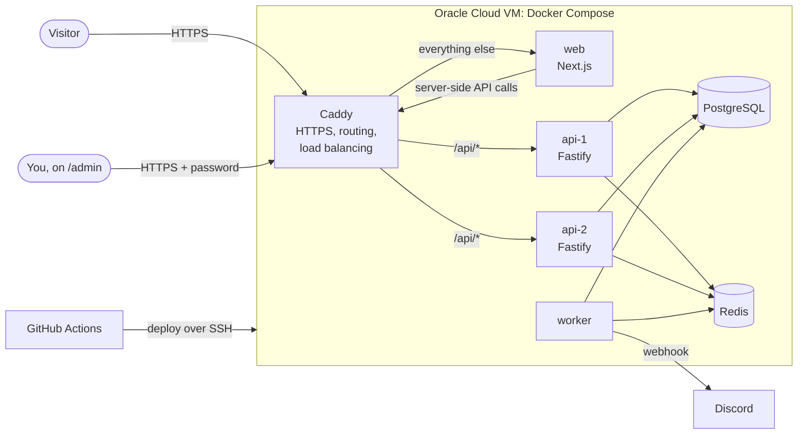
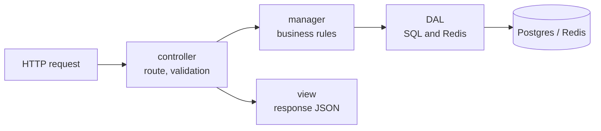
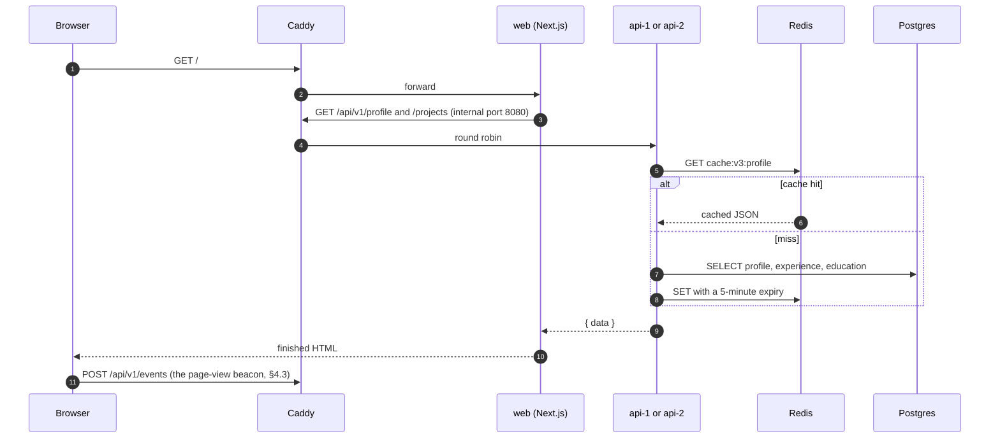
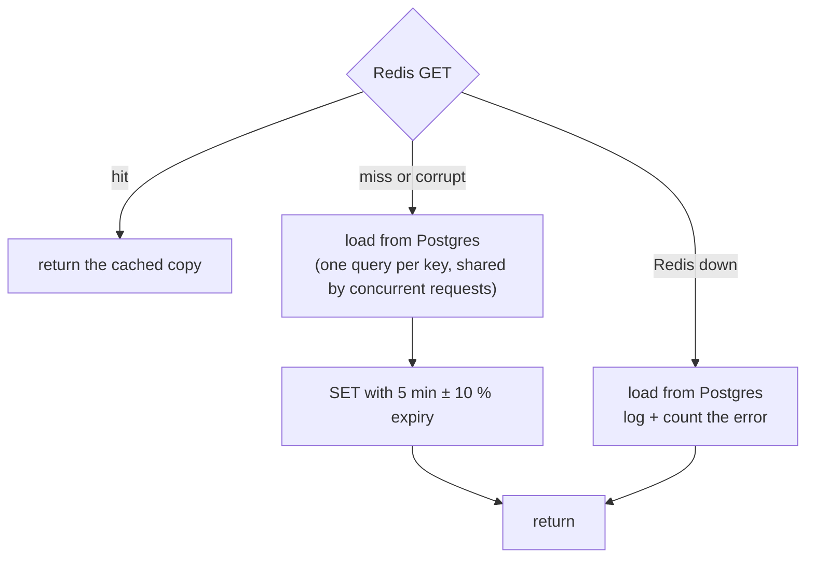
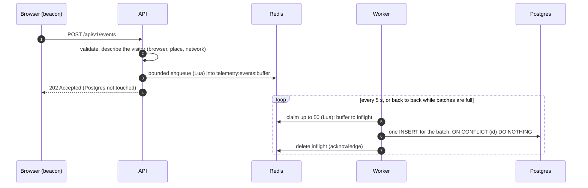
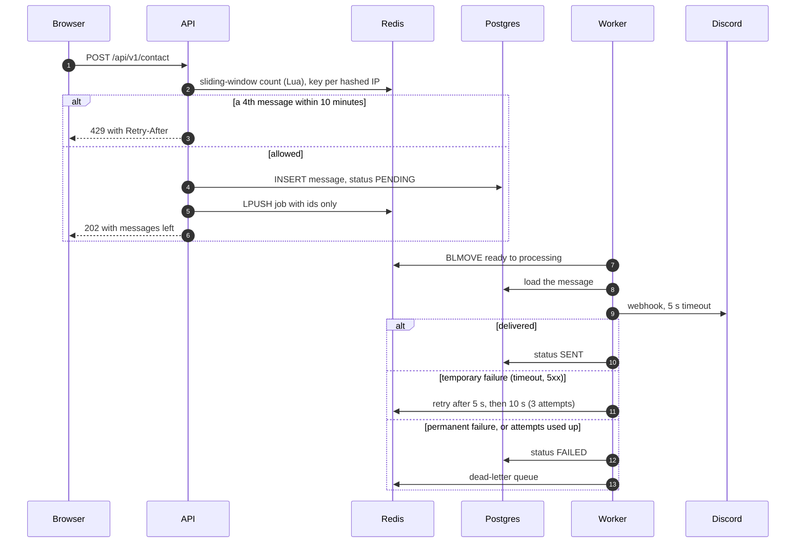
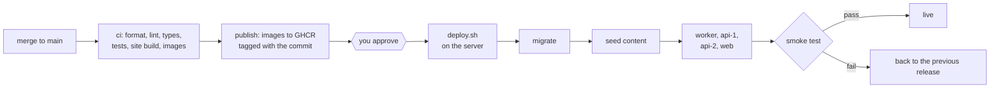
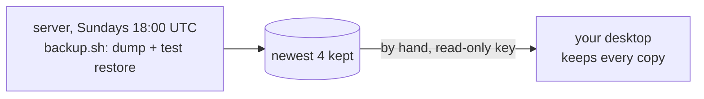

# Project guide: how everything works

The whole project in one place: what it does, how each feature moves through the code, how it
gets to production, how to use and edit the site, and how to read its data. Every section
links to the code and to the deeper guides. Diagrams render on GitHub.

1. [The short version](#1-the-short-version)
2. [The big picture](#2-the-big-picture)
3. [Find your way around the code](#3-find-your-way-around-the-code)
4. [Code flows, feature by feature](#4-code-flows-feature-by-feature)
5. [From a merge to production](#5-from-a-merge-to-production)
6. [Using the website](#6-using-the-website)
7. [Editing the website](#7-editing-the-website)
8. [Making sense of the data](#8-making-sense-of-the-data)
9. [Tests and CI](#9-tests-and-ci)
10. [Explaining it in an interview](#10-explaining-it-in-an-interview)
11. [Deeper guides](#11-deeper-guides)

---

## 1. The short version

A personal portfolio website with a production-style backend behind it.

- **Visitors** read about me (profile, experience, projects, photos) and can send a message.
- **Behind it**: an API with a Redis cache, an analytics pipeline that never makes a visitor
  wait, a rate-limited contact form with background notifications, an owner-only dashboard,
  and a deploy pipeline with an approval gate and automatic rollback.
- **Runs on** one free Oracle Cloud Arm VM (1 OCPU, 6 GB) with Docker Compose, at
  `https://<name>.duckdns.org`, live since 2026-11-20.

| Part                      | Choice                                            | Why                                                        |
| ------------------------- | ------------------------------------------------- | ---------------------------------------------------------- |
| Language                  | TypeScript (strict), Node.js 24                   | One language for API, worker and website                   |
| API                       | Fastify 5 + Zod                                   | Fast, schema-validated requests and responses              |
| Website                   | Next.js 16 (React 19) + Tailwind CSS              | Pages rendered on the server, so they work without JS      |
| Shared contract           | `packages/shared` (Zod schemas)                   | API and website cannot disagree about a field              |
| Database                  | PostgreSQL 16, plain SQL migrations               | Source of truth                                            |
| Cache, queues, rate limit | Redis 7 (with Lua scripts)                        | Fast, and atomic scripts for counting and moving work      |
| Web server                | Caddy                                             | Automatic HTTPS, load balancing over two API replicas      |
| Delivery                  | Docker images, GitHub Actions, GHCR, SSH          | Every release is a tested, tagged image; one-click approve |
| Tests                     | Vitest: unit + integration on real Postgres/Redis | Confidence to change code                                  |

---

## 2. The big picture



| Container        | What it does                                                                            | Code                                                                 |
| ---------------- | --------------------------------------------------------------------------------------- | -------------------------------------------------------------------- |
| `caddy`          | HTTPS certificates, sends `/api/*` to the API replicas and the rest to the website      | [Caddyfile](../deploy/caddy/Caddyfile)                               |
| `web`            | Renders the pages; serves the browser code (beacon, contact form, dashboard)            | [apps/web](../apps/web/src)                                          |
| `api-1`, `api-2` | The HTTP API: content, events, contact, owner routes. Two copies: zero-downtime deploys | [main.ts](../apps/api/src/main.ts), [app.ts](../apps/api/src/app.ts) |
| `worker`         | Background loops: write events to Postgres, send notifications, retry, repair           | [worker.ts](../apps/api/src/worker.ts)                               |
| `postgres`       | Content, page views, contact messages                                                   | [migrations/](../apps/api/migrations)                                |
| `redis`          | Content cache, event buffer, job queues, rate-limit windows                             | key list: [DESIGN.md §6.2](../DESIGN.md#62-key-catalog)              |

All shared state lives in Postgres and Redis, so the two API replicas need no coordination.
Only Caddy is reachable from the internet (ports 80 and 443). Memory, measured on the server
(2026-11-20): about 600 MB for all seven, mostly the two API replicas and `web` (~170 MB each).

---

## 3. Find your way around the code

```
packages/shared/src   the contract: Zod schemas for every request and response (API and web import it)
apps/api/src          the API and the worker (one codebase, two processes)
apps/api/migrations   numbered SQL files, applied in order, never edited once applied
apps/api/content      portfolio.json: all the text about you
apps/web/src          the website (app/ = pages, components/, lib/ = logic with unit tests)
deploy/               production: compose file, Caddyfile, deploy/backup/restore scripts
.github/workflows     ci.yml (tests on every PR), deploy.yml (release to the server)
docs/                 the guides (§11)
```

**The API is layered**, one file per feature per layer (`content.controller.ts`,
`content.manager.ts`, `content.dal.ts`, …):



| Layer        | Folder                                                         | Rule                                                              |
| ------------ | -------------------------------------------------------------- | ----------------------------------------------------------------- |
| Controllers  | [controllers/](../apps/api/src/controllers)                    | Declare routes, validate input, call one manager, pick the status |
| Managers     | [services/](../apps/api/src/services)                          | Business rules; no HTTP, no SQL                                   |
| DAL          | [dal/](../apps/api/src/dal)                                    | The only code that talks to Postgres, Redis or GeoIP files        |
| DAO / schema | [dao/](../apps/api/src/dao), [schema/](../apps/api/src/schema) | Row types (database) vs API types (contract)                      |
| Views        | [views/](../apps/api/src/views)                                | Build `{ data }` / `{ error }` bodies                             |
| Workers      | [workers/](../apps/api/src/workers)                            | Background loops: decide _when_, call one manager                 |
| Middleware   | [middleware/](../apps/api/src/middleware)                      | Request ids, errors, metrics, rate limit, tokens                  |

Why: each layer changes for one reason, managers are unit-tested with fake DALs, and the
composition roots ([app.ts](../apps/api/src/app.ts), [worker.ts](../apps/api/src/worker.ts))
wire everything explicitly (no global singletons).

---

## 4. Code flows, feature by feature

### 4.1 Opening a page



- The page is rendered on the server per request, so it shows up even without JavaScript.
- Responses are validated with the shared schemas on both sides.
- Code: [app/page.tsx](../apps/web/src/app/page.tsx) →
  [lib/api.ts](../apps/web/src/lib/api.ts) (`getProfile`, `getProjects`) →
  [content.controller.ts](../apps/api/src/controllers/content.controller.ts) →
  [content.manager.ts](../apps/api/src/services/content.manager.ts) →
  [content.dal.ts](../apps/api/src/dal/content.dal.ts). Project pages:
  [app/[slug]/page.tsx](../apps/web/src/app/[slug]/page.tsx).

### 4.2 The content cache (cache-aside)



| Safeguard             | Problem it prevents                                              |
| --------------------- | ---------------------------------------------------------------- |
| Single-flight         | 100 requests after a key expires would run 100 identical queries |
| ± 10 % expiry         | Keys written together would expire together                      |
| Fallback + metric     | Redis down or holding garbage: serve from Postgres, never fail   |
| Versioned keys (`v2`) | Old and new code during a deploy never read each other's shapes  |

Code: [cache-aside.manager.ts](../apps/api/src/services/cache-aside.manager.ts) (the whole
algorithm), [content-cache.dal.ts](../apps/api/src/dal/content-cache.dal.ts). Publishing
content: [seed-content.ts](../apps/api/src/cli/seed-content.ts) validates the JSON, writes
only what changed in one transaction (so the pages' "Last updated" dates mean something), then
clears and re-warms the cache.

### 4.3 Page views: the analytics pipeline



- **Fast for the visitor**: the request only waits for Redis (< 1 ms).
- **Nothing lost**: a claimed batch stays in `inflight` until Postgres has it. After a crash it
  is claimed again; each event's id makes the re-insert a no-op (at-least-once + idempotent).
- **Outage vs bad data**: Postgres down → retry with backoff (0.5 s … 30 s). An event that can
  never be inserted → dead-letter queue (`telemetry:events:dlq`), replayable with
  `npm run dlq:replay -- telemetry`.
- **What is recorded**: path, tagged-link parameters (`?ref=`), referring site, browser, OS,
  device, language, time zone, country, city, network owner, IP address (§8).
- Code: browser [page-view-beacon.tsx](../apps/web/src/components/page-view-beacon.tsx),
  [lib/telemetry.ts](../apps/web/src/lib/telemetry.ts) → API
  [events.controller.ts](../apps/api/src/controllers/events.controller.ts) →
  [telemetry.manager.ts](../apps/api/src/services/telemetry.manager.ts),
  [visitor-details.manager.ts](../apps/api/src/services/visitor-details.manager.ts) →
  [event-buffer.dal.ts](../apps/api/src/dal/event-buffer.dal.ts) → worker
  [telemetry-flusher.worker.ts](../apps/api/src/workers/telemetry-flusher.worker.ts) →
  [telemetry-flush.manager.ts](../apps/api/src/services/telemetry-flush.manager.ts) →
  [analytics-event.dal.ts](../apps/api/src/dal/analytics-event.dal.ts).

### 4.4 The contact form



- **Exact limit under concurrency**: counting and adding happen in one Lua script, so 20
  simultaneous requests let exactly 3 through.
- **Postgres first, then Redis** (no transaction spans both): if queuing the job fails, the
  message is already saved, and the worker's **reconciler** (every 60 s) re-queues messages
  stuck in `PENDING` for 5 minutes.
- **The visitor never waits for Discord**; a slow webhook cannot slow the site.
- Code: [contact.controller.ts](../apps/api/src/controllers/contact.controller.ts) →
  [rate-limit.ts](../apps/api/src/middleware/rate-limit.ts) →
  [sliding-window.lua.ts](../apps/api/src/dal/lua/sliding-window.lua.ts) →
  [contact.manager.ts](../apps/api/src/services/contact.manager.ts); worker
  [notification-consumer.worker.ts](../apps/api/src/workers/notification-consumer.worker.ts) →
  [notification.manager.ts](../apps/api/src/services/notification.manager.ts) →
  [discord.notifier.ts](../apps/api/src/infra/notifiers/discord.notifier.ts). Browser side:
  [contact-form.tsx](../apps/web/src/components/contact-form.tsx),
  [lib/contact.ts](../apps/web/src/lib/contact.ts).

### 4.5 The owner page (`/admin`)

```mermaid
sequenceDiagram
  participant B as Your browser
  participant C as Caddy
  participant W as web
  participant A as API
  B->>C: GET /admin
  C->>W: forward
  W->>W: proxy.ts checks the password (ADMIN_TOKEN)
  W->>C: GET /api/v1/admin/visitors, Bearer token (internal port)
  C->>A: allowed on the internal port only
  A-->>W: visitor summary
  W-->>B: page (no-store, noindex)
  loop every 5 s while the tab is visible
    B->>W: GET /admin/system-status
    W->>A: GET /api/v1/admin/system-status on api-1 and on api-2, directly, Bearer token
    W-->>B: both reports; the page adds them up
  end
  opt you press "Show items" on a queue
    B->>W: GET /admin/queues/telemetryDeadLetter (for example)
    W->>A: GET /api/v1/admin/queues/telemetryDeadLetter, Bearer token
  end
  Note over C: /api/v1/admin/* from the internet gets 404
```

Three locks: the browser's password prompt (HTTP Basic), the token the web server adds, and
Caddy refusing owner routes from outside. Your own browser is not counted as a visitor once
you have opened `/admin`.

Code: [proxy.ts](../apps/web/src/proxy.ts), [lib/admin-auth.ts](../apps/web/src/lib/admin-auth.ts),
[app/admin/page.tsx](../apps/web/src/app/admin/page.tsx),
[lib/admin-api.ts](../apps/web/src/lib/admin-api.ts) →
[admin.controller.ts](../apps/api/src/controllers/admin.controller.ts) →
[visitor-insights.manager.ts](../apps/api/src/services/visitor-insights.manager.ts),
[system-status.manager.ts](../apps/api/src/services/system-status.manager.ts),
[queue-items.manager.ts](../apps/api/src/services/queue-items.manager.ts) (what is in a queue;
on the page: [queue-card.tsx](../apps/web/src/components/admin/queue-card.tsx),
[queue-items.tsx](../apps/web/src/components/admin/queue-items.tsx),
[lib/queue-items.ts](../apps/web/src/lib/queue-items.ts)).

### 4.6 Health and metrics

| Endpoint                      | Answers                                           | Used by                            |
| ----------------------------- | ------------------------------------------------- | ---------------------------------- |
| `GET /health`                 | Ready? (Postgres and Redis answer)                | Docker health checks, the deploy   |
| `GET /health/live`            | Alive? (the process answers)                      | Caddy, every 5 s, to pick replicas |
| `GET /metrics`                | Prometheus counters and histograms (token)        | Monitoring (not public)            |
| `/api/v1/admin/system-status` | JSON report: latency, cache, queues, dependencies | The `/admin` dashboard             |
| `/api/v1/admin/queues/<name>` | What waits in one queue, newest 20 first          | The queue card's "Show items"      |

Why two health checks: if Redis is down, `/health` fails on _both_ replicas. Caddy using it
would take the whole site down, although content still works from Postgres. So Caddy uses the
liveness check. Every retry, fallback and dead letter logs a line **and** bumps a metric.

---

## 5. From a merge to production



- **Zero downtime for the API**: replicas are replaced one at a time; Caddy sends traffic to
  the other one meanwhile (measured: all 503 API requests during a deploy succeeded; pages
  blink for under a second while `web` restarts).
- **Safe migrations**: the old code keeps running on the new schema, so migrations only add
  (expand → contract). That is also what makes a rollback safe.
- **Secrets** live only in the server's `deploy/.env` (and your password manager). GitHub holds
  just the SSH key, usable only after your approval.
- **Backups**: weekly `pg_dump` with a test restore on the server (on since 2026-11-22); you
  copy them to your desktop with one command, by a read-only key, whenever you like
  ([BACKUPS.md §3.4](BACKUPS.md#34-copying-the-backups-home-whenever-you-like)).
- **Pausing**: one file on the server switches the site to a "back soon" page; `/admin` and
  deploys keep working ([CD.md §5](CD.md#5-pausing-the-site)).



Code: [deploy.yml](../.github/workflows/deploy.yml), [deploy.sh](../deploy/deploy.sh),
[compose.prod.yml](../deploy/compose.prod.yml), [backup.sh](../deploy/backup.sh). Guides:
[CD.md](CD.md), [BACKUPS.md](BACKUPS.md).

---

## 6. Using the website

**As a visitor** (`https://<name>.duckdns.org`):

| Part                   | What it does                                                                |
| ---------------------- | --------------------------------------------------------------------------- |
| Top (hero)             | Photo collage, name, headline, links                                        |
| About Me               | Summary and links                                                           |
| Experience & education | Timeline of jobs and studies, in the order of `portfolio.json`              |
| Projects               | Cards with a technology filter; a card opens the project's page (`/<slug>`) |
| Outside work           | Photo carousel: arrows, dots, ← → keys or swipe                             |
| Get in touch           | Contact form: 3 messages per person per 10 minutes, arrives in Discord      |

**As the owner** (`/admin`, any username, password = `ADMIN_TOKEN`):

1. Pick a period (Today, 7, 30, 90 days).
2. Read the totals, the daily visitors chart and the lists: where visitors came from, tagged
   links, organisations, places, devices, pages, clicks, and the 50 latest visits.
3. Below: the live system dashboard (health, latency, cache, queues), refreshed every 5 s.

**To learn who opened a link**, share a tagged link such as `https://<name>.duckdns.org/?ref=acme`.
That visit then shows `acme` under "Tagged links" and in its row of "Recent visits".

**To take the site offline for a while**: `ssh portfolio 'touch ~/portfolio/deploy/caddy/paused'`;
`rm` instead of `touch` brings it back ([CD.md §5](CD.md#5-pausing-the-site)).

---

## 7. Editing the website

Changes go live the same way: edit → test locally → pull request → merge → approve the deploy.
The deploy publishes `portfolio.json` itself.

| You want to change…                            | Edit                                                                                               | Local preview          |
| ---------------------------------------------- | -------------------------------------------------------------------------------------------------- | ---------------------- |
| Text about you: profile, jobs, projects, links | [portfolio.json](../apps/api/content/portfolio.json)                                               | `npm run content:seed` |
| Page wording: section titles, buttons, footer  | the `.tsx` file (table in [EDITING-THE-SITE.md](EDITING-THE-SITE.md#2-page-wording-the-tsx-files)) | save, page reloads     |
| Photos and captions                            | [content/photos.ts](../apps/web/src/content/photos.ts) + the image file                            | save, page reloads     |

**Local preview** (three terminals): `npm run infra:up`, then `npm run dev:api` and
`npm run dev:web`; open http://localhost:3000.

**Text example**: change `profile.headline` in `portfolio.json`, run `npm run content:seed`,
reload. A mistake (bad slug, missing field) is listed with its location and nothing is
written.

**Adding a photo**: shrink it and strip its GPS data first, then list it in `photos.ts`:

```bash
node -e "require('sharp')(process.argv[1]).rotate().resize({ width: 1600, height: 1600, fit: 'inside' }).jpeg({ quality: 80, mozjpeg: true }).toFile(process.argv[2])" ~/Pictures/IMG_1234.jpg apps/web/src/content/photos/my-photo.jpg
```

```ts
import myPhoto from './photos/my-photo.jpg'; // at the top of photos.ts
// …then, in PHOTOS, where it should appear in the carousel:
{ src: myPhoto, alt: 'What the photo shows', caption: 'Weekend rides' },
```

Every field and file: [EDITING-THE-SITE.md](EDITING-THE-SITE.md).

---

## 8. Making sense of the data

### What one page view records

| Column(s)                                         | From                                | Example                       |
| ------------------------------------------------- | ----------------------------------- | ----------------------------- |
| `path`, `event_type`, `event_name`                | The page / the clicked link         | `/bowling-buddy`, `page_view` |
| `ref`, `utm_source`, `utm_medium`, `utm_campaign` | The link's `?ref=…&utm_…`           | `acme`                        |
| `referrer_host`                                   | The site they came from (host only) | `www.linkedin.com`            |
| `browser`, `os`, `device_type`, `language`        | The browser's headers               | `Chrome`, `macOS`, `desktop`  |
| `timezone`                                        | The browser                         | `Asia/Singapore`              |
| `country_code`, `city`, `organization`            | The IP address, looked up offline   | `SG`, `Singapore`, `Singtel`  |
| `ip_address`                                      | The connection                      | `203.0.113.7`                 |
| `session_id`                                      | Random per browser tab              | groups one visit's pages      |
| `visitor_hash`                                    | Daily-salted hash of IP + browser   | unique visitors per day       |

Bots are recorded but left out of every summary. Your own browser records nothing once you
have opened `/admin` in it.

### The words on `/admin`

| Term            | Means                                                                          |
| --------------- | ------------------------------------------------------------------------------ |
| Visit           | One browser tab's session: everything someone did in that tab                  |
| Page view       | One page shown (a reload counts again; jumping to a section does not)          |
| Unique visitors | Different people per day (the hash changes daily, so there is no period total) |
| Link click      | A click on a link that leaves the site (e.g. the LinkedIn button)              |
| Organisation    | Who owns the visitor's network: a company on its own network, else an ISP      |

### Where to look

| Question                                | Look at                                                                                   |
| --------------------------------------- | ----------------------------------------------------------------------------------------- |
| How many people visited, from where?    | `/admin`: totals, chart, referring sites, places                                          |
| Did Acme open the link I sent them?     | `/admin` → Tagged links (share `/?ref=acme`)                                              |
| What did one visitor look at, in order? | `/admin` → Recent visits, or the tagged-links query in [telemetry.sql](sql/telemetry.sql) |
| Who sent a message?                     | Discord, or [contact.sql](sql/contact.sql)                                                |
| Is the system healthy?                  | `/admin` → system dashboard (amber = degraded, red = down)                                |
| Is anything stuck?                      | Dashboard queues: a dead-letter queue above 0 "needs attention"                           |

**SQL on the server** (read-only questions; saved queries in [docs/sql/](sql/)):

```bash
ssh portfolio
docker compose -f ~/portfolio/deploy/compose.prod.yml exec postgres sh -c 'psql -U "$POSTGRES_USER" -d "$POSTGRES_DB"'
# then paste a query from docs/sql/telemetry.sql, e.g. "Most viewed pages in the last 7 days"
```

**A dead-letter queue is not empty?** It is never lost data: a dead visit is kept in Redis,
and a contact message is always saved in the database first (a notification dead letter only
means you were not told). Fix the cause first, then retry:

1. **See what failed.** `/admin` → the queue card → **Show items** under the dead-letter list:
   each item says what it was (the visit, or who wrote), why it failed and the exact error, and
   "Before retrying" says what to fix for each reason.
2. **Fix the cause**, depending on the reason:

   | Reason               | Means                                                        | Fix                                                                                                                                     |
   | -------------------- | ------------------------------------------------------------ | --------------------------------------------------------------------------------------------------------------------------------------- |
   | `insert_failed`      | The database refused a visit (the error code names the rule) | A bug: the API accepted something the database does not allow. Fix the code, merge, deploy                                              |
   | `rejected`           | Discord refused the message: a wrong or deleted webhook      | New webhook URL in the server's `~/portfolio/deploy/.env`, then redeploy the same release ([START-HERE §5](START-HERE.md#5-the-server)) |
   | `attempts_exhausted` | Discord was down or slow through every retry                 | Nothing, once Discord works again                                                                                                       |
   | `invalid_payload`    | The stored entry cannot be read                              | A bug; retrying cannot help (the retry leaves it in place)                                                                              |

3. **Retry**, on the server (after `ssh portfolio`):
   `docker compose -f ~/portfolio/deploy/compose.prod.yml run --rm replay-dlq telemetry`
   (or `notifications`). A visit that still fails goes back to the dead letters; a notification
   is sent again with a full set of tries. The worker's log says more:
   `docker compose -f ~/portfolio/deploy/compose.prod.yml logs --tail 50 worker`.

Locally, the same data is visible in VS Code's PostgreSQL and Redis panels:
[DATA-TOOLS.md](DATA-TOOLS.md).

---

## 9. Tests and CI

| Kind            | Where                                                     | Touches                 |
| --------------- | --------------------------------------------------------- | ----------------------- |
| API unit        | [apps/api/test/unit](../apps/api/test/unit)               | nothing (fakes)         |
| API integration | [apps/api/test/integration](../apps/api/test/integration) | real Postgres and Redis |
| Web unit        | [apps/web/test/lib](../apps/web/test/lib)                 | logic only, no browser  |

`npm run check` runs what CI runs (format, lint, types, all tests); CI also builds the site and
both Docker images, on every pull request. `main` is protected, so a pull request merges only
with passing CI ([CI.md §4](CI.md#4-protecting-main)). Guide: [TESTING.md](TESTING.md).

---

## 10. Explaining it in an interview

**One minute**: "It's my portfolio site, built like a small production system. Pages are
rendered by Next.js from a Fastify API that reads Postgres through a Redis cache. Page views
go into a Redis buffer and a worker writes them to Postgres in batches, so a visitor never
waits for the database and nothing is lost if a process crashes. The contact form has an
atomic Lua rate limiter and sends notifications from a background queue with retries and a
dead-letter queue. Every merge is tested, packaged as Docker images and, after I approve,
rolled out to two API replicas one at a time with a smoke test and automatic rollback."

**Deep dives** (problem → what I did → trade-off):

| Topic           | Problem                                      | What I did                                                     | Trade-off                                              |
| --------------- | -------------------------------------------- | -------------------------------------------------------------- | ------------------------------------------------------ |
| Caching         | Every page read hit Postgres                 | Cache-aside, single-flight, jittered expiry, Redis optional    | Content can be up to 5 min stale (seed clears it)      |
| Async ingestion | Analytics must not slow pages or lose events | Redis buffer + batch worker, at-least-once + idempotent insert | Events land ~5 s later; one worker only                |
| Rate limiting   | Spam, even with simultaneous requests        | Sliding-window log in one Lua script, per hashed IP            | Fails closed when Redis is down (form unavailable)     |
| Dual write      | Postgres and Redis can't share a transaction | Postgres first; a reconciler re-queues lost jobs               | A notification can arrive twice, never zero times      |
| Failures        | Outage vs bad data need different handling   | Retry outages with backoff; dead-letter bad data; replay CLI   | Someone must look at the DLQ (dashboard flags it)      |
| Deploys         | Updating without downtime on one VM          | Two replicas, liveness vs readiness, rolling update, rollback  | Pages blink < 1 s while the website container restarts |
| Schema changes  | Old and new code run side by side            | Expand → contract migrations, versioned cache keys             | Renames take two releases                              |
| Observability   | Know what's happening without guessing       | Request ids, structured logs, Prometheus metrics, `/admin`     | Metrics are per replica; no Prometheus server yet      |

**Questions you may get**

<details><summary>Why not write page views straight to Postgres?</summary>

It would make every page wait for the database, and a database outage would lose events or
break pages. The buffer answers in under a millisecond and the worker inserts 50 rows in one
statement.

</details>

<details><summary>What happens if the worker crashes mid-batch?</summary>

The batch is still in `telemetry:events:inflight`, so the restarted worker claims it again.
Event ids were assigned at ingestion and the insert ignores duplicates, so nothing is counted
twice.

</details>

<details><summary>Why Lua for the rate limiter?</summary>

Redis runs a script without interleaving other commands, so "count, then add" is atomic.
As two separate commands, simultaneous requests could all count 0 and all pass.

</details>

<details><summary>How do you deploy without downtime on one machine?</summary>

Two API replicas behind Caddy. The deploy replaces one, waits until it is healthy and Caddy
has seen it (6 s), then replaces the other. Caddy retries a failed connection on the other
replica.

</details>

<details><summary>How do you roll back, and what about the database?</summary>

The previous release's images are redeployed the same way. Migrations stay: they only ever
add things, so the old code still works on the new schema.

</details>

<details><summary>What would you do with more time?</summary>

A Prometheus + Grafana server for history and alerts; a privacy notice before targeting
EU/UK visitors; per-worker queues to run more than one worker; continuous deployment
(no approval) once releases are routine.

</details>

**Known limits** (say them before you're asked): one worker process by design; metrics are
in-memory per replica; 1 OCPU (2 was refused for lack of capacity); IP addresses are kept
without a notice to visitors (owner's decision, [DESIGN.md §12](../DESIGN.md#12-security--privacy)).

---

## 11. Deeper guides

| Guide                                                              | Read it for                                                  |
| ------------------------------------------------------------------ | ------------------------------------------------------------ |
| [START-HERE.md](START-HERE.md)                                     | "How do I…?": each task's command and guide                  |
| [DESIGN.md](../DESIGN.md)                                          | The full specification: every table, key, endpoint, decision |
| [ROADMAP.md](../ROADMAP.md)                                        | What was built, phase by phase                               |
| [GUIDED-TOUR.md](GUIDED-TOUR.md)                                   | Hands-on: poke every feature from the terminal               |
| [EDITING-THE-SITE.md](EDITING-THE-SITE.md)                         | Every content field, page-wording file and photo setting     |
| [CONTENT-AND-CACHE.md](CONTENT-AND-CACHE.md)                       | The content API and cache, step by step                      |
| [DATA-TOOLS.md](DATA-TOOLS.md)                                     | Watching Postgres and Redis in VS Code                       |
| [TESTING.md](TESTING.md), [CI.md](CI.md)                           | Tests and GitHub Actions                                     |
| [DOCKER.md](DOCKER.md), [PRODUCTION-STACK.md](PRODUCTION-STACK.md) | The images, and the stack on your laptop                     |
| [HOSTING.md](HOSTING.md), [CD.md](CD.md)                           | The server, and releasing to it                              |
| [BACKUPS.md](BACKUPS.md)                                           | Weekly backups and restoring                                 |
